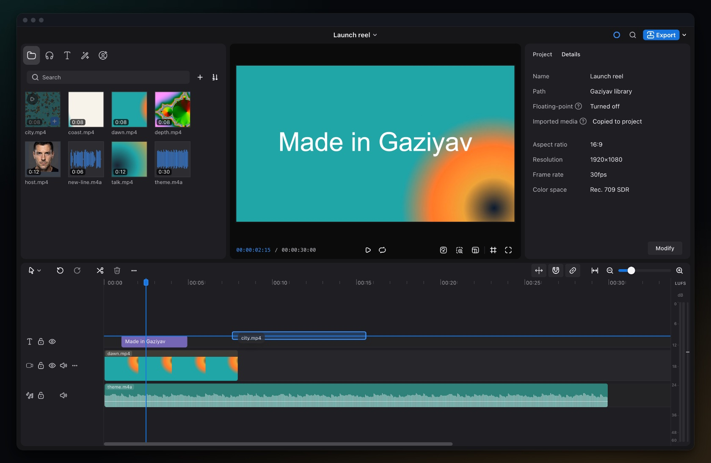
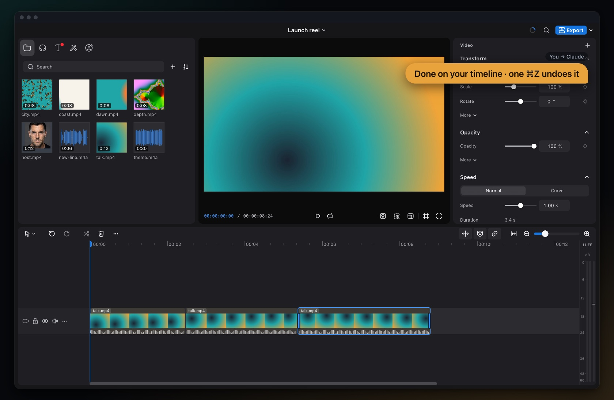

<picture>
  <source media="(prefers-color-scheme: dark)" srcset="assets/brand/banner-en-dark.png">
  <source media="(prefers-color-scheme: light)" srcset="assets/brand/banner-en-light.png">
  
</picture>

<p align="center"><b>English</b> · <a href="README.ru.md">Русский</a></p>

<p align="center">
Gaziyav is the free, open-source alternative to CapCut, rebuilt from the timeline up: for Reels, TikToks and Shorts shot on your phone — one timeline where every clip behaves the same, AI that edits for you right inside it (Claude included), and no account, no watermark, no subscription.
</p>

<p align="center">
<a href="https://gamidaliev03.github.io/gaziyav/editor/"><b>Open the editor in your browser</b></a> ·
<a href="https://github.com/gamidaliev03/gaziyav/releases/latest"><b>Download for macOS</b></a> ·
<a href="docs/en/manual/README.md">Manual</a> ·
<a href="https://gamidaliev03.github.io/gaziyav/tour/">Presentation</a>
</p>

<p align="center">
<a href="https://github.com/gamidaliev03/gaziyav/releases/latest"></a>
<a href="LICENSE"></a>

<a href="https://github.com/gamidaliev03/gaziyav/stargazers"></a>
</p>

<p align="center">

</p>

<p align="center"><a href="docs/en/tour.md"><b>The two-minute tour →</b></a> · <a href="https://gamidaliev03.github.io/gaziyav/tour/">the same tour as slides</a></p>

## Why Gaziyav

- **The video editor, reinvented.** We did not reskin an editor — we rethought how one works. Every kind of clip obeys one grammar, every edit is exactly one undo step, speech on the timeline is words you can cut, and the export is exactly what you saw. You learn it once, it never surprises you, and it stays light on an ordinary Mac ([measured](#fast-on-an-ordinary-mac)).
- **Claude edits inside Gaziyav — free.** Connect the Claude app you already use and say what you want: «remove the pauses», «captions, bold», «cut it to 30 seconds for Reels». Claude works in your open project with the editor's own commands, every step lands on the timeline you see and is undone with <kbd>⌘Z</kbd>. Gaziyav sells no credits and asks for no API key for this.
- **Free for real.** The editor's own code is MIT: no account, no watermark, export up to 8K at 60 fps. The AI that matters for editing — captions, voice clean-up, pause removal, scenes, auto colour, reframing — runs on your own Mac at no cost.
- **Everything stays with you.** Projects and media live on your disk. Nothing leaves the computer unless you press a button that needs the network — and then only the piece it needs. No telemetry.
- **Open, built on OpenCut.** Read it, change it, ship your own. Paid neural networks (lipsync, voice, generation) are an [optional extra on your own key](#extras-paid-ai-with-your-own-key) — never needed to edit.

Also on the desktop, one step each: **a clip by link** — paste a YouTube, TikTok or Instagram link, mark the piece with <kbd>I</kbd> / <kbd>O</kbd>, and only that piece comes into your project (for material you have the right to use); and **posting straight from the editor** — **Post to Shorts, Reels, TikTok…** (beside Export) opens YouTube's, Instagram's or TikTok's own upload page inside the app, you sign in there, Gaziyav never sees your password.

## What it does

### A timeline with one grammar



What we rethought: in most editors every kind of object has its own rules. Here video, titles, audio, captions, shapes and compound clips all behave the same: drag the body to move, drag an edge to trim, <kbd>⌥</kbd> copies, <kbd>⇧</kbd> adds to the selection, <kbd>Esc</kbd> cancels. Every edit is exactly one undo step — checked over 930 automated runs of every command with zero broken timeline rules.

- Magnetic main track on <kbd>P</kbd>, snapping on <kbd>N</kbd>, linked audio on <kbd>`</kbd>.
- Trim tool <kbd>T</kbd> with roll, ripple and slip; trim by typed numbers; trim while the cut plays.
- Nest any selection into a compound clip (<kbd>⌥G</kbd>), open it with <kbd>⌘↓</kbd>, come back with <kbd>⌘↑</kbd>.
- Two complete keymaps — CapCut's and Final Cut Pro's — 136 commands with keys, all rebindable; <kbd>⌘K</kbd> finds every command by name, in English or Russian.

[The timeline, page by page →](docs/en/manual/timeline.md)

### Claude edits right inside Gaziyav



What we rethought: AI in an editor usually means a black box that hands back a new file. Gaziyav's connector gives Claude the editor itself — the same operations as its buttons — so Claude's work is an ordinary edit in your project: you watch it happen, change any part by hand, and undo it step by step.

**Connect in three steps**

1. Install Gaziyav and the Claude app for Mac (or Claude Code). Anthropic's own help pages state that desktop extensions are available to all users on Claude Desktop.
2. In Gaziyav: **Settings → AI → Claude → Connect Claude**. One press: Claude for Mac opens the Gaziyav extension and installs it; for Claude Code the editing skill and the server are added.
3. Open a project in Gaziyav and talk to Claude in Claude's own window.

**Things to type**

- «Remove the pauses and the ums in the first clip.»
- «Captions in a bold style, and a title "Day one" at 0:02.»
- «Make it vertical for Reels and keep it under 30 seconds.»
- «Lower my music under the voice and fade it out at the end.»
- «Find the scenes of this film and give me YouTube chapters.»

What it costs: Gaziyav takes nothing and needs no API key for the connector. Claude's own messages count toward the plan of your Claude app, as any chat does. Only if you ask Claude for paid generation (a voice, a picture, lipsync) does it run on your own key, priced first — see [Extras](#extras-paid-ai-with-your-own-key).

[Claude inside Gaziyav: connect, what to ask, how to undo, what it cannot do →](docs/en/manual/claude.md)

### Free AI on your own Mac


No key, no account, no per-use price: these run on your Mac (Apple silicon), the model is fetched once and checked by SHA-256.

- **Captions** from speech, word-timed and editable; **remove pauses and filler words** — cuts placed inside the silence, captions and titles follow.
- **Enhance voice** (noise, hum, room), **separate voice and music**, **voice changer**.
- **Remove an object or a caption** from a shot, **retouch**, **remove or blur the background**, **upscale** 2× / 4×, **deflicker**.
- **Auto colour**, **split into scenes**, **make vertical** (the face kept in frame), **beat markers**, **tracking** (blur or pixelate a face that moves).

[Free on-device AI →](docs/en/manual/ondevice-ai.md)

### Exports exact to the frame


H.264, HEVC, AV1, Apple ProRes and VP9; MP4, MOV, WebM and GIF; up to 8K; 23.976 to 60 fps — all free. Frame counts were checked with `ffprobe` in 72 export cases — every frame rate, with and without frame smoothing — and all 72 were exact, and a 10-minute 60 fps film came out with all 36 017 frames in order and the sound ending within 0.3 ms of the picture.

If something cannot be exported the way you set it (a hardware encoder that is busy, say), the export tells you what it used instead; with an In–Out range marked, only that range is exported.

[Export →](docs/en/manual/export.md)

### Fast on an ordinary Mac

Measured on the project files, not guessed: dragging a clip writes nothing until you drop it; typing a title costs 33 renders per letter instead of 1 039; importing a 57 MB clip writes 0 bytes (an APFS clone); a 6-minute 4K project with 432 clips peaked at 722 MB of memory with the 8 GB memory budget switched on.  The window fits a small laptop screen too — down to 720 × 600.

### Looks


A look changes every surface, icon and motion of the interface — never the layout, the keys or the colours of your picture. The player and thumbnails stay neutral in every look, so colour is judged the same everywhere. Besides the calm default (**Minimal**) there are ten full skins — **Pixel**, **Neon**, **Comic**, **Sakura**, **Rose**, **Arena**, **Film**, **Analog**, **Terminal**, **95** — and quieter palettes: Liquid glass, Frosted glass, Strict, Midnight, Sand, High contrast.  [Looks →](docs/en/manual/looks.md)

<details>
<summary><b>Everything else in the box</b></summary>

- **Titles and text designs**, **effects**, **transitions**, **filters** and **colour** controls, **speed** and speed curves, **freeze frame**, **reverse**, **keyframes** with easing, **markers**.
- **Guides in the player**: the social frame for TikTok, Reels, Shorts and VK Clips, TV action / title safe, text zones, thirds — never in the export. <kbd>⇧⌘;</kbd>
- **Two keymaps**, every key rebindable, <kbd>⌘K</kbd> finds every command and runs it.
- **A Russian interface written as Russian**, and English.

</details>

[The whole manual, area by area →](docs/en/manual/README.md)

## Gaziyav vs CapCut

An honest comparison of what each one asks of you. CapCut is a capable editor; these are the facts as CapCut's own pages state them.

| | Gaziyav | CapCut |
|---|---|---|
| Price | Free; the editor's own code is MIT | Free plan; paid Pro and Ultra subscriptions[^1] |
| 4K and 60 fps export (desktop) | Free — up to 8K, up to 60 fps | Requires Pro[^2] |
| Watermark | Never | Exporting without a watermark requires Pro when Pro materials or settings are used[^2][^3] |
| AI pricing | Editing AI on your Mac for free; Claude through your own Claude app; paid models on your own key at the provider's list price, shown before you press | AI features with Pro; a monthly allowance of AI credits (650 on Pro)[^1] |
| Where projects live | On your disk | Pro includes 1 TB of cloud storage[^1] |

[^1]: [capcut.com/pricing](https://www.capcut.com/pricing), checked 14 Nov 2026. Prices are shown per region; the page also offers a 7-day Pro trial.
[^2]: [Why am I prompted to join CapCut Pro when exporting?](https://www.capcut.com/help/join-capcut-pro-for-exporting), CapCut Help Center, checked 14 Nov 2026 — on desktop, a Pro-tagged resource or a 4K / 60 fps export brings the Pro prompt; «4K», «60fps» and «No Watermark» are locked for non-Pro users.
[^3]: [Why am I prompted to purchase CapCut Pro?](https://www.capcut.com/help/why-prompted-to-purchase-capcut-pro), CapCut Help Center, checked 14 Nov 2026.

## Gaziyav in your browser


For every computer that is not a Mac — Windows, Linux, a Chromebook — Gaziyav is the browser edition. [Open the editor in your browser](https://gamidaliev03.github.io/gaziyav/editor/) — no install, no account, no server: it runs on your own hardware, your files never leave the tab, and after the first open it works offline. It has the timeline, titles, effects, transitions, looks, local import and export. [The tour as slides](https://gamidaliev03.github.io/gaziyav/tour/) opens there too.
- **Lipsync (beta), with your own fal.ai key** — the key stays in this browser and goes only to fal.ai.
- **Desktop only:** Claude inside Gaziyav, the free on-device AI (captions from speech, pause removal and the rest), a clip by link, posting, and long, heavy exports.

## Install

**macOS (Apple silicon).** Download the `.dmg` from [Releases](https://github.com/gamidaliev03/gaziyav/releases/latest) and drag Gaziyav to Applications. The app is not notarised by Apple yet, so the first open is blocked once: open **System Settings → Privacy & Security**, scroll to Security and click **Open Anyway**, then **Open**. You do this once.

**Any other computer — Windows, Linux, a Chromebook:** [open the editor in your browser](https://gamidaliev03.github.io/gaziyav/editor/). Nothing to install; what it has and what only the Mac app has is [just above](#gaziyav-in-your-browser).

[The full install guide, with every warning explained →](docs/en/install.md)

## Extras: paid AI with your own key

Not needed to edit — here if you want it. Gaziyav can also call paid neural networks through your own [fal.ai](https://fal.ai) key (Settings → AI): lipsync, a voice from text or a cloned voice, pictures and video from text, face swap, and the in-app agent on a paid model. The key is stored encrypted in the macOS Keychain; the page never sees more than its last four characters. Every run is billed by fal to you at fal's price — Gaziyav adds nothing on top. The button shows the price before the run; above your limit (default $1) it asks once.

**Lipsync, the strongest of them.** Select the clip → <kbd>⌥L</kbd> → type the words → <kbd>⌘</kbd><kbd>↵</kbd>: the voice is cloned from the clip and the same clip speaks the new line. Gaziyav sends **only the parts where somebody speaks** and composites only the face back onto your original frames. You can also reach it from the clip's menu or <kbd>⌘K</kbd>.

- One line of 2–24 s on the default model: **20 ¢**, shown on the button before you press it.
- A 3-minute clip that is 64 % silence: **60 ¢ instead of 90.5 ¢** for sending it whole.
- **Try before you pay:** a 3-second sample of the real face for about **2.6 ¢** plays right in the panel, before and after; then make the whole clip, or pick another model from the list — each with its price for this clip.
- **Takes on the clip:** each result is a take of the same clip — <kbd>⇧⌥L</kbd> flips between the original and the lipsynced take, «Another take» makes one more. If you later change the sound under the clip, a mark says the lips are out of date and offers to redo them, with the price.
- The progress is drawn on the clip itself. Several clips at once (three run in parallel, the rest queue), and a paid run survives quitting the app; one <kbd>⌘Z</kbd> undoes it all.

| Task | Default model | List price (USD) | Other choices |
|---|---|---|---|
| Lipsync | LatentSync (ByteDance) | $0.20 per clip up to 40 s, then $0.005/s | VEED Lipsync $0.40/min · Sync 1.9 $0.70/min · Sync lipsync‑2 $3/min · lipsync‑2 Pro $5/min · Kling LipSync $0.07 per 5 s |
| Voice from text | Qwen3 TTS 1.7B | $0.09 per 1,000 characters | MiniMax Speech 2.8 Turbo $0.06 · 2.8 HD $0.10 |
| Voice clone | Qwen3 voice clone | $0.0008 per minute of sample | MiniMax clone $1.50 per voice |
| Picture | Seedream 4.0 | $0.03 per picture | FLUX.1 schnell $0.003 · Nano Banana $0.0398 |
| Video | Seedance 1.0 Pro Fast | $0.0216/s at 720p | Kling 3.0, Veo 3.1 Fast, Wan 2.6, Seedance 2.0 and more, each priced per second |
| Face swap | PixVerse Swap | $0.20 per clip up to 5 s | — |
| In-app agent, scripts, translation | Gemini 2.5 Flash | by tokens ($0.30 per 1M input) | Claude Sonnet 4.5 · GPT-5 mini · DeepSeek V3 · any OpenRouter model |

[Extras with your own key: setup, every model, lipsync step by step →](docs/en/manual/extras.md)

## What leaves your computer

Nothing, until you ask for it.

| When | What is sent | Where |
|---|---|---|
| You talk to Claude | Your messages and what Claude reads from the project through the connector | Anthropic, through your own Claude app |
| You run a paid AI feature | Only the piece it needs — for lipsync, the speech spans of the trimmed clip and the sound | fal.ai — or kie.ai / ArgoLink, if you add their key and pick one of their models |
| You import by link | The link | the site itself, through yt-dlp |
| You install an on-device feature | A download request | Hugging Face (mirror: hf-mirror.com) or the model's original publisher; every file checked by SHA-256 |
| You post | Your video | the platform's own page, signed in by you |

No account, no analytics, no crash reports sent anywhere. [The full privacy note →](docs/en/privacy.md)

## Build from source

The Mac app, as [BUILDING.md](BUILDING.md) does it:

```sh
git clone https://github.com/gamidaliev03/gaziyav.git gaziyav && cd gaziyav
bun install                      # the editor's dependencies (workspace root)
cd desktop
npm install                      # Electron for the shell
ARCHES=arm64 ./fetch-vendor.sh   # pinned third-party tools into desktop/vendor/, each checked by sha256
./build.sh                       # → desktop/dist/Gaziyav.app
./make-dmg.sh                    # optional: → a DMG next to it
```

The editor alone, in a browser: `cd apps/web && bun run dev` (http://localhost:3000). Tests and code style: [CONTRIBUTING.md](.github/CONTRIBUTING.md).

## Built on OpenCut

Gaziyav grew from **[OpenCut](https://github.com/opencut-app/opencut)** — «the open-source CapCut alternative» — and specifically from its earlier codebase, now kept at **[opencut-app/opencut-classic](https://github.com/opencut-app/opencut-classic)** while OpenCut is being rewritten from the ground up. Thank you to the OpenCut team and its contributors: their editor core, timeline model, renderer and Next.js app are the ground this one stands on.

What Gaziyav added on top: the desktop app and its native helpers, the timeline's grammar and its automated checks, the Claude connector, the on-device AI, frame-exact export, the looks, AI on your own key with exact prices, and a Russian interface written as Russian. OpenCut's MIT licence and copyright notice are kept in [LICENSE](LICENSE); the editor's own code is MIT; bundled third-party parts keep their own licences — see [THIRD-PARTY-NOTICES](THIRD-PARTY-NOTICES.md). Motion-graphics layers are rendered with [Remotion](https://www.remotion.dev/license), which has its own licence: free for individuals, organisations of up to three people and non-profits; larger companies need Remotion's company licence.

## Roadmap

Not in this release — planned, in this order:

- **macOS:** notarisation.
- **Editing:** overwrite and append keys from Media, a default-transition key.
- **Extras:** choosing the face when there are several in the frame; several speakers, each with their own voice.

## Contribute

Bug reports and ideas are all welcome — [open an issue](https://github.com/gamidaliev03/gaziyav/issues/new/choose). Code: read [CONTRIBUTING.md](.github/CONTRIBUTING.md) first. Please be kind: [Code of Conduct](.github/CODE_OF_CONDUCT.md). Security issues: [SECURITY.md](.github/SECURITY.md).

## Support the project

Gaziyav is free and stays free. If it saves you time: star the repository, show it to someone who edits video, or tell us what broke. [More ways →](docs/en/support.md)

## Licence

The editor's own code: [MIT](LICENSE) — © the OpenCut contributors and the Gaziyav contributors. Bundled third-party parts keep their own licences — see [THIRD-PARTY-NOTICES](THIRD-PARTY-NOTICES.md). Motion-graphics layers are rendered with [Remotion](https://www.remotion.dev/license), which has its own licence: free for individuals, organisations of up to three people and non-profits; larger companies need Remotion's company licence.
