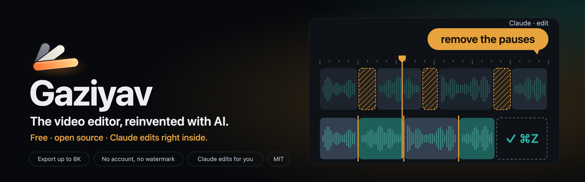
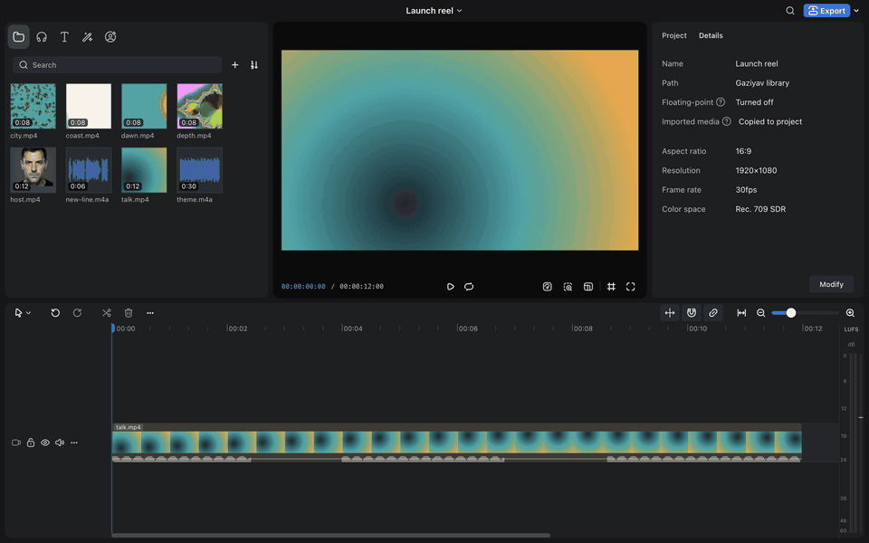
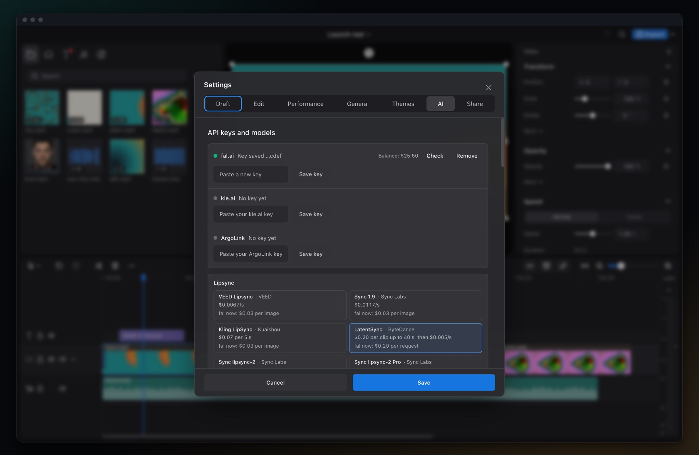
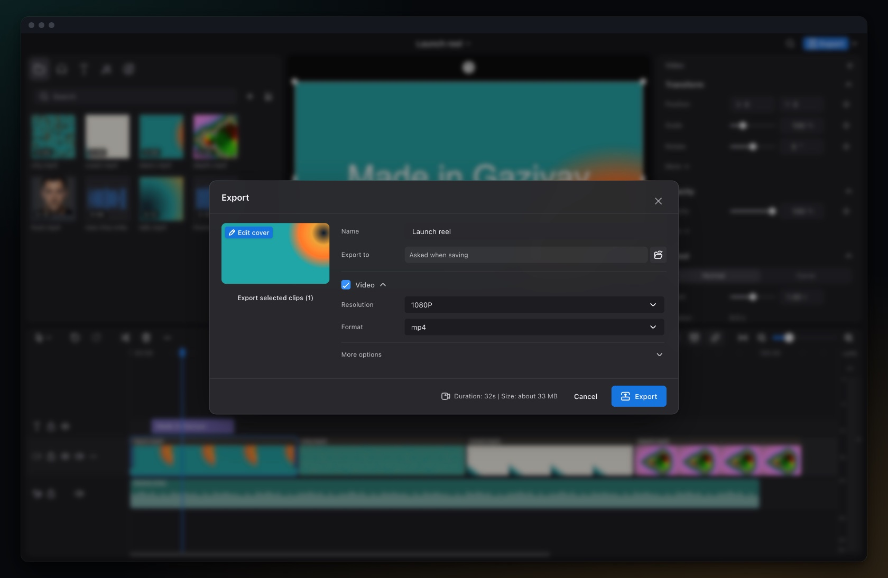
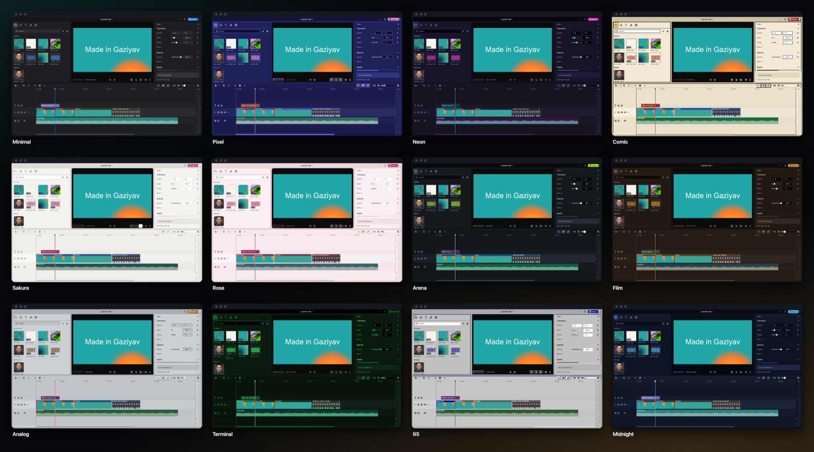
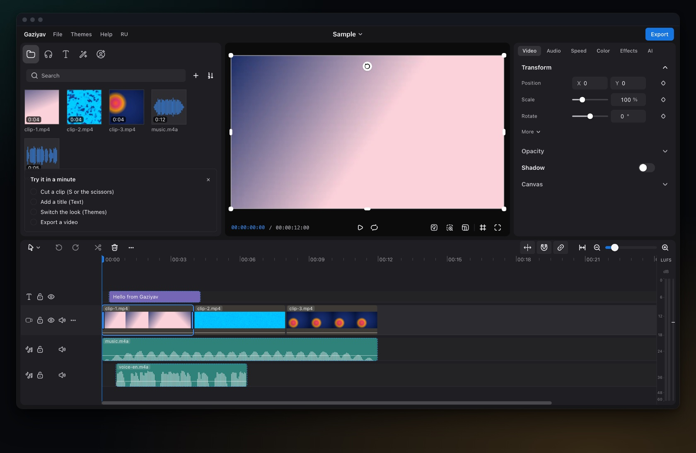

<picture>
  <source media="(prefers-color-scheme: dark)" srcset="assets/brand/banner-en-dark.png">
  <source media="(prefers-color-scheme: light)" srcset="assets/brand/banner-en-light.png">
  
</picture>

<p align="center"><b>English</b> · <a href="README.ru.md">Русский</a></p>

<p align="center">
Gaziyav is a free, open-source alternative to CapCut for the Mac and the browser, made for Reels, TikToks and Shorts shot on a phone. Claude can edit your project inside it. No account, no watermark, no subscription.
</p>

<p align="center">
<a href="https://gamidaliev03.github.io/gaziyav/editor/"><b>Open the editor in your browser</b></a> ·
<a href="https://github.com/gamidaliev03/gaziyav/releases/latest"><b>Download for macOS</b></a> ·
<a href="docs/en/manual/README.md">Manual</a> ·
<a href="https://gamidaliev03.github.io/gaziyav/tour/">Slides</a>
</p>

<p align="center">
<a href="https://github.com/gamidaliev03/gaziyav/releases/latest"></a>
<a href="LICENSE"></a>

<a href="https://github.com/gamidaliev03/gaziyav/stargazers"></a>
</p>

<p align="center">

</p>

<p align="center"><a href="docs/en/tour.md"><b>The two-minute tour →</b></a> · <a href="https://gamidaliev03.github.io/gaziyav/tour/">the same tour as slides</a></p>

## Made in Gaziyav by AI

Three music videos for LINDA 4EVER, a band that does not exist. An AI made them in Gaziyav from start to finish: the characters, the lipsync, the cuts to the beat. Nobody touched the timeline by hand. Click a frame to watch the whole clip.

<table>
<tr>
<td width="33%"><a href="https://gamidaliev03.github.io/portfolio/linda-mama-full.mp4"></a><br><b>«Mama»</b> · 3:10</td>
<td width="33%"><a href="https://gamidaliev03.github.io/portfolio/linda-nas-ne-bylo-full.mp4"></a><br><b>«We Weren't There»</b> · 2:25</td>
<td width="33%"><a href="https://gamidaliev03.github.io/portfolio/linda-dnevnik-full.mp4"></a><br><b>«Diary» (live)</b> · 1:48</td>
</tr>
</table>

## Why Gaziyav

- **One set of rules for every clip.** Video, titles, sound and captions move, trim and copy the same way. Every edit is one undo step. Speech on the timeline is words you can cut. The export matches the preview frame for frame.
- **Claude edits inside the app, for free.** Connect the Claude app you already use and type what you want: «remove the pauses», «bold captions», «cut it to 30 seconds for Reels». Claude uses the editor's own commands, each step appears on your timeline, and <kbd>⌘Z</kbd> undoes it. Gaziyav sells no credits and needs no API key for this.
- **Free.** No account, no watermark, export up to 8K at 60 fps. Captions, voice clean-up, pause removal, scene detection, auto colour and reframing run on your Mac at no cost.
- **Music and sounds included.** 311 tracks and 2,514 sound effects, in the Mac app and in the browser.
- **Open source.** Built on OpenCut; the editor's own code is MIT. Paid AI (lipsync, voice, generation) is [optional, on your own key](#paid-ai-on-your-own-key); you never need it to edit.

Two more things in the Mac app:

- **A clip by link.** Paste a YouTube, TikTok or Instagram link, mark the piece with <kbd>I</kbd> / <kbd>O</kbd>, and only that piece comes into your project. Use it for material you have the right to use.
- **Posting.** **Post to Shorts, Reels, TikTok…** next to Export opens the platform's own upload page inside the app. You sign in there; Gaziyav never sees your password.

## What it does

### The timeline


Video, titles, audio, captions, shapes and compound clips follow the same rules: drag the body to move, drag an edge to trim, <kbd>⌥</kbd> copies, <kbd>⇧</kbd> adds to the selection, <kbd>Esc</kbd> cancels. Every edit is one undo step. Automated tests ran every command 930 times without breaking a timeline rule.

- Magnetic main track on <kbd>P</kbd>, snapping on <kbd>N</kbd>, linked audio on <kbd>`</kbd>.
- Trim tool <kbd>T</kbd> with roll, ripple and slip; trim by a typed number; trim while the cut plays.
- Nest any selection into a compound clip (<kbd>⌥G</kbd>), open it with <kbd>⌘↓</kbd>, come back with <kbd>⌘↑</kbd>.
- Two keymaps, CapCut's and Final Cut Pro's: 136 commands with keys, all rebindable. <kbd>⌘K</kbd> finds any command by name, in English or Russian.

[The timeline, page by page →](docs/en/manual/timeline.md)

### Claude inside Gaziyav


The connector gives Claude the same operations as the editor's buttons. Claude's work is an ordinary edit in your project: you watch it happen, change any part by hand and undo it step by step.

**Connect in three steps**

1. Install Gaziyav and the Claude app for Mac (or Claude Code). Anthropic's help says desktop extensions are available to all Claude Desktop users.
2. In Gaziyav: **Settings → AI → Claude → Connect Claude**. Claude for Mac opens the Gaziyav extension and installs it; for Claude Code, the editing skill and the server are added.
3. Open a project in Gaziyav and write to Claude in Claude's window.

**Things to type**

- «Remove the pauses and the ums in the first clip.»
- «Captions in a bold style, and a title "Day one" at 0:02.»
- «Make it vertical for Reels and keep it under 30 seconds.»
- «Lower my music under the voice and fade it out at the end.»
- «Find the scenes of this film and give me YouTube chapters.»

**What it costs.** Gaziyav charges nothing for the connector and needs no API key. Your messages count toward your Claude plan, like any chat. Paid generation (a voice, a picture, lipsync) runs only if you ask for it, on your own key, with the price shown first: see [Paid AI](#paid-ai-on-your-own-key).

[Claude inside Gaziyav: connect, what to ask, how to undo, what it cannot do →](docs/en/manual/claude.md)

### Free AI on your Mac



These run on your Mac (Apple silicon) and need no key, no account and no payment. Each model downloads once, the first time you use it.

- **Captions** from speech, timed to the word and editable. **Remove pauses and filler words**: the cuts land inside the silence, and captions and titles move with them.
- **Enhance voice** (noise, hum, room echo), **separate voice and music**, **voice changer**.
- **Remove an object or a caption** from a shot, **retouch**, **remove or blur the background**, **upscale** 2× / 4×, **deflicker**.
- **Auto colour**, **split into scenes**, **make vertical** (keeps the face in frame), **beat markers**, **tracking** (blur or pixelate a moving face).

[Free on-device AI →](docs/en/manual/ondevice-ai.md)

### Music and sounds

311 music tracks and 2,514 sound effects, in **Audio → Music** and **Audio → Sound effects**, in the Mac app and in the browser. They are not inside the download. Each file downloads in the background the first time you use it, from the author's Hugging Face (Mixkit items from Mixkit's own site), is checked by SHA-256 and then stays in a cache. The on-device AI models download the same way.

### Frame-exact export



H.264, HEVC, AV1, Apple ProRes and VP9; MP4, MOV, WebM and GIF; up to 8K; 23.976 to 60 fps. All free. Frame counts were checked with `ffprobe` in 72 export cases (every frame rate, with and without frame smoothing), and all 72 were exact. A 10-minute 60 fps film came out with all 36 017 frames in order, and the sound ended within 0.3 ms of the picture.

If the export cannot use a setting (a busy hardware encoder, say), it tells you what it used instead. With an In–Out range marked, only that range is exported.

[Export →](docs/en/manual/export.md)

### Fast on an ordinary Mac

Dragging a clip writes nothing to disk until you drop it. Typing a title costs 33 renders per letter instead of 1 039. Importing a 57 MB clip writes 0 bytes (an APFS clone). A 6-minute 4K project with 432 clips peaked at 722 MB of memory with the 8 GB memory budget on.  The window fits a small laptop screen, down to 720 × 600.

### Looks



A look changes the interface (surfaces, icons, motion), never the layout, the keys or the colours of your picture. The player and thumbnails stay neutral in every look. Besides the default, **Minimal**, there are ten skins (**Pixel**, **Neon**, **Comic**, **Sakura**, **Rose**, **Arena**, **Film**, **Analog**, **Terminal**, **95**) and quieter palettes: Liquid glass, Frosted glass, Strict, Midnight, Sand, High contrast.  [Looks →](docs/en/manual/looks.md)

<details>
<summary><b>Also included</b></summary>

- **Titles and text designs**, **effects**, **transitions**, **filters**, **[generators](docs/en/manual/generators.md)** (solids, 382 gradients, moving backgrounds, overlays) and **colour** controls. Each clip's settings are in the [inspector's tabs](docs/en/manual/inspector.md). **Speed** and speed curves, **freeze frame**, **reverse**, **keyframes** with easing, **markers**.
- **Guides in the player**: the frames of TikTok, Reels, Shorts and VK Clips, TV action / title safe, text zones, thirds. They never reach the export. <kbd>⇧⌘;</kbd>
- **Two keymaps**, every key rebindable; <kbd>⌘K</kbd> finds and runs any command.
- **Interface in English and Russian.**

</details>

[The whole manual, area by area →](docs/en/manual/README.md)

## Gaziyav vs CapCut

CapCut's column is taken from CapCut's own pages.

| | Gaziyav | CapCut |
|---|---|---|
| Price | Free; the editor's own code is MIT | Free plan; paid Pro and Ultra subscriptions[^1] |
| 4K and 60 fps export (desktop) | Free, up to 8K and 60 fps | Requires Pro[^2] |
| Watermark | None | Exporting without a watermark requires Pro when Pro materials or settings are used[^2][^3] |
| AI pricing | Editing AI on your Mac for free; Claude through your own Claude app; paid models on your own key at the provider's list price, shown before you press | AI features with Pro; a monthly allowance of AI credits (650 on Pro)[^1] |
| Where projects live | On your disk | Pro includes 1 TB of cloud storage[^1] |

[^1]: [capcut.com/pricing](https://www.capcut.com/pricing), checked 14 Nov 2026. Prices are shown per region; the page also offers a 7-day Pro trial.
[^2]: [Why am I prompted to join CapCut Pro when exporting?](https://www.capcut.com/help/join-capcut-pro-for-exporting), CapCut Help Center, checked 14 Nov 2026. On desktop, a Pro-tagged resource or a 4K / 60 fps export brings the Pro prompt; «4K», «60fps» and «No Watermark» are locked for non-Pro users.
[^3]: [Why am I prompted to purchase CapCut Pro?](https://www.capcut.com/help/why-prompted-to-purchase-capcut-pro), CapCut Help Center, checked 14 Nov 2026.

## Gaziyav in your browser



On Windows, Linux, a Chromebook, a phone or a tablet, use the browser edition: [open the editor](https://gamidaliev03.github.io/gaziyav/editor/). Nothing to install, no account. After the first open it also works offline, and it picks up new versions by itself.

It has the timeline, titles, effects, transitions, filters, generators, the whole music and sound library, looks, import and export, and **captions from speech with pause removal** (the speech model runs inside the page and downloads once). [The tour as slides](https://gamidaliev03.github.io/gaziyav/tour/) is on the same site.
- **Lipsync (beta), AI image and AI video** on your own fal.ai key, with the price shown before anything runs.
- **On a phone or a tablet** the layout is made for a finger: the player, full-width tracks, a bottom bar (Add · Edit · Text · Audio · Filters · Format) and quick actions for the selected clip.
- **Only in the Mac app:** Claude inside Gaziyav, the other on-device AI tools (background removal, voice clean-up, retouch and more), a clip by link, posting, a voice from text, motion graphics, and long, heavy exports. [What the browser edition has →](docs/en/manual/browser.md)

## Install

**Mac (Apple silicon, macOS 14 or later).** Download the `.dmg` from [Releases](https://github.com/gamidaliev03/gaziyav/releases/latest) and drag Gaziyav to Applications. There is one download: the same full build the author edits with. Apple has not notarised the app yet, so macOS blocks the first open. Open **System Settings → Privacy & Security**, scroll to Security, click **Open Anyway**, then **Open**. You do this once.

**Windows, Linux, a Chromebook:** [open the editor in your browser](https://gamidaliev03.github.io/gaziyav/editor/). There is no Windows or Linux app; what the browser edition has is [above](#gaziyav-in-your-browser).

[The full install guide, every warning explained →](docs/en/install.md)

## Paid AI on your own key

You don't need it to edit. With your own [fal.ai](https://fal.ai) key (Settings → AI), Gaziyav can run lipsync, a voice from text or a cloned voice, pictures and video from text, face swap, and the in-app agent on a paid model. The key is stored encrypted in the macOS Keychain, and the app shows only its last four characters. fal bills you at its own price; Gaziyav adds nothing. The button shows the price before the run; above your limit (default $1) it asks once.

**Lipsync.** Select the clip → <kbd>⌥L</kbd> → type the words → <kbd>⌘</kbd><kbd>↵</kbd>. The voice is cloned from the clip, and the same face says the new line. Gaziyav sends **only the parts where someone speaks** and puts back only the face, on top of your original frames. Lipsync is also in the clip's menu and in <kbd>⌘K</kbd>.

- A line of 2–24 s on the default model costs **20 ¢**. The price is on the button before you press it.
- A 3-minute clip that is 64 % silence: **60 ¢**, instead of 90.5 ¢ for sending it whole.
- **Sample first:** 3 seconds of the real face for about **2.6 ¢**, played in the panel before and after. Then make the whole clip, or pick another model from the list; each shows its price for this clip.
- **Takes:** each result is a take of the same clip. <kbd>⇧⌥L</kbd> switches between the original and the lipsynced take; «Another take» makes one more. If you later change the sound under the clip, a mark says the lips are out of date and offers to redo them, with the price.
- Progress shows on the clip itself. Three clips run at once, the rest wait in a queue. A paid run survives quitting the app. One <kbd>⌘Z</kbd> undoes it all.

| Task | Default model | List price (USD) | Other choices |
|---|---|---|---|
| Lipsync | LatentSync (ByteDance) | $0.20 per clip up to 40 s, then $0.005/s | VEED Lipsync $0.40/min · Sync 1.9 $0.70/min · Sync lipsync‑2 $3/min · lipsync‑2 Pro $5/min · Kling LipSync $0.07 per 5 s |
| Voice from text | Qwen3 TTS 1.7B | $0.09 per 1,000 characters | MiniMax Speech 2.8 Turbo $0.06 · 2.8 HD $0.10 |
| Voice clone | Qwen3 voice clone | $0.0008 per minute of sample | MiniMax clone $1.50 per voice |
| Picture | Seedream 4.0 | $0.03 per picture | FLUX.1 schnell $0.003 · Nano Banana $0.0398 |
| Video | Seedance 1.0 Pro Fast | $0.0216/s at 720p | Kling 3.0, Veo 3.1 Fast, Wan 2.6, Seedance 2.0 and more, each priced per second |
| Face swap | PixVerse Swap | $0.20 per clip up to 5 s | — |
| In-app agent, scripts, translation | Gemini 2.5 Flash | by tokens ($0.30 per 1M input) | Claude Sonnet 4.5 · GPT-5 mini · DeepSeek V3 · any OpenRouter model |

[Paid AI on your own key: setup, every model, lipsync step by step →](docs/en/manual/extras.md)

## What leaves your computer

Nothing leaves your computer unless you use one of these:

| When | What is sent | Where |
|---|---|---|
| You talk to Claude | Your messages and what Claude reads from the project through the connector | Anthropic, through your own Claude app |
| You run a paid AI feature | Only the piece it needs; for lipsync, the speech parts of the trimmed clip and the sound | fal.ai, or kie.ai / ArgoLink if you add their key and pick one of their models |
| You import by link | The link | the site itself, through yt-dlp |
| You first use a library track or sound, or an on-device AI feature | A download request | the author's Hugging Face (mirror hf-mirror.com; a few models from their own publisher), Mixkit items from mixkit.co; every file checked by SHA-256 |
| You post | Your video | the platform's own page, signed in by you |

No account, no analytics, no crash reports. In the browser edition your files stay in the tab, and a fal.ai key you paste goes only to fal.ai. [The full privacy note →](docs/en/privacy.md)

## Build from source

The Mac app (full steps in [BUILDING.md](BUILDING.md)):

```sh
git clone https://github.com/gamidaliev03/gaziyav.git gaziyav && cd gaziyav
bun install                      # the editor's dependencies (workspace root)
cd desktop
npm install                      # Electron for the shell
ARCHES=arm64 ./fetch-vendor.sh   # pinned third-party tools into desktop/vendor/, each checked by sha256
./build.sh                       # → desktop/dist/Gaziyav.app
./make-dmg.sh                    # optional: → a DMG next to it
```

The editor alone, in a browser: `cd apps/web && bun run dev` (http://localhost:3000). Tests and code style: [CONTRIBUTING.md](.github/CONTRIBUTING.md).

## Built on OpenCut

Gaziyav grew from **[OpenCut](https://github.com/opencut-app/opencut)**, «the open-source CapCut alternative», and specifically from its earlier codebase, now kept at **[opencut-app/opencut-classic](https://github.com/opencut-app/opencut-classic)** while OpenCut is rewritten from scratch. Thanks to the OpenCut team and contributors: Gaziyav stands on their editor core, timeline model, renderer and Next.js app.

Gaziyav added the Mac app and its native helpers, the timeline rules and their automated checks, the Claude connector, the on-device AI, frame-exact export, the looks, paid AI on your own key with exact prices, and the Russian interface.

## Roadmap

Planned, in this order:

- **macOS:** notarisation.
- **Editing:** overwrite and append keys from Media, a default-transition key.
- **Paid AI:** choosing the face when there are several in the frame; several speakers, each with their own voice.

## Contribute

Report bugs and ideas in [issues](https://github.com/gamidaliev03/gaziyav/issues/new/choose). Before sending code, read [CONTRIBUTING.md](.github/CONTRIBUTING.md). Please be kind: [Code of Conduct](.github/CODE_OF_CONDUCT.md). Security issues: [SECURITY.md](.github/SECURITY.md).

## Support the project

Gaziyav is free and will stay free. To help: star the repository, show it to someone who edits video, or report what broke. [More ways →](docs/en/support.md)

## Licence

The editor's own code: [MIT](LICENSE), © the OpenCut contributors and the Gaziyav contributors. OpenCut's licence and copyright notice are kept in [LICENSE](LICENSE). Bundled third-party parts keep their own licences: see [THIRD-PARTY-NOTICES](THIRD-PARTY-NOTICES.md). Motion-graphics layers are rendered with [Remotion](https://www.remotion.dev/license), which has its own licence: free for individuals, organisations of up to three people and non-profits; larger companies need Remotion's company licence.
