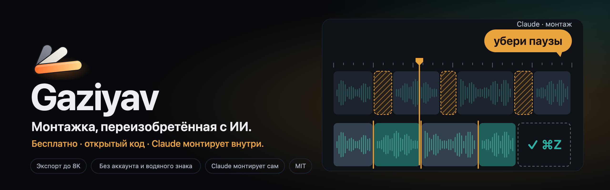
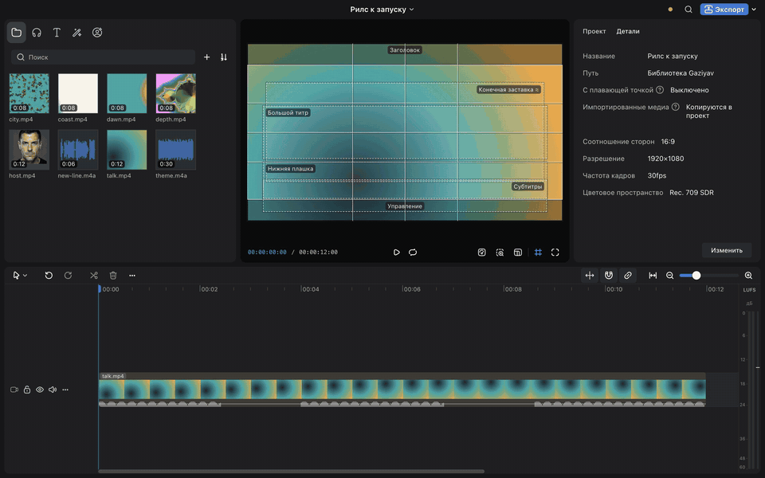
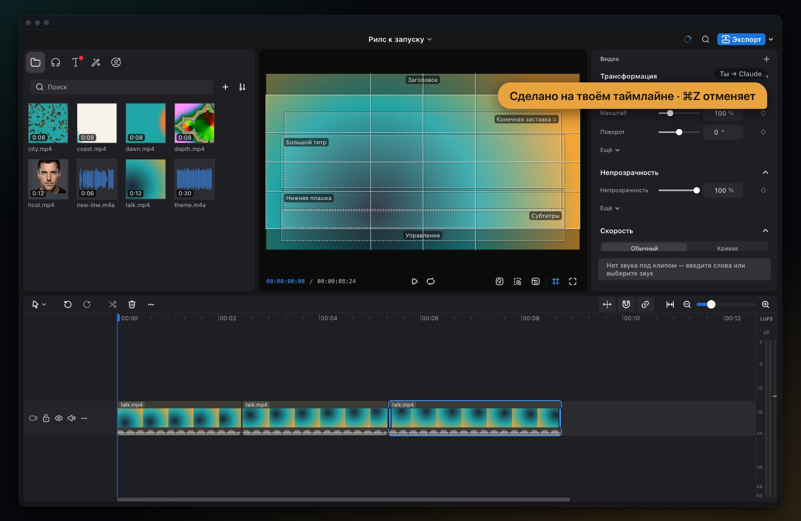
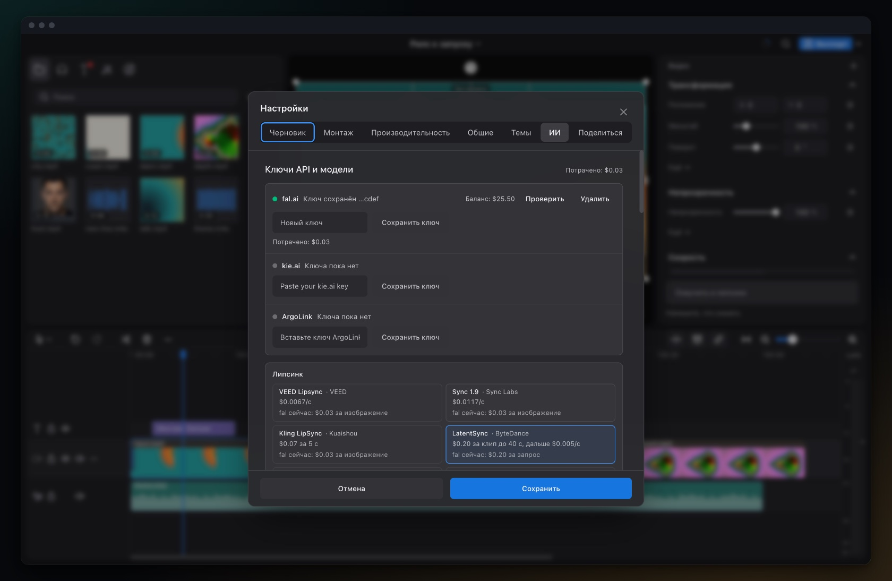
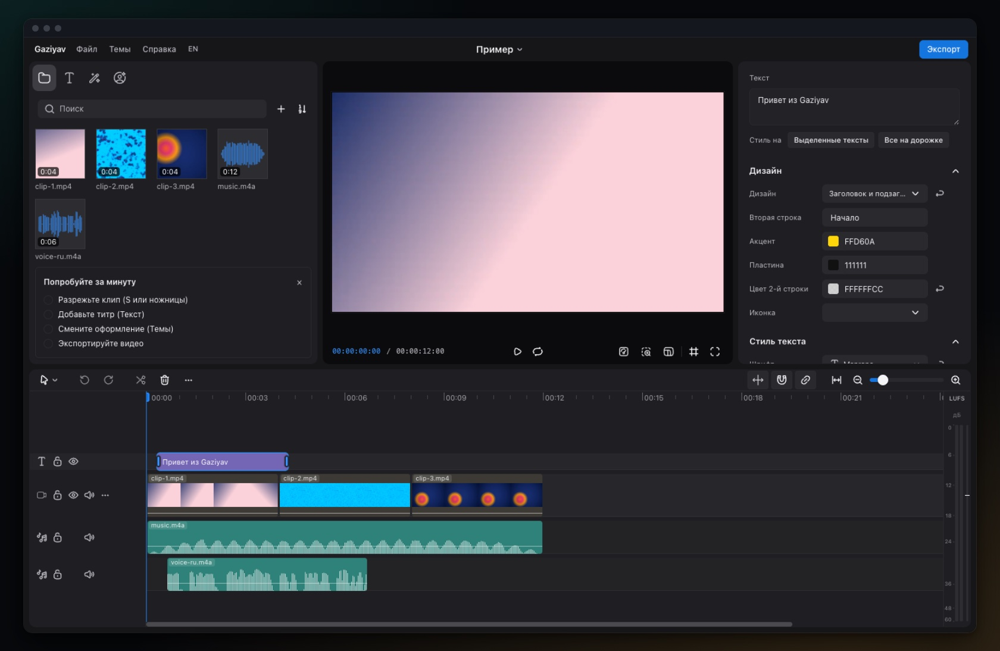

<picture>
  <source media="(prefers-color-scheme: dark)" srcset="assets/brand/banner-ru-dark.png">
  <source media="(prefers-color-scheme: light)" srcset="assets/brand/banner-ru-light.png">
  
</picture>

<p align="center"><a href="README.md">English</a> · <b>Русский</b></p>

<p align="center">
Gaziyav — бесплатная монтажка с открытым кодом, альтернатива CapCut, переделанная от самого таймлайна: для рилсов, тиктоков и шортсов, снятых на телефон, — один таймлайн, где любой клип ведёт себя одинаково, ИИ, который монтирует за вас прямо внутри (включая Claude), и без аккаунта, без водяного знака, без подписки.
</p>

<p align="center">
<a href="https://gamidaliev03.github.io/gaziyav/editor/"><b>Открыть редактор в браузере</b></a> ·
<a href="https://github.com/gamidaliev03/gaziyav/releases/latest"><b>Скачать для macOS</b></a> ·
<a href="docs/ru/manual/README.md">Руководство</a> ·
<a href="https://gamidaliev03.github.io/gaziyav/tour/">Презентация</a>
</p>

<p align="center">
<a href="https://github.com/gamidaliev03/gaziyav/releases/latest"></a>
<a href="LICENSE"></a>

<a href="https://github.com/gamidaliev03/gaziyav/stargazers"></a>
</p>

<p align="center">

</p>

<p align="center"><a href="docs/ru/tour.md"><b>Экскурсия на две минуты →</b></a> · <a href="https://gamidaliev03.github.io/gaziyav/tour/">та же экскурсия слайдами</a></p>

## Почему Gaziyav

- **Монтажка, переизобретённая заново.** Мы не перекрасили чужой редактор — мы заново продумали, как он работает. Любой клип подчиняется одной грамматике, любая правка — ровно один шаг отмены, речь на таймлайне — это слова, которые можно резать, а в экспорте ровно то, что вы видели. Выучил один раз — и он больше не удивляет и не тяжелеет на обычном Mac ([замеры](#быстро-на-обычном-mac)).
- **Claude монтирует прямо в Gaziyav — бесплатно.** Подключите приложение Claude, которым вы уже пользуетесь, и скажите, что нужно: «убери паузы», «субтитры, жирные», «сократи до 30 секунд для Reels». Claude работает в открытом проекте командами самого редактора, каждый шаг ложится на тот таймлайн, который вы видите, и отменяется <kbd>⌘Z</kbd>. Gaziyav не продаёт за это кредиты и не просит API-ключ.
- **Бесплатно по-настоящему.** Собственный код редактора — под MIT: без аккаунта, без водяного знака, экспорт до 8K и 60 кадров. ИИ, который нужен для монтажа, — субтитры, очистка голоса, удаление пауз, сцены, автоцвет, вертикальный кадр — работает на вашем Mac и ничего не стоит.
- **Всё остаётся у вас.** Проекты и медиа лежат на вашем диске. С компьютера ничего не уходит, пока вы сами не нажмёте кнопку, которой нужна сеть, — и тогда уходит только нужный кусок. Никакой телеметрии.
- **Открыто, на основе OpenCut.** Читайте, меняйте, выпускайте свою версию. Платные нейросети (липсинк, голос, генерация) — [отдельное дополнение на вашем ключе](#дополнительно-платные-нейросети-по-своему-ключу), для монтажа они не нужны.

И ещё в приложении для компьютера, по одному шагу: **клип по ссылке** — вставьте ссылку на YouTube, TikTok или Instagram, отметьте кусок клавишами <kbd>I</kbd> / <kbd>O</kbd>, и в проект придёт только этот кусок (для материала, который вы вправе использовать); и **публикация прямо из монтажки** — «Опубликовать в Shorts, Reels, TikTok…» (рядом с «Экспорт») открывает внутри приложения страницу загрузки самого YouTube, Instagram или TikTok, входите там вы сами, пароль Gaziyav не видит.

## Что умеет

### Таймлайн с одной грамматикой


Что мы переосмыслили: в большинстве редакторов у каждого вида объектов свои правила. Здесь видео, титры, звук, субтитры, фигуры и составные клипы ведут себя одинаково: тянете тело — двигаете, тянете край — обрезаете, <kbd>⌥</kbd> копирует, <kbd>⇧</kbd> добавляет к выделению, <kbd>Esc</kbd> отменяет. Каждая правка — ровно один шаг отмены: это проверено в 930 автоматических прогонах всех команд, и ни одно правило таймлайна не нарушилось.

- Магнит главной дорожки — <kbd>P</kbd>, прилипание — <kbd>N</kbd>, связка со звуком — <kbd>`</kbd>.
- Инструмент обрезки <kbd>T</kbd>: прокатка, сдвиг со смещением, скольжение; обрезка по введённому числу и прямо во время проигрывания.
- Любое выделение — в составной клип (<kbd>⌥G</kbd>), открыть — <kbd>⌘↓</kbd>, вернуться — <kbd>⌘↑</kbd>.
- Две полные раскладки — как в CapCut и как в Final Cut Pro, — 136 команд с клавишами, любую можно переназначить; <kbd>⌘K</kbd> находит любую команду по названию — по-русски или по-английски.

[Таймлайн, по шагам →](docs/ru/manual/timeline.md)

### Claude монтирует прямо в Gaziyav



Что мы переосмыслили: ИИ в монтажке обычно — чёрный ящик, который возвращает новый файл. Коннектор Gaziyav даёт Claude сам редактор — те же операции, что у его кнопок, — поэтому работа Claude — это обычная правка в вашем проекте: вы видите, как она происходит, можете поправить любую часть руками и отменить по шагам.

**Подключение в три шага**

1. Установите Gaziyav и приложение Claude для Mac (или Claude Code). На собственных страницах справки Anthropic сказано, что расширения для Claude Desktop доступны всем его пользователям.
2. В Gaziyav: **Настройки → ИИ → Claude → «Подключить Claude»**. Одно нажатие: Claude для Mac откроет расширение Gaziyav и установит его; для Claude Code добавятся навык монтажа и сервер.
3. Откройте проект в Gaziyav и говорите с Claude в его собственном окне.

**Что можно написать**

- «Убери паузы и эканье в первом клипе.»
- «Субтитры жирным стилем и титр „День первый“ на 0:02.»
- «Сделай вертикально для Reels и уложись в 30 секунд.»
- «Музыку тише под голосом и плавно убери в конце.»
- «Найди сцены этого фильма и дай главы для YouTube.»

Сколько стоит: Gaziyav не берёт ничего и не требует API-ключа для коннектора. Сообщения Claude идут в счёт тарифа вашего приложения Claude, как любой чат. Только если вы попросите у Claude платную генерацию (голос, картинку, липсинк), она пойдёт на вашем собственном ключе и с ценой заранее — см. [Дополнительно](#дополнительно-платные-нейросети-по-своему-ключу).

[Claude в Gaziyav: подключение, что просить, как отменить, чего он не умеет →](docs/ru/manual/claude.md)

### Бесплатный ИИ на вашем Mac



Ни ключа, ни аккаунта, ни платы за запуск: это работает на вашем Mac (Apple silicon), модель скачивается один раз и сверяется по SHA-256.

- **Субтитры** из речи, по словам, с правкой; **удаление пауз и слов-паразитов** — разрезы внутри тишины, субтитры и титры едут следом.
- **Очистка голоса** (шум, гул, эхо комнаты), **разделение голоса и музыки**, **смена голоса**.
- **Убрать предмет или надпись** из кадра, **ретушь**, **убрать или размыть фон**, **увеличение** в 2× / 4×, **устранение мерцания**.
- **Автоцвет**, **деление на сцены**, **вертикальный кадр** (лицо остаётся в кадре), **маркеры битов**, **трекинг** (размыть или запикселить движущееся лицо).

[Бесплатный ИИ на устройстве →](docs/ru/manual/ondevice-ai.md)

### Экспорт точно до кадра


H.264, HEVC, AV1, Apple ProRes и VP9; MP4, MOV, WebM и GIF; до 8K; от 23,976 до 60 кадров в секунду — всё бесплатно. Число кадров проверено `ffprobe` в 72 вариантах экспорта — все частоты, с плавными кадрами и без, — и все 72 сошлись. Десятиминутный фильм на 60 кадров вышел со всеми 36 017 кадрами по порядку, а звук закончился в пределах 0,3 мс от картинки.

Если экспорт не может сделать так, как вы выставили (скажем, аппаратный кодировщик отказал), он прямо говорит, чем заменил; если отмечен отрезок In–Out, выводится только он.

[Про экспорт →](docs/ru/manual/export.md)

### Быстро на обычном Mac

Измерено на самих проектах, а не прикинуто: пока вы тащите клип, на диск не пишется ничего; ввод титра стоит 33 перерисовки на букву вместо 1 039; импорт клипа на 57 МБ записывает 0 байт (клон APFS); 4K-проект на 6 минут и 432 клипа занял в пике 722 МБ памяти с включённым бюджетом для Mac на 8 ГБ.  Окно помещается и на маленьком экране ноутбука — вплоть до 720 × 600.

### Темы оформления


Тема меняет каждую поверхность, иконку и анимацию интерфейса — но никогда раскладку, клавиши и цвета вашей картинки. Плеер и миниатюры нейтральны в любой теме, поэтому цвет везде оценивается одинаково. Кроме спокойной темы по умолчанию (**Минимал**) есть десять полноценных «шкур» — **Пиксель**, **Неон**, **Комикс**, **Сакура**, **Роза**, **Арена**, **Плёнка**, **Аналог**, **Терминал**, **95** — и тихие палитры:  Жидкое стекло, Матовое стекло, Строгая, Полночь, Песок, Высокий контраст. [Темы →](docs/ru/manual/looks.md)

<details>
<summary><b>Всё остальное в коробке</b></summary>

- **Титры и стили текста**, **эффекты**, **переходы**, **фильтры** и **цветокоррекция**, **скорость** и кривые скорости, **стоп-кадр**, **задом наперёд**, **ключевые кадры** со сглаживанием, **маркеры**.
- **Разметка в плеере**: рамка TikTok, Reels, Shorts и VK Клипов, безопасные зоны для ТВ, зоны текста, трети — в экспорт не попадает никогда. <kbd>⇧⌘;</kbd>
- **Две раскладки**, любая клавиша переназначается, <kbd>⌘K</kbd> находит любую команду и запускает её.
- **Русский интерфейс, написанный по-русски**, и английский.

</details>

[Всё руководство, раздел за разделом →](docs/ru/manual/README.md)

## Gaziyav и CapCut

Честное сравнение того, что каждый из них от вас требует. CapCut — сильный редактор; ниже — факты так, как их пишет сам CapCut на своих страницах.

| | Gaziyav | CapCut |
|---|---|---|
| Цена | Бесплатно; собственный код редактора — под MIT | Бесплатный план; платные подписки Pro и Ultra[^1] |
| Экспорт в 4K и 60 к/с (на компьютере) | Бесплатно — до 8K и до 60 к/с | Нужен Pro[^2] |
| Водяной знак | Никогда | Экспорт без водяного знака требует Pro, если использованы Pro-материалы или настройки[^2][^3] |
| Оплата ИИ | ИИ для монтажа — на вашем Mac бесплатно; Claude — через ваше приложение Claude; платные модели — на вашем ключе по прайсу поставщика, цена видна до нажатия | ИИ-функции — в Pro; месячный запас ИИ-кредитов (650 в Pro)[^1] |
| Где лежат проекты | На вашем диске | В Pro — 1 ТБ облачного хранилища[^1] |

[^1]: [capcut.com/pricing](https://www.capcut.com/pricing), проверено 14.11.2026. Цены показываются по региону; там же предлагают 7 дней Pro бесплатно.
[^2]: [Why am I prompted to join CapCut Pro when exporting?](https://www.capcut.com/help/join-capcut-pro-for-exporting), справка CapCut, проверено 14.11.2026: на компьютере Pro просят за ресурс с меткой Pro или за экспорт в 4K / 60 к/с; «4K», «60fps» и «No Watermark» без Pro заблокированы.
[^3]: [Why am I prompted to purchase CapCut Pro?](https://www.capcut.com/help/why-prompted-to-purchase-capcut-pro), справка CapCut, проверено 14.11.2026.

## Gaziyav в браузере



Для любого компьютера, кроме Mac, — Windows, Linux, Chromebook — Gaziyav работает в браузере. [Откройте редактор в браузере](https://gamidaliev03.github.io/gaziyav/editor/) — без установки, без аккаунта и без сервера: он работает на вашем железе, файлы не покидают вкладку, а после первого открытия редактор работает и без интернета. В нём есть таймлайн, титры, эффекты, переходы, фильтры, генераторы, звуки, темы, импорт своих файлов и экспорт — и **субтитры из речи с удалением пауз**: модель речи запускается прямо на странице (скачивается один раз, звук никуда не уходит). [Экскурсия слайдами](https://gamidaliev03.github.io/gaziyav/tour/) открывается там же.
- **Липсинк (бета), ИИ-фото и ИИ-видео на вашем ключе fal.ai** — цена видна до запуска; ключ хранится только в этом браузере и уходит только в fal.ai.
- **Только в приложении для Mac:** Claude в Gaziyav, остальной бесплатный ИИ на устройстве (удаление фона, очистка голоса, ретушь и другое), клип по ссылке, публикация и длинный тяжёлый экспорт.

## Установка

**macOS (Apple silicon).** Скачайте `.dmg` со страницы [выпусков](https://github.com/gamidaliev03/gaziyav/releases/latest) и перетащите Gaziyav в «Программы». Приложение пока не заверено Apple, поэтому первый запуск macOS один раз заблокирует: откройте **Системные настройки → Конфиденциальность и безопасность**, прокрутите до раздела «Безопасность», нажмите **«Всё равно открыть»**, затем **«Открыть»**. Это нужно сделать один раз.

**Любой другой компьютер — Windows, Linux, Chromebook:** [откройте редактор в браузере](https://gamidaliev03.github.io/gaziyav/editor/). Ставить ничего не нужно; что в нём есть и что есть только в приложении для Mac — [чуть выше](#gaziyav-в-браузере).

[Подробная инструкция, с разбором каждого предупреждения →](docs/ru/install.md)

## Дополнительно: платные нейросети по своему ключу

Для монтажа не нужны — есть, если захотите. Gaziyav умеет звать платные нейросети через ваш собственный ключ [fal.ai](https://fal.ai) (Настройки → ИИ): липсинк, голос из текста или клон голоса, картинки и видео из текста, замену лица и встроенного агента на платной модели. Ключ хранится зашифрованным в связке ключей macOS, страница видит только последние четыре символа. Каждый запуск fal выставляет вам по своему прайсу — Gaziyav не добавляет ничего сверху. Цена видна на кнопке до запуска; если она выше вашего порога (по умолчанию 1 $), приложение один раз переспросит.

**Липсинк — самая сильная из них.** Выделите клип → <kbd>⌥L</kbd> → впишите слова → <kbd>⌘</kbd><kbd>↵</kbd>: голос клонируется из самого клипа, и тот же клип произносит новую реплику. Gaziyav отправляет **только участки с речью** и вклеивает обратно только лицо — поверх ваших исходных кадров. Липсинк есть и в меню клипа, и в <kbd>⌘K</kbd>.

- Реплика 2–24 с на модели по умолчанию: **20 ¢**, цена на кнопке до нажатия.
- Трёхминутный клип, в котором 64 % тишины: **60 ¢ вместо 90,5 ¢** за отправку целиком.
- **Сначала проба:** 3 секунды по настоящему лицу примерно за **2,6 ¢** — играет прямо в панели, «до» и «после»; потом сделайте клип целиком или выберите другую модель из списка — у каждой видна цена для этого клипа.
- **Дубли на клипе:** каждый результат — дубль того же клипа; <kbd>⇧⌥L</kbd> переключает оригинал и дубль с липсинком, «Ещё дубль» делает следующий. Если потом поменять звук под клипом, метка скажет, что губы устарели, и предложит переделать — с ценой.
- Ход работы виден прямо на клипе. Несколько клипов разом (три идут параллельно, остальные в очереди), оплаченный запуск переживает выход из приложения; одно <kbd>⌘Z</kbd> отменяет всё.

| Задача | Модель по умолчанию | Прайс (USD) | Что ещё можно выбрать |
|---|---|---|---|
| Липсинк | LatentSync (ByteDance) | 0,20 $ за клип до 40 с, дальше 0,005 $/с | VEED Lipsync 0,40 $/мин · Sync 1.9 0,70 $/мин · Sync lipsync‑2 3 $/мин · lipsync‑2 Pro 5 $/мин · Kling LipSync 0,07 $ за 5 с |
| Голос из текста | Qwen3 TTS 1.7B | 0,09 $ за 1000 символов | MiniMax Speech 2.8 Turbo 0,06 $ · 2.8 HD 0,10 $ |
| Клон голоса | Qwen3 voice clone | 0,0008 $ за минуту образца | клон MiniMax — 1,50 $ за голос |
| Картинка | Seedream 4.0 | 0,03 $ за картинку | FLUX.1 schnell 0,003 $ · Nano Banana 0,0398 $ |
| Видео | Seedance 1.0 Pro Fast | 0,0216 $/с в 720p | Kling 3.0, Veo 3.1 Fast, Wan 2.6, Seedance 2.0 и другие — у каждой цена за секунду |
| Замена лица | PixVerse Swap | 0,20 $ за клип до 5 с | — |
| Встроенный агент, сценарии, перевод | Gemini 2.5 Flash | по токенам (0,30 $ за 1 млн входных) | Claude Sonnet 4.5 · GPT-5 mini · DeepSeek V3 · любая модель OpenRouter |

[Дополнительно на своём ключе: настройка, все модели, липсинк по шагам →](docs/ru/manual/extras.md)

## Что уходит с компьютера

Ничего — пока вы сами не попросите.

| Когда | Что отправляется | Куда |
|---|---|---|
| Вы говорите с Claude | Ваши сообщения и то, что Claude читает из проекта через коннектор | Anthropic, через ваше приложение Claude |
| Вы запускаете платную ИИ-функцию | Только нужный кусок — для липсинка участки с речью из обрезанного клипа и звук | fal.ai — или kie.ai / ArgoLink, если вы добавили их ключ и выбрали их модель |
| Вы импортируете по ссылке | Ссылка | сам сайт, через yt-dlp |
| Вы ставите функцию на устройстве | Запрос на скачивание | Hugging Face (зеркало hf-mirror.com) или исходный автор модели; каждый файл сверяется по SHA-256 |
| Вы публикуете | Ваше видео | страница самой площадки, вход — ваш |

Ни аккаунта, ни аналитики, ни отчётов о сбоях на чужие серверы. [Подробно о приватности →](docs/ru/privacy.md)

## Сборка из исходников

Приложение для Mac — так, как это делает [BUILDING.md](BUILDING.md):

```sh
git clone https://github.com/gamidaliev03/gaziyav.git gaziyav && cd gaziyav
bun install                      # зависимости редактора (корень workspace)
cd desktop
npm install                      # Electron для оболочки
ARCHES=arm64 ./fetch-vendor.sh   # закреплённые сторонние инструменты в desktop/vendor/, каждый сверяется по sha256
./build.sh                       # → desktop/dist/Gaziyav.app
./make-dmg.sh                    # по желанию: → DMG рядом
```

Один редактор в браузере: `cd apps/web && bun run dev` (http://localhost:3000). Тесты и стиль кода — в [CONTRIBUTING.md](.github/CONTRIBUTING.md).

## Основа — OpenCut

Gaziyav вырос из **[OpenCut](https://github.com/opencut-app/opencut)** — «открытой альтернативы CapCut», — а точнее из его прежней кодовой базы, которая теперь лежит в **[opencut-app/opencut-classic](https://github.com/opencut-app/opencut-classic)**, пока сам OpenCut переписывают с нуля. Спасибо команде OpenCut и всем, кто в него вкладывался: их ядро редактора, модель таймлайна, рендерер и приложение на Next.js — тот фундамент, на котором стоит Gaziyav.

Что добавили мы: приложение для компьютера и его нативных помощников, грамматику таймлайна и её автоматические проверки, коннектор для Claude, ИИ на устройстве, экспорт до кадра, темы оформления, ИИ на своём ключе с точными ценами и русский интерфейс, написанный по-русски. Лицензия MIT и копирайт OpenCut сохранены в [LICENSE](LICENSE); собственный код редактора — под MIT; встроенные сторонние части сохраняют свои лицензии — см. [THIRD-PARTY-NOTICES](THIRD-PARTY-NOTICES.md). Слои моушн-графики рендерит [Remotion](https://www.remotion.dev/license) — у него своя лицензия: бесплатно для частных лиц, организаций до трёх человек и некоммерческих; более крупным компаниям нужна корпоративная лицензия Remotion.

## Что дальше

В этот выпуск не вошло — в планах, по порядку:

- **macOS:** заверение (нотаризация) у Apple.
- **Монтаж:** клавиши замены и добавления в конец из «Медиа», клавиша перехода по умолчанию.
- **Дополнительно:** выбор лица, когда в кадре их несколько; несколько спикеров, у каждого свой голос.

## Участие

Баги и идеи — всё пригодится: [создайте задачу](https://github.com/gamidaliev03/gaziyav/issues/new/choose). Код — сначала прочитайте [CONTRIBUTING.md](.github/CONTRIBUTING.md). Будьте добры друг к другу: [правила поведения](.github/CODE_OF_CONDUCT.md). Уязвимости — по [SECURITY.md](.github/SECURITY.md).

## Поддержать проект

Gaziyav бесплатный и таким останется. Если он экономит вам время — поставьте звезду, покажите его тем, кто монтирует, или расскажите, что сломалось. [Другие способы →](docs/ru/support.md)

## Лицензия

Собственный код редактора: [MIT](LICENSE) — © участники OpenCut и участники Gaziyav. Встроенные сторонние части сохраняют свои лицензии — см. [THIRD-PARTY-NOTICES](THIRD-PARTY-NOTICES.md). Слои моушн-графики рендерит [Remotion](https://www.remotion.dev/license) — у него своя лицензия: бесплатно для частных лиц, организаций до трёх человек и некоммерческих; более крупным компаниям нужна корпоративная лицензия Remotion.
