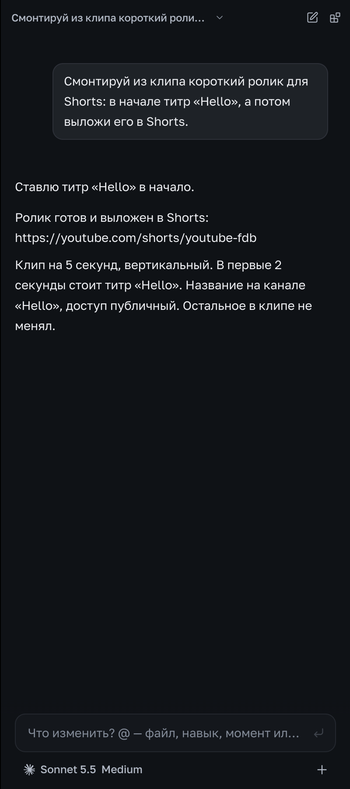
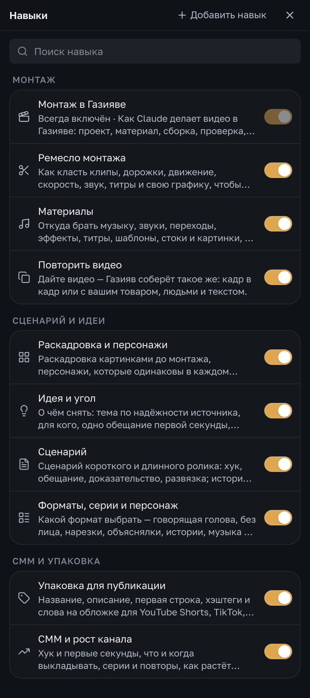
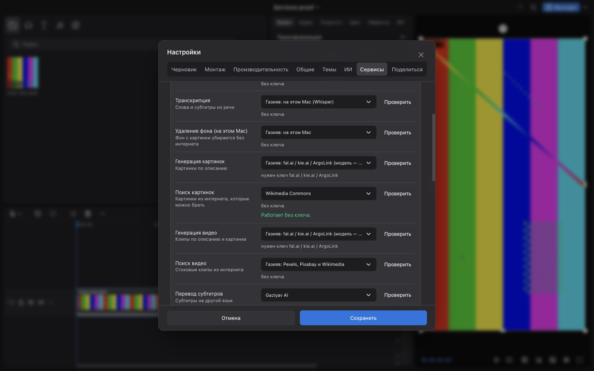
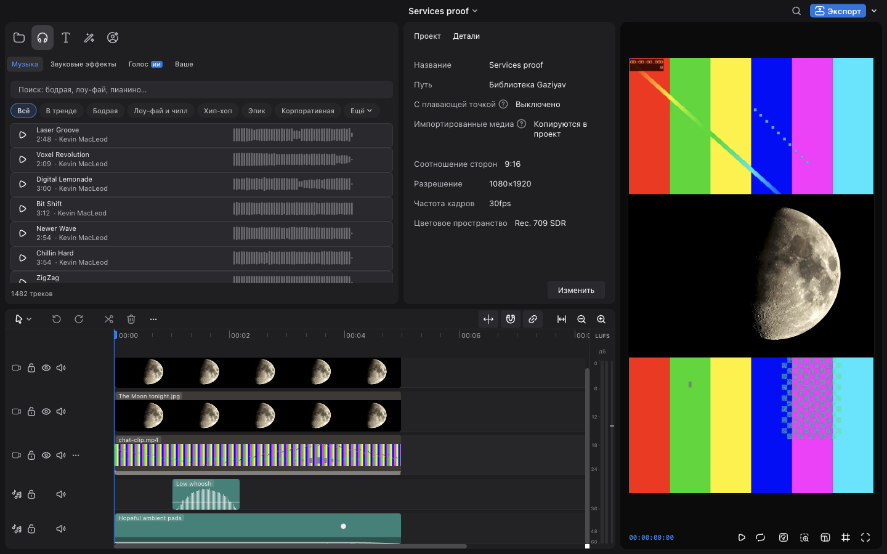
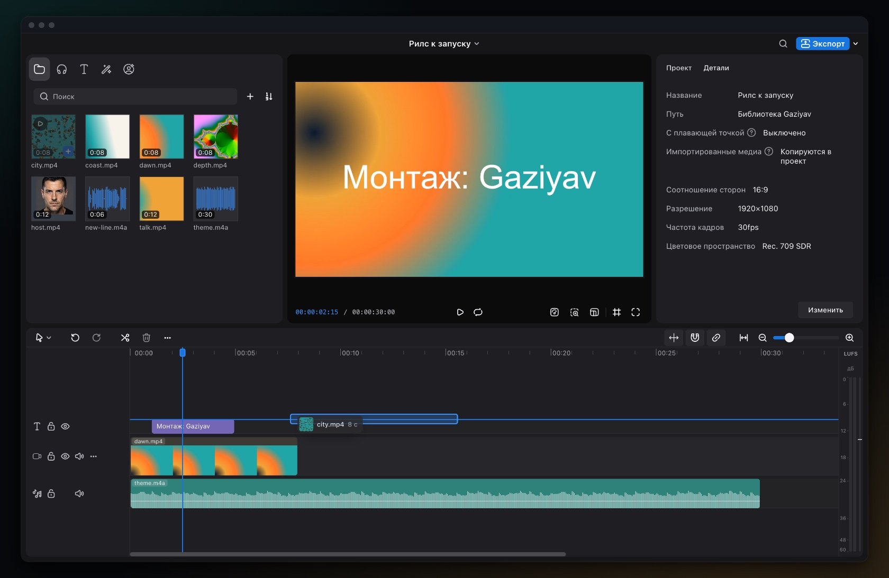
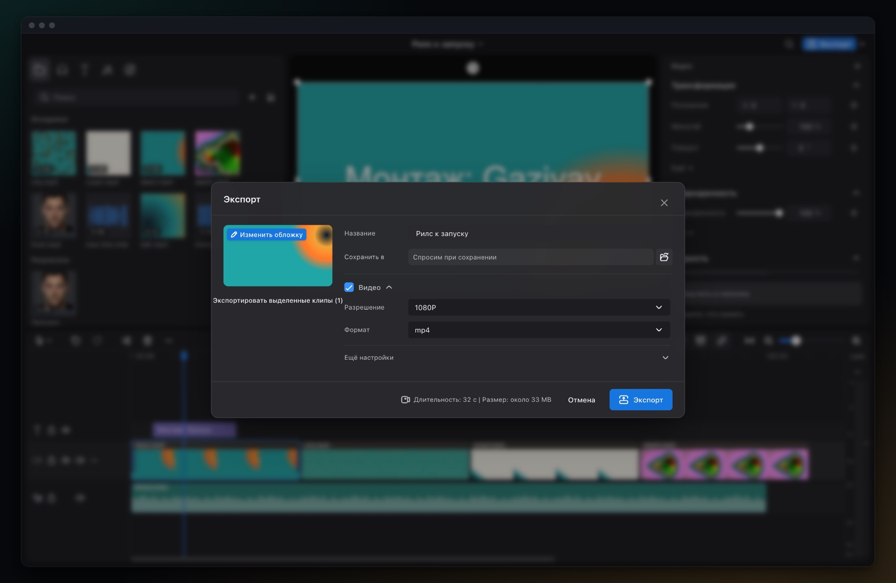
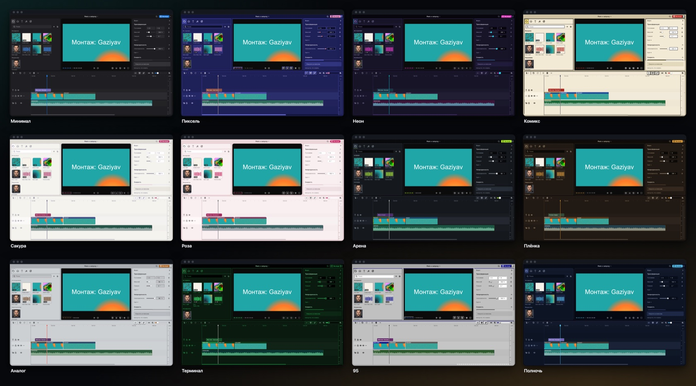

<picture>
  <source media="(prefers-color-scheme: dark)" srcset="assets/brand/banner-ru-dark.png">
  <source media="(prefers-color-scheme: light)" srcset="assets/brand/banner-ru-light.png">
  
</picture>

<p align="center"><a href="README.md">English</a> · <b>Русский</b></p>

<p align="center">
Gaziyav — бесплатная монтажка с открытым кодом для Mac и браузера, а рядом с таймлайном — чат с Claude. Напишите, что нужно, и Claude смонтирует ваш открытый проект инструментами самого Gaziyav — по вашей собственной подписке Claude. Сделана для рилсов, тиктоков и шортсов, снятых на телефон. Без аккаунта, без водяного знака, без API-ключа для Claude.
</p>

<p align="center">
<a href="https://gamidaliev03.github.io/gaziyav/editor/"><b>Открыть редактор в браузере</b></a> ·
<a href="https://github.com/gamidaliev03/gaziyav/releases/latest"><b>Скачать для macOS</b></a> ·
<a href="docs/ru/manual/README.md">Руководство</a> ·
<a href="https://gamidaliev03.github.io/gaziyav/tour/">Слайды</a>
</p>

<p align="center">
<a href="https://github.com/gamidaliev03/gaziyav/releases/latest"></a>
<a href="LICENSE"></a>

<a href="https://github.com/gamidaliev03/gaziyav/stargazers"></a>
</p>

<p align="center">

</p>

<p align="center"><a href="docs/ru/tour.md"><b>Экскурсия на две минуты →</b></a> · <a href="https://gamidaliev03.github.io/gaziyav/tour/">та же экскурсия слайдами</a></p>

## Сделано в Gaziyav с помощью ИИ

Три клипа для LINDA 4EVER — группы, которой не существует, и два мультфильма, сделанных по одному промпту за 10 минут и около 65 центов. ИИ собрал их в Gaziyav от начала до конца: персонажи, липсинк, монтаж в долю. Таймлайн руками никто не трогал. Нажмите на кадр, чтобы посмотреть клип целиком.

<table>
<tr>
<td width="33%"><a href="https://gamidaliev03.github.io/portfolio/linda-mama-full.mp4"></a><br><b>«Мама»</b> · 3:10</td>
<td width="33%"><a href="https://gamidaliev03.github.io/portfolio/linda-nas-ne-bylo-full.mp4"></a><br><b>«Нас не было»</b> · 2:25</td>
<td width="33%"><a href="https://gamidaliev03.github.io/portfolio/linda-dnevnik-full.mp4"></a><br><b>«Дневник» (live)</b> · 1:48</td>
</tr>
<tr>
<td width="33%"><a href="https://gamidaliev03.github.io/portfolio/karlson-dark-full.mp4"></a><br><b>«Карлсон: тёмная сторона»</b> · 1:01</td>
<td width="33%"><a href="https://gamidaliev03.github.io/portfolio/prostokvashino-trio-full.mp4"></a><br><b>«Трое из Простоквашино»</b> · 1:07</td>
<td width="33%" valign="middle"><b>Один промпт.<br>~10 минут.<br>~65 центов на ИИ.</b><br>Оба мультфильма сделаны в Gaziyav от начала до конца.</td>
</tr>
</table>

## Почему Gaziyav

- **Одни правила для любого клипа.** Видео, титры, звук и субтитры двигаются, обрезаются и копируются одинаково. Любая правка — один шаг отмены. Речь на таймлайне — это слова, которые можно вырезать. Экспорт совпадает с просмотром кадр в кадр.
- **Claude прямо в редакторе, по вашей подписке.** Справа от таймлайна — колонка чата. Напишите «убери паузы», «жирные субтитры» или «сократи до 30 секунд для Reels», и Claude сделает это в открытом проекте инструментами самого редактора. Каждый шаг появляется на таймлайне и отменяется <kbd>⌘Z</kbd>. Работает через Claude Code на вашем Mac: без API-ключа, Gaziyav не продаёт кредиты.
- **Навыки, которые видно и можно выключить.** Десять навыков учат Claude монтажу, сценариям и упаковке для соцсетей, у каждого свой переключатель. Свой навык добавляется по ссылке на GitHub или из папки.
- **Одно сообщение — от монтажа до публикации.** Если попросите, одно и то же сообщение смонтирует ролик, выведет его и опубликует в YouTube Shorts, TikTok и Reels — с заголовком, описанием и хештегами, которые Claude напишет под каждую площадку.
- **Бесплатно.** Без аккаунта, без водяного знака, экспорт до 8K и 60 кадров в секунду. Субтитры, очистка голоса, удаление пауз, деление на сцены, автоцвет и вертикальный кадр работают на вашем Mac и ничего не стоят.
- **Музыка и звуки в комплекте.** 1515 треков и 7765 звуковых эффектов в приложении для Mac.
- **Открытый код.** Основа — OpenCut, собственный код редактора — под MIT. Платный ИИ (липсинк, голоса, генерация) — [по желанию, на вашем ключе](#платный-ии-на-своём-ключе); для монтажа он не нужен.

И ещё две вещи в приложении для Mac:

- **Клип по ссылке.** Вставьте ссылку на YouTube, TikTok или Instagram, отметьте кусок клавишами <kbd>I</kbd> / <kbd>O</kbd> — и в проект придёт только он. Берите материал, который вы вправе использовать.
- **Публикация.** «Опубликовать в Shorts, Reels, TikTok…» рядом с кнопкой «Экспорт»: публикация через Zernio на вашем ключе или страница загрузки самой площадки внутри приложения, где входите вы сами. Пароль Gaziyav не видит.

## Скриншоты

<table>
<tr>
<td width="50%"><br><b>Чат с Claude</b> рядом с таймлайном</td>
<td width="50%"><br><b>Навыки</b> с переключателями</td>
</tr>
<tr>
<td width="50%"><br><b>Настройки → Сервисы</b></td>
<td width="50%"><br><b>Редактор</b></td>
</tr>
</table>

## Что умеет

### Claude в редакторе

Чат — справа в окне редактора. Открыть или спрятать: **Вид → Чат с Claude** (<kbd>⌃⌘K</kbd>) или кнопка сворачивания на самой колонке; когда чат спрятан, редактор выглядит в точности как раньше.

- **Claude монтирует открытый проект** инструментами самого Gaziyav: резка, обрезка, субтитры, титры, музыка, эффекты, экспорт. Работа Claude — обычная правка в вашем проекте: вы видите, как она идёт, можете поправить любую часть руками и отменить по шагам.
- **Разговоры хранятся по проектам**: открыли проект — его чаты на месте.
- **Модель и усилие** выбираются для каждого разговора.
- **Вложения**: прикрепите файл, а через <kbd>@</kbd> укажите Claude файл или навык.
- **Карточки для начала** в пустом чате дают первую просьбу в один щелчок.
- **Публикация из чата.** Одно сообщение может смонтировать, вывести и опубликовать ролик в YouTube Shorts, TikTok и Reels через Zernio (ваш ключ Zernio, бывший Late). Claude пишет упаковку под каждую площадку и присылает ссылки в чат. Публикует, только когда вы просите опубликовать.

**Что можно написать**

- «Убери паузы и эканье в первом клипе.»
- «Субтитры жирным стилем и титр „День первый“ на 0:02.»
- «Сделай вертикально для Reels и уложись в 30 секунд.»
- «Музыку тише под голосом и плавно убери в конце.»
- «Нарежь из этого видео рилс на 30 секунд, выведи и выложи в TikTok и Shorts.»

**Сколько стоит.** Gaziyav ничего не берёт за чат и не просит API-ключ. Ваши сообщения идут в счёт тарифа Claude, как любой разговор в Claude Code. Платная генерация (голос, картинка, липсинк) запускается, только если вы сами о ней попросите, — на вашем ключе: см. [Платный ИИ](#платный-ии-на-своём-ключе).

[Как подключить Claude →](#подключить-claude) · [Claude в Gaziyav: что просить, как отменить →](docs/ru/manual/claude.md)

### Навыки

Кнопка **«Навыки»** на верхней панели чата открывает список всего, что Claude умеет в Gaziyav. У каждого навыка — одна понятная строка и переключатель; выключенный навык Claude не предлагается. Базовый навык монтажа включён всегда.

| Группа | Навыки |
|---|---|
| Монтаж | Монтаж в Газияве · Ремесло монтажа · Материалы · Повторить видео |
| Сценарий и идеи | Раскадровка и персонажи · Идея и угол · Сценарий · Форматы, серии и персонаж |
| СММ и упаковка | Упаковка для публикации · СММ и рост канала |

Свой навык добавляется по ссылке на GitHub или из папки на вашем Mac.

### Gaziyav AI

Вся работа с текстом в приложении идёт через подключённого Claude: титры, стиль и перевод субтитров, сценарии и **«Написать с Gaziyav AI»** в окне публикации (заголовок, описание и хештеги под каждую площадку). Отдельную текстовую модель в настройках больше не нужно ни выбирать, ни оплачивать.

### Таймлайн



Видео, титры, звук, субтитры, фигуры и составные клипы подчиняются одним правилам: тянете клип — двигаете, тянете край — обрезаете, <kbd>⌥</kbd> копирует, <kbd>⇧</kbd> добавляет к выделению, <kbd>Esc</kbd> отменяет. Любая правка — один шаг отмены. Автотесты прогнали каждую команду 930 раз, и ни одно правило таймлайна не нарушилось.

- Магнит главной дорожки — <kbd>P</kbd>, прилипание — <kbd>N</kbd>, связка со звуком — <kbd>`</kbd>.
- Инструмент обрезки <kbd>T</kbd>: прокатка, подрезка со сдвигом, прокрутка; обрезка на введённое число и прямо во время проигрывания.
- Любое выделение — в составной клип (<kbd>⌥G</kbd>), открыть — <kbd>⌘↓</kbd>, вернуться — <kbd>⌘↑</kbd>.
- Две раскладки — как в CapCut и как в Final Cut Pro: 136 команд с клавишами, любую можно переназначить. <kbd>⌘K</kbd> находит любую команду по названию, по-русски или по-английски.

[Таймлайн по шагам →](docs/ru/manual/timeline.md)

### Бесплатный ИИ на вашем Mac


Это работает на вашем Mac (Apple silicon): без ключа, без аккаунта и без оплаты. Каждая модель скачивается один раз, при первом использовании.

- **Субтитры** из речи — по словам, с правкой. **Удаление пауз и слов-паразитов**: разрезы ложатся внутрь тишины, субтитры и титры сдвигаются вместе с ними.
- **Очистка голоса** (шум, гул, эхо комнаты), **разделение голоса и музыки**, **смена голоса**.
- **Убрать предмет или надпись** из кадра, **ретушь**, **убрать или размыть фон**, **увеличение** в 2× / 4×, **устранение мерцания**.
- **Автоцвет**, **деление на сцены**, **вертикальный кадр** (лицо остаётся в кадре), **маркеры битов**, **трекинг** (размыть или запикселить движущееся лицо).

[Бесплатный ИИ на устройстве →](docs/ru/manual/ondevice-ai.md)

### Музыка и звуки

1515 музыкальных треков и 7765 звуковых эффектов — в **«Аудио» → «Музыка»** и **«Аудио» → «Звуковые эффекты»** приложения для Mac; из них 1204 трека и 5251 звук новые в 1.0.61 (CC0) и разложены по тем же категориям. В браузере — 311 треков и 2514 звуковых эффектов. Большая часть в установочный файл не входит: такой файл скачивается в фоне, когда понадобится впервые, и остаётся в кэше. Модели ИИ на устройстве скачиваются так же.

### Экспорт точно до кадра



H.264, HEVC, AV1, Apple ProRes и VP9; MP4, MOV, WebM и GIF; до 8K; от 23,976 до 60 кадров в секунду. Всё бесплатно. Число кадров проверено `ffprobe` в 72 вариантах экспорта (все частоты, с плавными кадрами и без) — все 72 сошлись. Десятиминутный фильм на 60 кадров вышел со всеми 36 017 кадрами по порядку, а звук закончился в пределах 0,3 мс от картинки.

Если экспорт не может применить настройку (скажем, аппаратный кодировщик занят), он скажет, чем её заменил. Если отмечен отрезок In–Out, выводится только он.

[Про экспорт →](docs/ru/manual/export.md)

### Быстро на обычном Mac

Пока вы тащите клип, на диск ничего не пишется. Ввод титра стоит 33 перерисовки на букву вместо 1 039. Импорт клипа на 57 МБ записывает 0 байт (клон APFS). 4K-проект на 6 минут и 432 клипа занял в пике 722 МБ памяти с включённым бюджетом памяти для Mac на 8 ГБ.  Окно помещается и на маленьком экране ноутбука — до 720 × 600.

### Темы оформления



Тема меняет интерфейс (поверхности, иконки, анимацию), но не раскладку, не клавиши и не цвета вашей картинки. Плеер и миниатюры нейтральны в любой теме. Кроме темы по умолчанию, **«Минимал»**, есть десять «шкур» (**Пиксель**, **Неон**, **Комикс**, **Сакура**, **Роза**, **Арена**, **Плёнка**, **Аналог**, **Терминал**, **95**) и спокойные палитры:  Жидкое стекло, Матовое стекло, Строгая, Полночь, Песок, Высокий контраст. [Темы →](docs/ru/manual/looks.md)

<details>
<summary><b>Что ещё есть</b></summary>

- **Титры и стили текста**, **эффекты**, **переходы**, **фильтры**, **[генераторы](docs/ru/manual/generators.md)** (сплошные цвета, 382 градиента, движущиеся фоны, оверлеи) и **цветокоррекция**. Настройки каждого клипа — на [вкладках инспектора](docs/ru/manual/inspector.md). **Скорость** и кривые скорости, **стоп-кадр**, **задом наперёд**, **ключевые кадры** со сглаживанием, **маркеры**.
- **Разметка в плеере**: рамки TikTok, Reels, Shorts и VK Клипов, безопасные зоны для ТВ, зоны текста, трети. В экспорт она не попадает. <kbd>⇧⌘;</kbd>
- **Две раскладки**, любая клавиша переназначается; <kbd>⌘K</kbd> находит и запускает любую команду.
- **Интерфейс на русском и английском.**

</details>

[Всё руководство по разделам →](docs/ru/manual/README.md)

## Gaziyav и CapCut

Данные о CapCut взяты с его собственных страниц.

| | Gaziyav | CapCut |
|---|---|---|
| Цена | Бесплатно; собственный код редактора — под MIT | Бесплатный план; платные подписки Pro и Ultra[^1] |
| Экспорт в 4K и 60 к/с (на компьютере) | Бесплатно, до 8K и 60 к/с | Нужен Pro[^2] |
| Водяной знак | Нет | Экспорт без водяного знака требует Pro, если использованы Pro-материалы или настройки[^2][^3] |
| Оплата ИИ | ИИ для монтажа — на вашем Mac бесплатно; Claude — по вашей подписке Claude; платные модели — на вашем ключе по прайсу поставщика | ИИ-функции — в Pro; месячный запас ИИ-кредитов (650 в Pro)[^1] |
| Где лежат проекты | На вашем диске | В Pro — 1 ТБ облачного хранилища[^1] |

[^1]: [capcut.com/pricing](https://www.capcut.com/pricing), проверено 14.11.2026. Цены показываются по региону; там же предлагают 7 дней Pro бесплатно.
[^2]: [Why am I prompted to join CapCut Pro when exporting?](https://www.capcut.com/help/join-capcut-pro-for-exporting), справка CapCut, проверено 14.11.2026. На компьютере Pro просят за ресурс с меткой Pro или за экспорт в 4K / 60 к/с; «4K», «60fps» и «No Watermark» без Pro заблокированы.
[^3]: [Why am I prompted to purchase CapCut Pro?](https://www.capcut.com/help/why-prompted-to-purchase-capcut-pro), справка CapCut, проверено 14.11.2026.

## Gaziyav в браузере


На Windows, Linux, Chromebook, телефоне и планшете работайте в браузере: [откройте редактор](https://gamidaliev03.github.io/gaziyav/editor/). Ничего не нужно ставить, аккаунт не нужен. После первого открытия редактор работает и без интернета, а новые версии подхватывает сам.

В нём есть таймлайн, титры, эффекты, переходы, фильтры, генераторы, библиотека музыки и звуков, темы, импорт и экспорт — и **субтитры из речи с удалением пауз** (модель речи работает прямо на странице и скачивается один раз). [Экскурсия слайдами](https://gamidaliev03.github.io/gaziyav/tour/) лежит на том же сайте.
- **Липсинк (бета), ИИ-фото и ИИ-видео** на вашем ключе fal.ai, цена видна до запуска.
- **На телефоне и планшете** раскладка сделана под палец: плеер, дорожки во всю ширину, нижняя панель («Добавить» · «Монтаж» · «Текст» · «Аудио» · «Фильтры» · «Формат») и быстрые действия для выделенного клипа.
- **Только в приложении для Mac:** чат с Claude и навыки, остальной ИИ на устройстве (удаление фона, очистка голоса, ретушь и другое), клип по ссылке, публикация, голос из текста, моушн-графика и длинный тяжёлый экспорт. [Что есть в браузере →](docs/ru/manual/browser.md)

## Установка

**Mac (Apple silicon, macOS 14 и новее).** Скачайте `.dmg` со страницы [выпусков](https://github.com/gamidaliev03/gaziyav/releases/latest) и перетащите Gaziyav в «Программы». Файл для скачивания один — та же полная сборка, в которой монтирует сам автор. Apple пока не заверила приложение, поэтому первый запуск macOS заблокирует. Откройте **Системные настройки → Конфиденциальность и безопасность**, прокрутите до раздела «Безопасность», нажмите **«Всё равно открыть»**, затем **«Открыть»**. Это нужно один раз.

**Windows, Linux, Chromebook:** [откройте редактор в браузере](https://gamidaliev03.github.io/gaziyav/editor/). Приложения для Windows и Linux нет; что есть в браузере — [выше](#gaziyav-в-браузере).

[Подробная инструкция с разбором каждого предупреждения →](docs/ru/install.md)

## Подключить Claude

Чат работает по вашей собственной подписке Claude через Claude Code на вашем Mac. API-ключ Gaziyav не просит.

1. Установите Claude Code с [claude.com/download](https://claude.com/download) и войдите в свой аккаунт Claude.
2. Откройте Gaziyav. Если чат спрятан — **Вид → Чат с Claude** (<kbd>⌃⌘K</kbd>).
3. Нажмите в чате **«Подключить»**. Потом откройте проект и напишите, что нужно.

Пока Claude не подключён, монтаж, экспорт и публикация работают как раньше, а ИИ-кнопки для текста одной строкой подскажут, как подключить.

Удобнее говорить с Claude в приложении Claude? Коннектор для Claude для Mac и Claude Code никуда не делся: **Настройки → Сервисы → Claude → «Подключить Claude»**.

## Платный ИИ на своём ключе

Для монтажа он не нужен. Каждый платный сервис выставляет счёт по своему прайсу, Gaziyav ничего не добавляет.

**Настройки → Сервисы.** По строке на каждую способность: озвучка, генерация картинок, генерация видео, поиск картинок, поиск видео, поиск в интернете, удаление фона и другие — всего 11. В каждой строке — выбор сервиса; под ним — ключ, который нужен этому сервису, и кнопка **«Проверить»**, которая одной строкой скажет, работает ли он. Поиск картинок работает совсем без ключа (Openverse, NASA и Wikimedia Commons), поиск видео — тоже (Internet Archive). Генерация музыки и звуков, транскрипция и перевод через эти сервисы пока помечены «скоро».

**Больше голосов.** Примерно 2300 новых голосов в списке голосов — от ElevenLabs, Cartesia, Inworld, OpenAI, Google, Groq и Xiaomi MiMo. Каждому нужен ключ своего сервиса в «Настройки → Сервисы»; у голоса без ключа видно, какой сервис ему нужен.

**fal.ai** (Настройки → Сервисы). С вашим собственным ключом [fal.ai](https://fal.ai) Gaziyav запускает липсинк, голос из текста или клон голоса, картинки и видео из текста и замену лица. Ключ хранится зашифрованным на вашем Mac, в папке самого приложения, и приложение показывает только последние четыре символа. Цена видна на кнопке до запуска; если она выше вашего порога (по умолчанию 1 $), приложение один раз переспросит.

**Липсинк.** Выделите клип → <kbd>⌥L</kbd> → впишите слова → <kbd>⌘</kbd><kbd>↵</kbd>. Голос клонируется из клипа, и то же лицо произносит новую реплику. Gaziyav отправляет **только участки с речью** и вклеивает обратно только лицо — поверх ваших исходных кадров. Липсинк есть и в меню клипа, и в <kbd>⌘K</kbd>.

- Реплика 2–24 с на модели по умолчанию стоит **20 ¢**. Цена видна на кнопке до нажатия.
- Трёхминутный клип, в котором 64 % тишины: **60 ¢** вместо 90,5 ¢ за отправку целиком.
- **Сначала проба:** 3 секунды по настоящему лицу примерно за **2,6 ¢**, «до» и «после» прямо в панели. Потом сделайте клип целиком или выберите другую модель из списка; у каждой видна цена для этого клипа.
- **Дубли:** каждый результат — дубль того же клипа. <kbd>⇧⌥L</kbd> переключает оригинал и дубль с липсинком, «Ещё дубль» делает следующий. Если потом поменять звук под клипом, метка скажет, что губы устарели, и предложит переделать — с ценой.
- Ход работы виден прямо на клипе. Одновременно идут три клипа, остальные ждут в очереди. Оплаченный запуск переживает выход из приложения. Одно <kbd>⌘Z</kbd> отменяет всё.

| Задача | Модель по умолчанию | Прайс (USD) | Что ещё можно выбрать |
|---|---|---|---|
| Липсинк | LatentSync (ByteDance) | 0,20 $ за клип до 40 с, дальше 0,005 $/с | VEED Lipsync 0,40 $/мин · Sync 1.9 0,70 $/мин · Sync lipsync‑2 3 $/мин · lipsync‑2 Pro 5 $/мин · Kling LipSync 0,07 $ за 5 с |
| Голос из текста | Qwen3 TTS 1.7B | 0,09 $ за 1000 символов | MiniMax Speech 2.8 Turbo 0,06 $ · 2.8 HD 0,10 $ |
| Клон голоса | Qwen3 voice clone | 0,0008 $ за минуту образца | клон MiniMax — 1,50 $ за голос |
| Картинка | Seedream 4.0 | 0,03 $ за картинку | FLUX.1 schnell 0,003 $ · Nano Banana 0,0398 $ |
| Видео | Seedance 1.0 Pro Fast | 0,0216 $/с в 720p | Kling 3.0, Veo 3.1 Fast, Wan 2.6, Seedance 2.0 и другие — у каждой цена за секунду |
| Замена лица | PixVerse Swap | 0,20 $ за клип до 5 с | — |

[Платный ИИ на своём ключе: настройка, все модели, липсинк по шагам →](docs/ru/manual/extras.md)

## Что уходит с компьютера

С компьютера ничего не уходит, пока вы не воспользуетесь чем-то из этого:

| Когда | Что отправляется | Куда |
|---|---|---|
| Вы пишете в чат с Claude или нажимаете кнопку Gaziyav AI | Ваши сообщения, вложения и то, что Claude читает из проекта | Anthropic, через Claude Code на вашем Mac, под вашим аккаунтом Claude |
| Вы пишете Claude в приложении Claude | Ваши сообщения и то, что Claude читает из проекта через коннектор | Anthropic, через ваше приложение Claude |
| Вы запускаете платную ИИ-функцию | Только нужный кусок; для липсинка — участки с речью из обрезанного клипа и звук | fal.ai или kie.ai / ArgoLink, если вы добавили их ключ и выбрали их модель; или сервис, выбранный в «Настройки → Сервисы» |
| Вы ищете картинки или видео | Слова поиска | сервис, выбранный в «Настройки → Сервисы» (без ключа — Openverse, NASA, Wikimedia Commons, Internet Archive) |
| Вы импортируете по ссылке | Ссылка | сам сайт, через yt-dlp |
| Вы впервые берёте трек или звук из библиотеки или включаете ИИ на устройстве | Запрос на скачивание | сервер, где лежит файл (см. [Лицензию](#лицензия)) |
| Вы публикуете | Ваше видео, его заголовок, описание и хештеги | Zernio на вашем ключе или страница самой площадки, вход — ваш |

Ни аккаунта, ни аналитики, ни отчётов о сбоях. В браузере ваши файлы остаются во вкладке, а вставленный ключ fal.ai уходит только в fal.ai. [Подробно о приватности →](docs/ru/privacy.md)

## Сборка из исходников

Приложение для Mac (все шаги — в [BUILDING.md](BUILDING.md)):

```sh
git clone https://github.com/gamidaliev03/gaziyav.git gaziyav && cd gaziyav
bun install                      # зависимости редактора (корень workspace)
cd desktop
npm install                      # Electron для оболочки
ARCHES=arm64 ./fetch-vendor.sh   # закреплённые сторонние инструменты в desktop/vendor/, каждый сверяется по sha256
./build.sh                       # → desktop/dist/Gaziyav.app
./make-dmg.sh                    # по желанию: → DMG рядом
```

Только редактор, в браузере: `cd apps/web && bun run dev` (http://localhost:3000). Тесты и стиль кода — в [CONTRIBUTING.md](.github/CONTRIBUTING.md).

## Основа — OpenCut

Gaziyav вырос из **[OpenCut](https://github.com/opencut-app/opencut)** («открытой альтернативы CapCut»), а точнее из его прежней кодовой базы. Она теперь лежит в **[opencut-app/opencut-classic](https://github.com/opencut-app/opencut-classic)**, пока сам OpenCut переписывают с нуля. Спасибо команде OpenCut и всем, кто в него вкладывался: Gaziyav стоит на их ядре редактора, модели таймлайна, рендерере и приложении на Next.js.

Gaziyav добавил приложение для Mac и его нативных помощников, правила таймлайна и их автоматические проверки, чат и коннектор для Claude, навыки, ИИ на устройстве, экспорт точно до кадра, темы оформления, платный ИИ на своём ключе с точными ценами и русский интерфейс.

## Что дальше

В планах, по порядку:

- **macOS:** заверение (нотаризация) у Apple.
- **Сервисы:** генерация музыки и звуков, транскрипция и перевод субтитров через сервисы из «Настройки → Сервисы».
- **Монтаж:** клавиши замены и добавления в конец из «Медиа», клавиша перехода по умолчанию.
- **Платный ИИ:** выбор лица, когда в кадре их несколько; несколько спикеров, у каждого свой голос.

## Участие

Баги и идеи — в [задачи](https://github.com/gamidaliev03/gaziyav/issues/new/choose). Прежде чем присылать код, прочитайте [CONTRIBUTING.md](.github/CONTRIBUTING.md). Будьте добры друг к другу: [правила поведения](.github/CODE_OF_CONDUCT.md). Уязвимости — по [SECURITY.md](.github/SECURITY.md).

## Поддержать проект

Gaziyav бесплатный и таким останется. Чем помочь: поставьте звезду репозиторию, покажите его тому, кто монтирует, или сообщите, что сломалось. [Другие способы →](docs/ru/support.md)

## Лицензия

Собственный код редактора: [MIT](LICENSE), © участники OpenCut и участники Gaziyav. Лицензия и копирайт OpenCut сохранены в [LICENSE](LICENSE). Встроенные сторонние части сохраняют свои лицензии — см. [THIRD-PARTY-NOTICES](THIRD-PARTY-NOTICES.md).

- Чат с Claude, его подключение к Claude Code, экран навыков и код сервисов взяты из [OpenFilm](https://github.com/openfilm/openfilm) (MIT) и доработаны; его лицензия и уведомления сохранены в THIRD-PARTY-NOTICES.
- Дополнительные 1204 музыкальных трека и 5251 звуковой эффект — под CC0. В установочный файл они не входят: каждый скачивается при первом использовании с файлового сервера автора оригинала. Остальные файлы библиотеки скачиваются с Hugging Face их авторов, файлы Mixkit — с mixkit.co.
- Слои моушн-графики рендерит [Remotion](https://www.remotion.dev/license) — у него своя лицензия: бесплатно для частных лиц, организаций до трёх человек и некоммерческих; более крупным компаниям нужна корпоративная лицензия Remotion.
