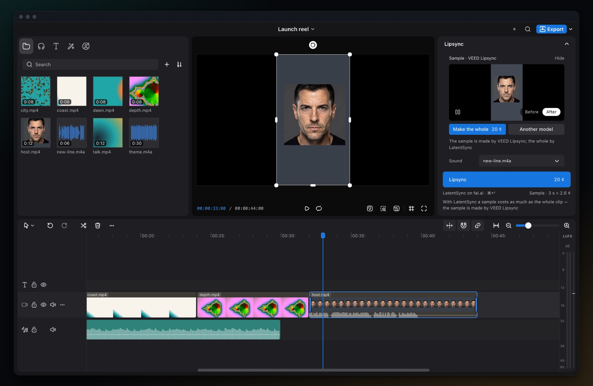

# Lipsync

**English** · [Русский](../ru/lipsync.md)

Lipsync is an optional extra on your own key — not needed to edit, and the strongest of the paid tools: the same clip, the same face, new words — in two clicks, for cents, without a scroll or a dialog in the way.

You need a [fal.ai key](ai.md) in **Settings → AI**. Everything below is billed by fal at its list price; Gaziyav adds nothing.

## The podcast flow

You have a guest's clip and want them to say something else — a correction, a call to action, a line in another language.

1. **Select the clip** on the timeline. Press <kbd>⌥L</kbd> — or the clip's right-click menu → **Lipsync…**, or <kbd>⌘K</kbd> → «lipsync». Lipsync is one of the AI tools in the inspector's tools block; all three ways reveal it with the cursor in the words field.
2. **Type the new words.** By default the voice is cloned from the clip itself.
3. **Press <kbd>⌘</kbd><kbd>↵</kbd>** (or the button). The button already says the total — for example «Voice and lipsync ≈ 21 ¢».

Gaziyav speaks the line in the guest's voice, sends the speech to the lipsync model, and puts the result **in place of the clip's old speech**: the clip takes the voice's length, the rest of the old take is trimmed off like any trim (drag the edge or <kbd>⌘Z</kbd> to get it back), and the clips after it follow the magnet. The old words are never heard after the new line. One <kbd>⌘Z</kbd> undoes the whole thing.

The progress stays on the clip's run, the editor stays free: start a second clip while the first runs. Three clips run at once, the rest wait in a queue with their place shown. A paid run survives quitting the app — open it again and the result lands once, never charged twice.

### Other sources of sound

- **A sound already under the clip** (a recorded line, a song): pick it in **Sound**. The clip keeps its length.
- **A file** from Media or from disk.
- **Your saved voices**, or **Voice only** if you just want the line spoken, without lipsync.

### Where the result goes

| Choice | What happens |
|---|---|
| **Clip to the voice's length** (default for new words) | The result stands at the clip's start; the rest of the clip is trimmed off; later clips close up. |
| **Only a piece, the rest stays** | The result replaces only as much of the clip as the voice lasts; the rest of the original follows. |
| **Whole clip** | The whole clip is sent; silence after the speech. |
| **Above the clip** | The result goes on a track above, the clip under it is muted for that time. |

When the voice is longer than the clip, the video plays forward and back (no jump) by default, or loops, or holds the last frame. Your last choice is remembered.

## Try a sample, keep takes

- **A 3-second sample first.** Beside the run button, **Sample · 3 s** (about **2.6 ¢**) lipsyncs three seconds of the real face and plays them right in the panel — before and after. Nothing lands on the timeline. If it looks right, **Make the whole**; if not, **Another model**. When the chosen model is priced per clip (LatentSync), the sample is made by VEED Lipsync and the panel says so.
- **The model list with prices.** The model line opens a list of every model with *its* price for this clip and a star on the one that suits the shot (a face to camera, a profile, a hand near the mouth…); a model that cannot take the clip is greyed out with the reason.
- **Takes on the clip.** Every result is a take of the same clip, not a new clip: <kbd>⇧⌥L</kbd> (or the clip's menu) flips between the original and the lipsynced take, in place, one <kbd>⌘Z</kbd>. **Another take** under the result makes one more at the same price.
- **Lips out of date.** If you later change the sound under the clip, an amber mark on the clip says the lips no longer match and offers **Redo the lipsync** with the price. <kbd>⌘Z</kbd> on the sound change makes the mark go by itself.
- **Progress on the clip.** A running lipsync is drawn on the clip itself; × on the clip stops it; a failure shows «!» there with one sentence and **Retry**.
- **No sound, no button.** With no words typed and no sound under the clip, the button is greyed and says why — you cannot pay for nothing.

## What it costs

The default model is **LatentSync** (ByteDance): **$0.20 per run up to 40 s, then $0.005 per second.**

| Example | Requests | Price |
|---|---|---|
| A line of 2, 7 or 24 s | 1 | 20 ¢ |
| A line of 45 s | 1 | 23 ¢ |
| A line of 70 s | 1 | 36 ¢ |
| A 3-minute clip, 64 % of it silence | 3 | 60 ¢ (sending it whole: 90.5 ¢) |

Plus the voice: Qwen3 speech at $0.09 per 1,000 characters (a sentence ≈ half a cent) and the clone at $0.0008 per minute of sample, once.

**Why it is cheap:** Gaziyav finds where somebody actually speaks, sends only those spans (with a quarter-second handle) and never sends silence. Pieces are split at your own cuts and never across them. For per-clip-priced models it packs short spans into one request. The price on the button is the server's plan for exactly what will be sent, so the button and the bill are the same number.

**The spending limit:** in **Settings → AI**, «Confirm spending above [1] $». Below it, the button itself is your consent; above it, one confirmation.

### Stronger models, same key

| Model | Price | Good for |
|---|---|---|
| LatentSync | $0.20 / run up to 40 s | drafts, frontal faces |
| VEED Lipsync | $0.40 / min | short pieces |
| Sync 1.9 | $0.70 / min | older generation, cheap per minute |
| Sync lipsync‑2 | $3 / min | real footage, head turns, close-ups |
| Sync lipsync‑2 Pro | $5 / min | detail: teeth, beards, a hand near the mouth |
| Kling LipSync | $0.07 / 5 s | pieces of 2–10 s only |

Each model in the panel shows its price for *this* clip; a model that cannot take the clip's length is greyed out.

## What leaves your computer

Only when you press the button, and only this:

- the **trimmed clip's speech spans** as a video file, re-encoded here to H.264 SDR (BT.709) at high quality — never the whole project, never the parts nobody speaks in;
- the **sound** the lips should follow;
- for the clone: the **voice sample** from the clip.

They go to **fal.ai** (to its file storage, then the model). What comes back is used only inside the **face region**: Gaziyav composites the answer's mouth area onto your original frames, so the rest of the picture keeps your original pixels.  fal's own terms decide how long they keep the files.

No watermark, no «AI-generated» stamp is added to the result.

## When something goes wrong

- **No key / no money on fal / a timeout:** one sentence on the run says what happened; nothing is lost, **Retry** runs it again in place. A failed piece of a long clip is retried once by itself.
- **Several faces in the frame:** today the model picks; choosing the face on the picture is on the [roadmap](../../README.md#roadmap).
- **The lips look wrong:** try a stronger model from the list (its price is shown) — Sync lipsync‑2 handles head turns and close-ups better.

## Coming next

Picking the face when there are several, several speakers with their own voices, songs with the vocal separated. See the [roadmap](../../README.md#roadmap).
