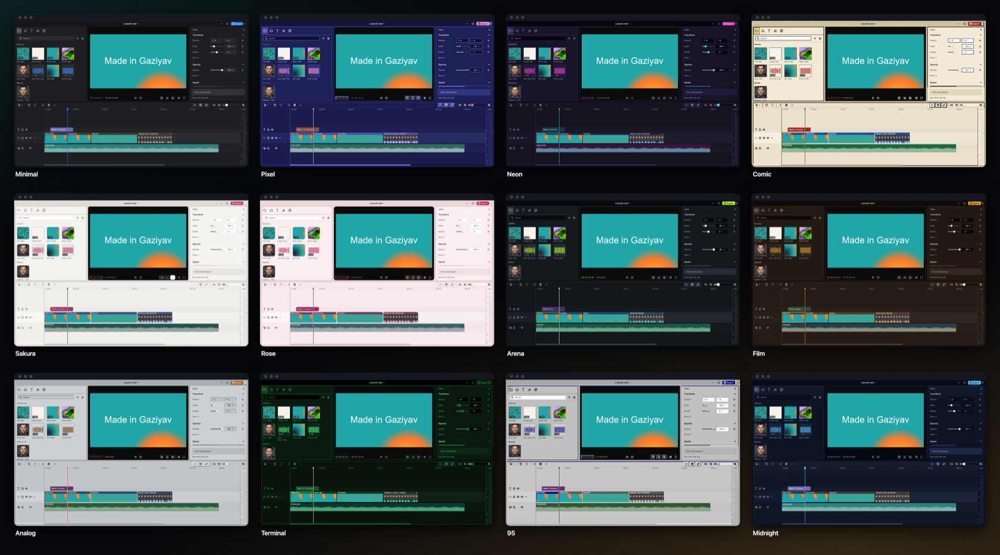

# Looks

**English** · [Русский](../ru/looks.md)

**Settings → Themes.** Pick a look and the whole interface changes at once — no restart.

## What a look is — and what it never touches

A look is a complete skin: surfaces, hairlines, shadows, corners, the heading and digit fonts, the icon style, buttons and sliders, the clip bodies and the playhead on the timeline, how progress moves, how a menu arrives.

It **never** changes the layout, the sizes, the hit zones, the keys or the behaviour — your hands never relearn anything. And it never colours your picture:

- the player's surround and every thumbnail stay neutral in every look, so colour is judged the same everywhere;
- nothing moves or pulses at rest; a look's effects appear only as an answer to what you do, and no motion lasts over 320 ms; **Reduce Motion** turns them into plain cross-fades;
- clip names, timecode and values keep their contrast in every look;
- a look costs no work while you edit: nothing in the timeline is blurred or filtered.

## The skins

| Look | Character |
|---|---|
| **95** | Grey keys, hard bevels, navy title bars, no blur, no shadow, no gradient — instant. The lightest to draw: the one for older Macs. |
| **Terminal** | Green phosphor on black, mono type for headings and digits, faint scanlines on the frame, a scan reveal. |
| **Pixel** | 8-bit and cute: pastels on deep navy, square corners, hard 2 px edges, stepped shadows, stepped motion. |
| **Neon** | Cyberpunk: near-black, a magenta light that glows only on focus and on what you chose — never near the picture. |
| **Comic** | Ink outlines, flat colour, halftone, a quick pop. |
| **Sakura** | Soft paper, indigo ink, one blossom accent. |
| **Rose** | Rose quartz and graphite, pill-shaped buttons, a soft spring. |
| **Arena** | Gamer cockpit: graphite, one electric accent, angular. |
| **Film** | Vintage film: warm blacks, cream, tungsten amber. |
| **Analog** | Studio hardware: raised keys, inset wells, an amber lamp. |

## The palettes

**Minimal** (the default), **Liquid glass**, **Frosted glass**, **Strict**, **Midnight** (true black for OLED and night work), **Sand**, **High contrast** — each in light and dark where it makes sense, with your choice of accent colour.
