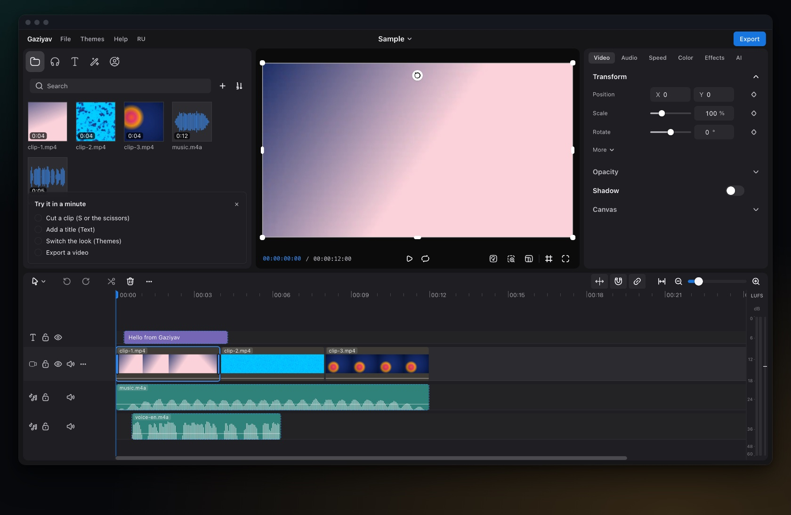

# The browser edition

[← Manual](README.md)

**What it is for.** Gaziyav on any computer that is not a Mac (Windows, Linux, a Chromebook), on a phone or a tablet, or on a Mac where you cannot install anything. There is no Windows build; this is the way to edit on Windows.

**How.** Open `https://gamidaliev03.github.io/gaziyav/editor/`. No install, no account. Your files stay in the browser tab. After the first visit it works offline. When a new version of the site is out, the page loads it by itself; if you are in the middle of editing, a small **A new version is ready — reload** button appears instead.

**What it has.**
- The timeline and its gestures, titles, effects, transitions, filters, [generators](generators.md), looks, import of your own files, and export.
- **Music and sounds:** 311 tracks and 2,514 sounds in the Audio tab (the Mac app has 1,515 and 7,765), and your own files.
- **Captions from speech** and **Remove pauses**. The open Whisper speech model runs in the page. It downloads once from Hugging Face: about 300 MB on a computer, about 140 MB on a phone.
- **AI image, AI video and lipsync (beta) on your own fal.ai key** (the AI tab). The price is shown before anything runs. The key is kept in this browser and sent only to fal.ai.
- **A layout for phones and tablets:** the player, full-width tracks and a bottom bar with **Add · Edit · Text · Audio · Filters · Format**. Each button opens a panel. With a clip selected, **Edit** has quick actions: split, delete, duplicate, speed, reverse, freeze, mute. Undo, play and redo sit above the timeline; **Format** sets 9:16, 4:5, 1:1 or 16:9.
- Auto colour: in the clip's right-click menu, or **More tools** in the timeline toolbar.
- The inspector shows only what works in a browser ([The inspector](inspector.md)).

**Only in the Mac app.** The Claude chat, skills and Gaziyav AI on the connected Claude; the Claude connector; the other on-device AI tools (background removal, voice clean-up, retouch, upscale, stabilise and more); a clip by link; posting; a voice from text; motion graphics; long, heavy exports.

**Good to know.** Projects are kept in this browser's storage, so clearing the site's data deletes them. Export what you want to keep.

The tour as slides is on the same site: `https://gamidaliev03.github.io/gaziyav/tour/`.
