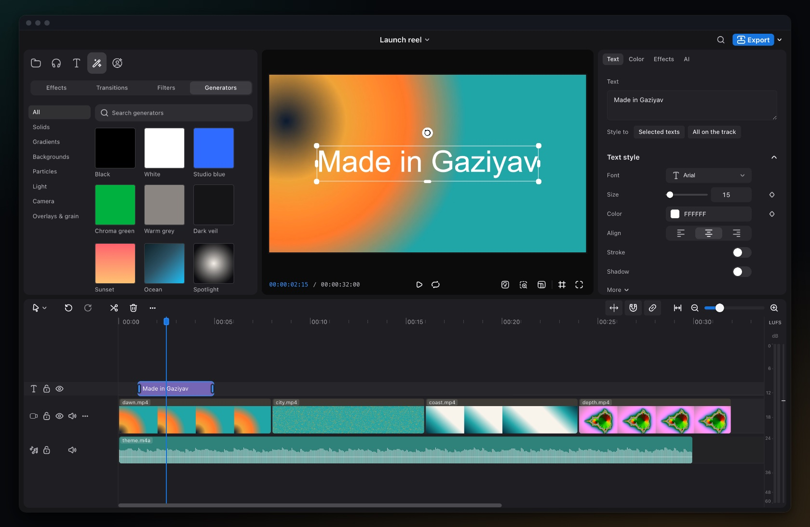
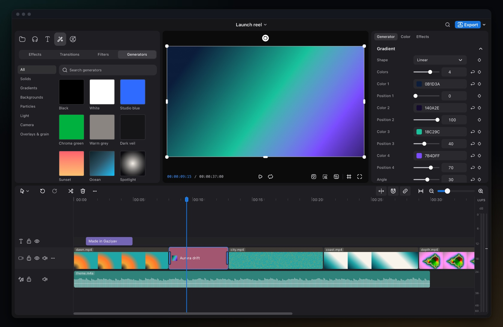

# Generators

[← Manual](README.md)

**What it is for.** A picture made by the editor itself: a colour plate under a title, a moving background, snow or a light leak over your footage, film grain.

**How.**
- Open **Effects → Generators**. The families are down the left: **Solids**, **Gradients**, **Backgrounds**, **Particles**, **Light**, **Camera**, **Overlays & grain**. The search field finds a tile by name.
- Drag a tile onto the timeline, or press its **+** to put it at the playhead. It lands as an ordinary 5-second clip: trim, move and split it like any other.
- Solids, gradients and backgrounds fill the frame and go into the main track, at the cut after the clip under the playhead.
- Particles, light, camera marks and grain lie over the footage: they go on a track above, at the playhead, with a blend mode already set, so the black or grey around them does not show over your picture.
- Select the clip and edit it in the inspector. Its first tab, **Generator**, holds its own values: the colour and opacity of a solid; a gradient's shape, colours and their positions, angle, centre, scale, and its **Motion** (still, drift, rotate, breathe) with its speed. A ready-made background or overlay is a generator with the editor's own effects on it: their strength and settings are in the **Effects** tab, the blend mode under **Opacity → More**.

- Every value can be keyframed, like any other parameter ([Keyframes](keyframes.md)).

**What is in it.** About 460 tiles: solids, 382 named gradients (the open uiGradients palette), moving backgrounds (liquid, silk, glass, kaleidoscope, bokeh, stars, mist, snow, rain, disco, lasers…), overlays (snow, rain, dust, sparkles, fog, light leaks, flashes, VHS noise, film grain, old film, scratches, lens dirt, vignette, cinema bars), and the editor's motion graphics that work as generators (confetti, sparks, hearts, a lens flare, a camera viewfinder, VHS, a film countdown, a CRT frame…).

**Good to know.**
- A generator draws the same frame every time: in the player, in the export and after <kbd>⌘Z</kbd>.
- A tile is a still; it moves only on the timeline.

**Limits.** In the [browser edition](browser.md) the Generators tab has everything except the motion-graphics tiles.
