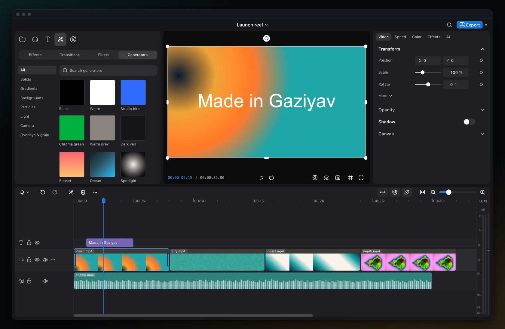
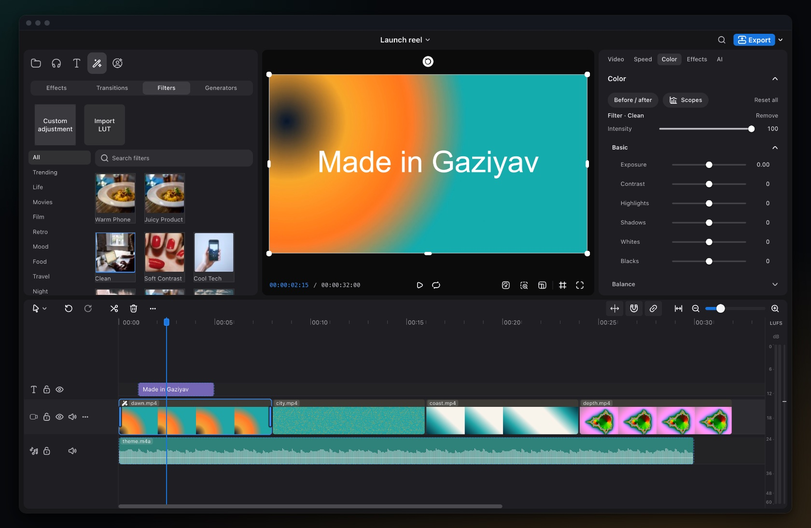

# The inspector

[← Manual](README.md)

**What it is for.** Everything about the selected clip, on the right of the window (<kbd>⌘4</kbd> shows or hides it).

**The tabs.** The same few tabs for every kind of clip; a clip shows only those it has something in.

| Tab | What is in it |
|---|---|
| **Video** · **Photo** · **Text** · **Shape** · **Sticker** · **Generator** · **Audio**… — the clip itself | A title's words and design, a shape, a generator's colours; then Transform, Opacity (the blend mode under its **More**), Shadow, Canvas. For a sound clip: its volume, pan and sound effects. |
| **Audio** | The sound of a video (shown when the clip has sound): volume, pan, clean-up, enhance voice, sound effects, voice changer, separate voice and music. |
| **Speed** | Speed, speed curve, freeze, reverse ([Speed](speed.md)). |
| **Color** | The filter on the clip, the colour correction, auto colour, colour match ([Colour](colour.md)). |
| **Effects** | The effects on the clip, its animation, masks, remove background, chroma key, tracking and follow. |
| **AI** | Lipsync, face swap, upscale, enhance, reduce noise, remove objects, retouch, stabilise, deflicker, make vertical; a voice for a title. |

**How.**
- In every tab one section lies open (Transform, the volume, the speed, the colour correction, the effects); the others are rows — a click opens one, and it stays open.
- The tab you picked stays when you click another clip, if that clip has it.
- <kbd>⌘K</kbd>, the clip's menu and a key such as <kbd>⌥L</kbd> open the right tab on the right section. A filter or an effect picked or dropped on a clip opens the inspector on it.
- A filter applied to a clip is at the top of **Color**: its name, its strength (Intensity), **Remove**.

**Rules that surprise people.**
- A tool applied from the inspector (remove background, auto colour, enhance…) is the clip's effect, not a new file in Media. Its section has a switch: off shows the clip as it was.
- Such a copy that no clip uses any more leaves the project the next time the project is opened ([Settings](settings.md)).

**Limits.** In the [browser edition](browser.md) the inspector lists only what works in a browser: the tools that need the Mac app are not shown there.
