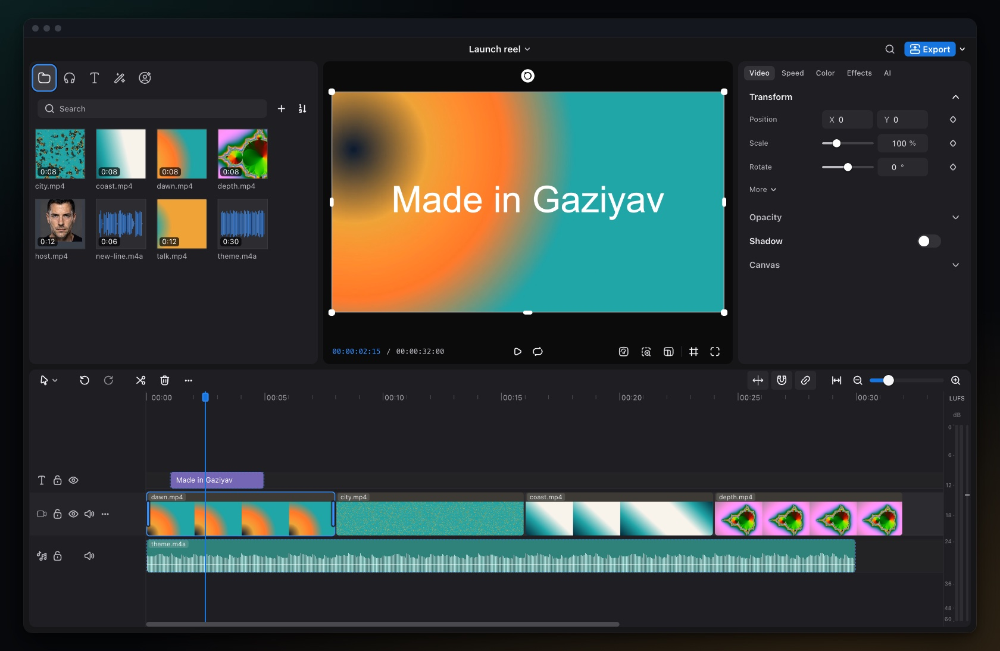

# Import and the Media panel

[← Manual](README.md)

**What it is for.** Media holds everything a project uses — your clips, pictures and sounds, pieces brought in by link, AI pictures and videos, compound clips — in one list.

**How.**
- Import: drag files from Finder onto Media or straight onto the timeline, or <kbd>⌘I</kbd> (Import Media…).
- **+** at the top of Media: **Import files…**, **YouTube link…**, **Web images…**, **AI photo…**, **AI video…** (the last two open the AI tab's generators — an [extra](extras.md) on your own key).
- Place: drag a tile onto the timeline; the drop place is highlighted before you let go. Insert at the playhead: <kbd>⌥W</kbd>.
- Delete: select files in Media and press <kbd>⌫</kbd> or <kbd>Delete</kbd>. A file the timeline uses asks first; <kbd>⌘Z</kbd> brings it back.
- Mark a piece of a file before placing it: hover a tile — the line under the pointer and the source monitor are one playhead — and press <kbd>I</kbd> / <kbd>O</kbd>; the marked piece shows as a band on the tile ([Markers](markers.md)).
- Find: <kbd>⌘F</kbd> searches the current panel.
- Show the source of a clip in Media (Final Cut Pro keymap): <kbd>⇧F</kbd>.
- A clip by link: see [A clip by link](link.md).

**The side panel's tabs.** Media · Audio (your own sounds under «Yours», and Voice — an [extra](extras.md)) · Text (titles and captions) · Effects, Transitions, Filters, Generators · AI (the [extras](extras.md) on your own key).

**Rules that surprise people.**
- A tool applied from the inspector (remove background, auto colour, enhance…) is the clip's effect: its processed copy is not listed in Media ([The inspector](inspector.md)).
- Dropping onto the main track inserts in the magnet's order: the main track never has gaps ([the timeline](timeline.md)). Drop on the left half of a clip and the new one goes before it, on the right half — after it.
- Import several clips into an **empty** project and they all land on the timeline at once, in the order you picked them, with the sounds under them — ready to trim. One <kbd>⌘Z</kbd> takes them off again.

**Limits.** This edition ships no music or sound-effect library and no sticker packs: bring your own music and sounds.
