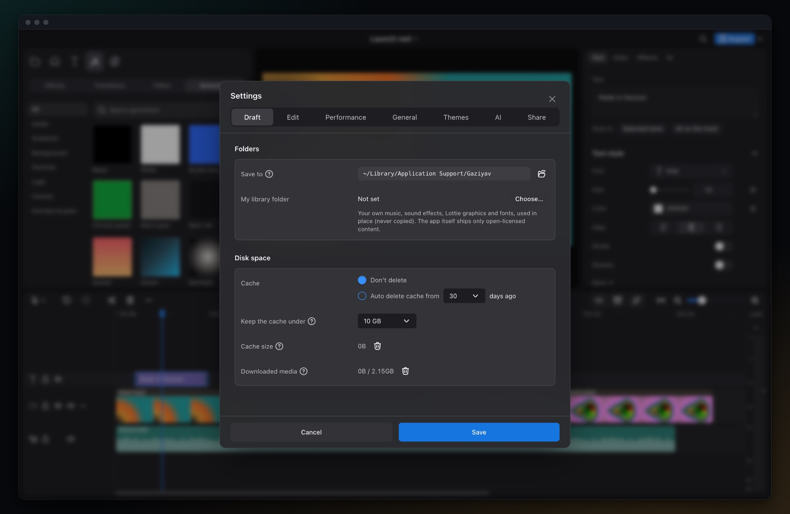

# Settings

[← Manual](README.md)

Open Settings from the app menu (Gaziyav → Settings). The sections:

- **Draft** — where projects are saved (Folders), and **Disk space**: how long to keep the cache, **Keep the cache under** (5, 10, 20 or 50 GB, or No limit; 10 GB by default), the cache size with a button to clear it, downloaded media and the export cache.
- **Edit** — how many frames a big step moves, the default length of a picture, the frame rate, the target loudness, a sound when an export finishes.
- **Performance** — encoding and decoding: «Speed up hardware encoding».
- **General** — language (English, Russian), a notification when an export finishes in the background, trackpad feedback (a light tap when a clip snaps, a guide aligns or a trim reaches its end).
- **Themes** — the [looks](looks.md).
- **AI** — the [free on-device features](ondevice-ai.md), [Claude](claude.md), and the key for [paid AI](extras.md) with your spending limit.
- **Share** — the accounts used by [Post](post.md).

**The cache cleans itself up.** When it passes the size you set, the files used longest ago are deleted; they are made again when needed. A copy made by an on-device tool (remove background, enhance, auto colour…) leaves the project the next time you open it if no clip uses it any more and it is a few days old. Your own files and paid results are never removed this way. Media you delete from a project is deleted from disk when you leave the project; until then, <kbd>⌘Z</kbd> brings it back.

Keys are set in the Shortcuts window (<kbd>⌘/</kbd>): pick the CapCut or Final Cut Pro keymap and rebind any command ([Keys](keys.md)).
