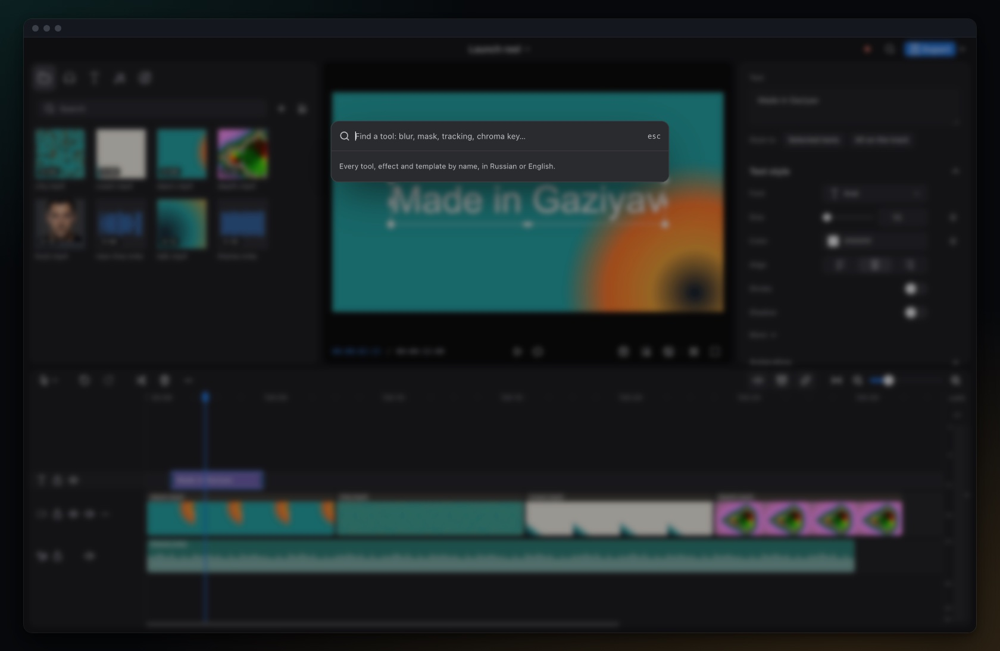
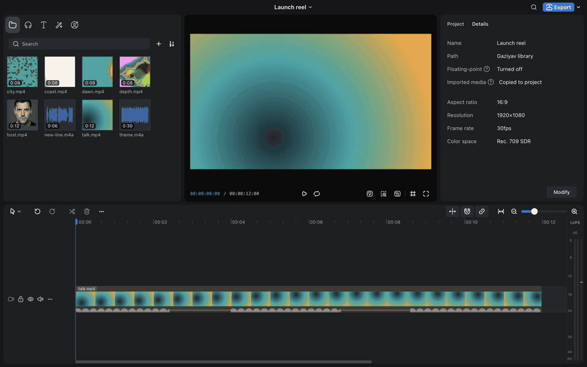
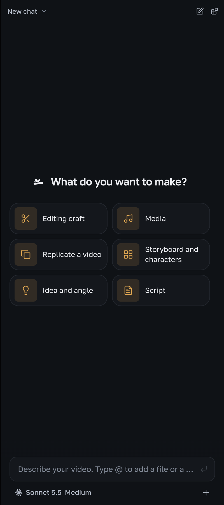
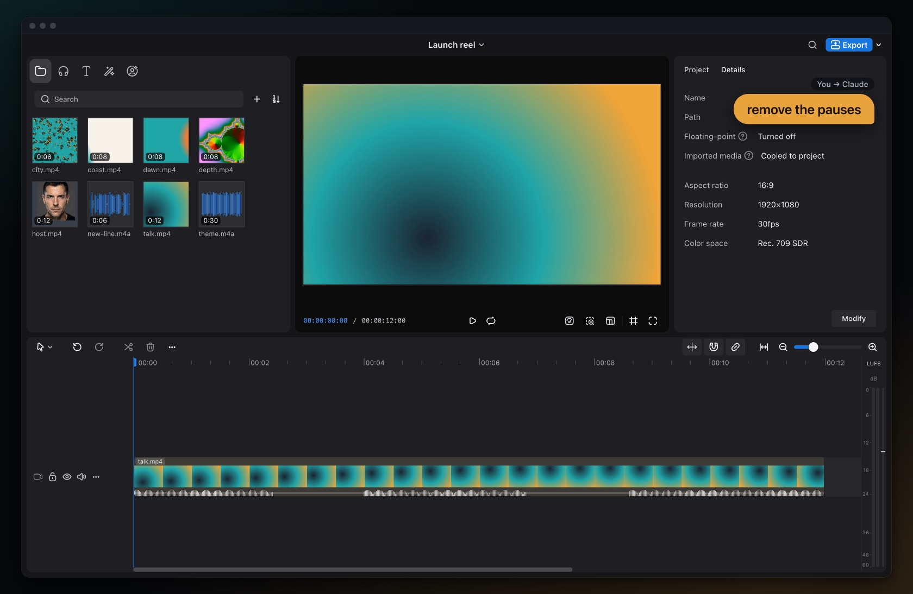
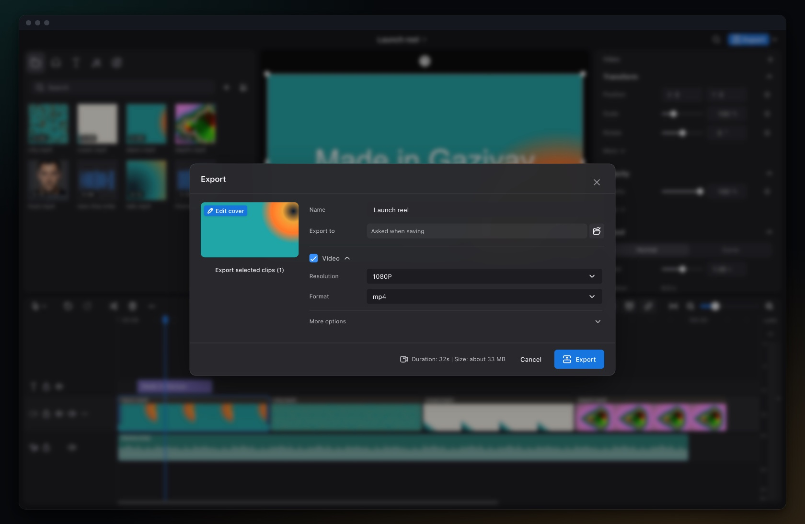
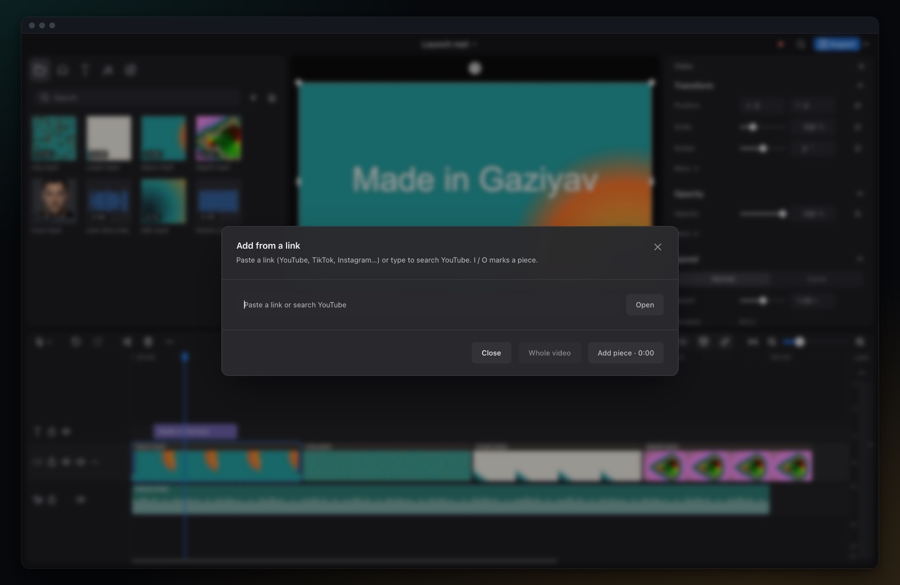
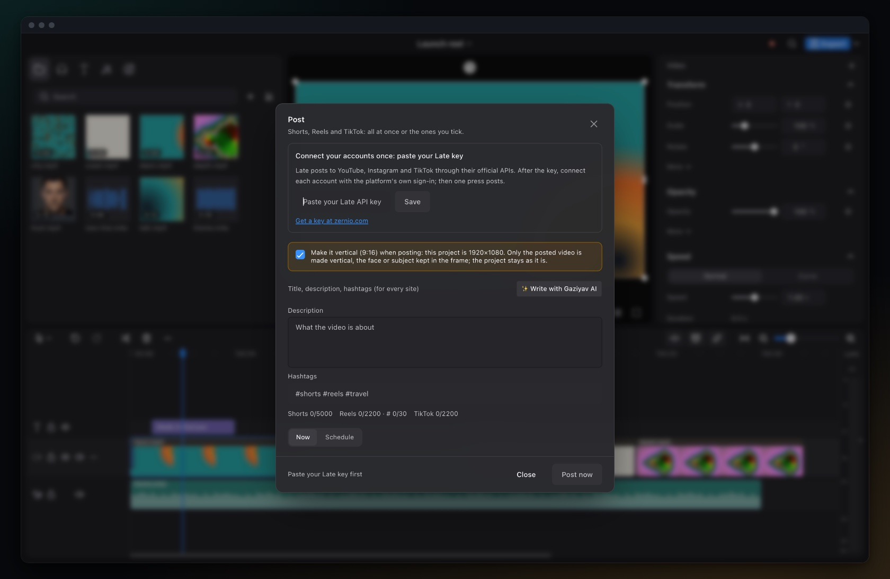

# The Gaziyav tour

**English** · [Русский](../ru/tour.md) · [as slides](../../tour/) · [as a PDF](../../tour/Gaziyav-tour-en.pdf)

Fifteen slides, two minutes. One idea per slide.

---

### 1 · A free video editor with AI inside

- For Reels, TikToks and Shorts shot on a phone. On the Mac and in the browser.
- AI edits **inside** the editor with the editor's own commands; you see every step on the timeline.
- Free, open source (the editor's own code is MIT), no account, no watermark.

---

### 2 · One timeline, one set of rules

- Video, titles, audio, captions, shapes and compound clips all move, trim and copy the same way.
- Drag the body to move, an edge to trim; <kbd>⌥</kbd> copies, <kbd>⇧</kbd> adds, <kbd>Esc</kbd> cancels.
- Magnet <kbd>P</kbd> · snapping <kbd>N</kbd> · linked sound <kbd>`</kbd>.

---

### 3 · Every edit is one undo

- Each change is one history step: <kbd>⌘Z</kbd> brings back the state before it, byte for byte.
- 930 automated runs of every command broke no timeline rule.
- <kbd>⌘K</kbd> finds and runs any command by name; <kbd>⌘/</kbd> lists every key, in CapCut's keymap or Final Cut Pro's.

---

### 4 · Claude edits inside Gaziyav

- Write to Claude in the chat at the right of the editor, for example «remove the pauses». Claude does it in your open project.
- It uses the editor's own operations: cut by words, remove pauses, captions, titles, music levels, export.
- Every step appears on your timeline, and <kbd>⌘Z</kbd> undoes it.

---

### 5 · No credits, no API key

- Gaziyav sells no credits for Claude and asks for no key: the chat runs on your own Claude subscription through Claude Code on your Mac.
- Install Claude Code from [claude.com/download](https://claude.com/download) and sign in, then press **Connect** in the chat (**View → Claude Chat**, <kbd>⌃⌘K</kbd>).
- The **Skills** button lists 10 skills, each with an on/off switch. Prefer the Claude app? **Settings → Services → Claude → Connect Claude**.

---

### 6 · Things to write

- «Captions in a bold style, and a title "Day one" at 0:02.»
- «Make it vertical for Reels and keep it under 30 seconds.»
- «Find the scenes of this film and give me YouTube chapters.»

---

### 7 · Free AI on your Mac

- Captions from speech, pause and filler removal, voice clean-up, voice and music apart, voice changer.
- Remove an object, retouch, remove or blur the background, upscale, deflicker.
- Auto colour, scenes, make vertical, beat markers, tracking. No key, no per-use price.

---

### 8 · Captions that follow the cut

- Captions timed to the word, recognised on your Mac. Edit the words, pick a style.
- Remove pauses: the cuts land inside the silence, and captions and titles move with them.
- One <kbd>⌘Z</kbd> takes the whole pass back.

---

### 9 · Titles, effects, music, sounds

- Title designs, effects, transitions and colour filters: drag onto the timeline or double-click.
- 1,515 music tracks and 7,765 sound effects in the Mac app (311 and 2,514 in the browser); each downloads the first time you use it.
- Keyframes with easing (<kbd>⌥⇧K</kbd>, <kbd>F9</kbd> for easy ease), speed and speed curves, freeze frame <kbd>⌥F</kbd>, reverse.

---

### 10 · Looks

- Ten skins (Pixel, Neon, Comic, Sakura, Rose, Arena, Film, Analog, Terminal, 95) and quiet palettes.
- A look changes the interface, never your picture: the player stays neutral.
- Settings → Themes.

---

### 11 · Export, exact to the frame

- H.264, HEVC, AV1, ProRes, VP9 · MP4, MOV, WebM, GIF · up to 8K · 23.976–60 fps. Free.
- 72 of 72 export cases exact to the frame.
- <kbd>⌘E</kbd>.

---

### 12 · A clip by link

- Paste a YouTube, TikTok or Instagram link in Media, or search YouTube.
- Mark the piece with <kbd>I</kbd> / <kbd>O</kbd>. Only that piece downloads, ready to drag onto the timeline (Claude places it there itself).
- For material you have the right to use. Mac app.

---

### 13 · Post from the editor

- The arrow beside Export → **Post to Shorts, Reels, TikTok…**: YouTube, Instagram or TikTok, through Zernio on your own key or on the platform's own upload page inside the app.
- Or ask in the chat: one message edits, exports and posts, with a title, description and hashtags Claude writes for each site.
- Gaziyav never sees your password. Mac app.

---

### 14 · The browser edition

- For Windows, Linux, a Chromebook, a phone or a tablet. No install, no account; works offline after the first open; on a phone, a layout for a finger.
- Timeline, titles, effects, transitions, generators, the music and sound library, looks, import and export. Captions from speech and pause removal, with the model running in the page. AI image, AI video and lipsync (beta) on your own key.
- Only in the Mac app: the Claude chat and skills, the other on-device AI tools, a clip by link, posting, voice, motion graphics.

---

### 15 · Paid AI on your own key, and where to start

- Optional, never needed to edit: lipsync, voice, pictures and video, face swap on your own fal.ai key, with the price on the button. A line of lipsync costs **20 ¢**; a 3-second sample first, about 2.6 ¢.
- Start: [download for macOS](https://github.com/gamidaliev03/gaziyav/releases/latest) or [open it in your browser](https://gamidaliev03.github.io/gaziyav/editor/).
- Then: [the manual](manual/README.md).
