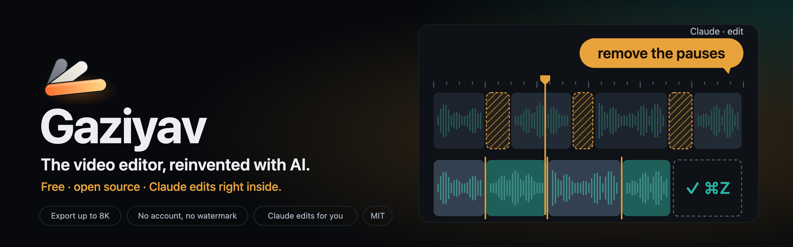
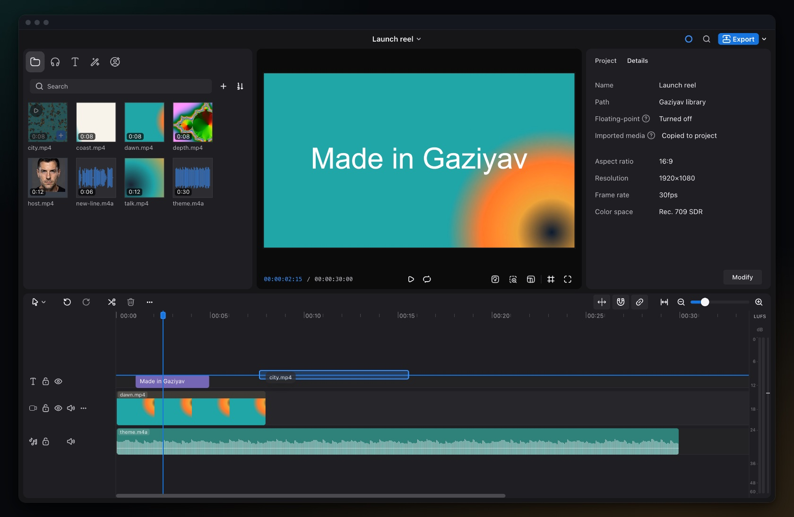
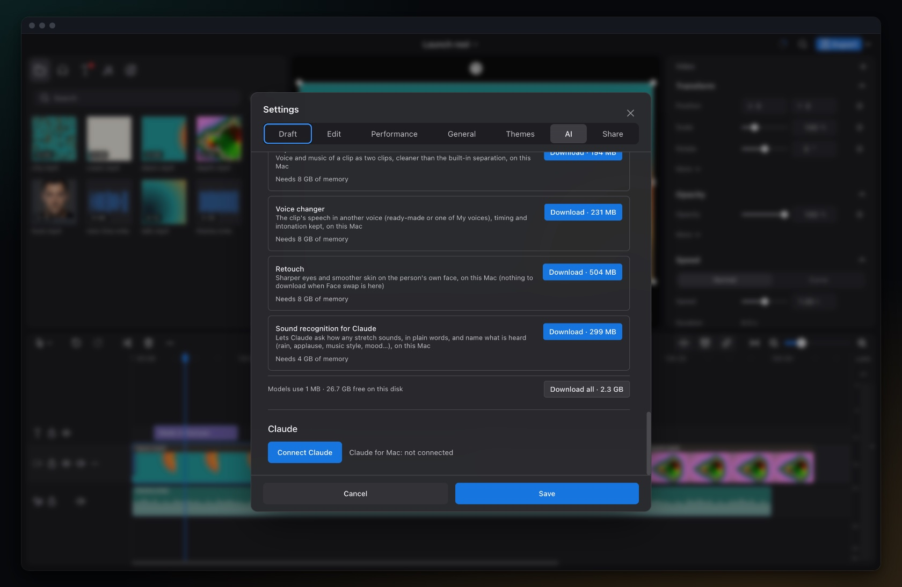
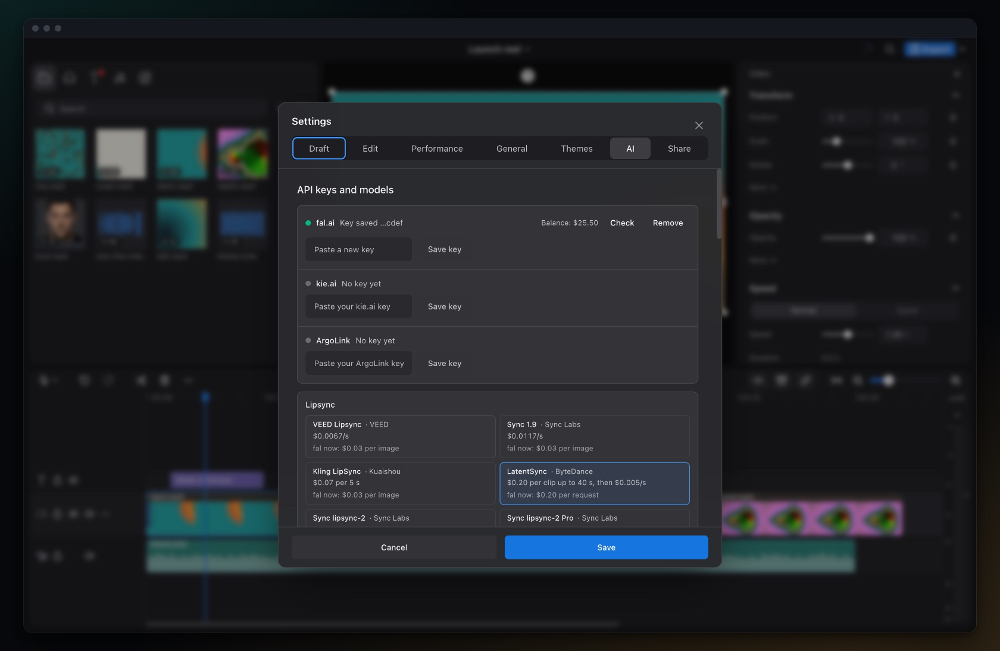
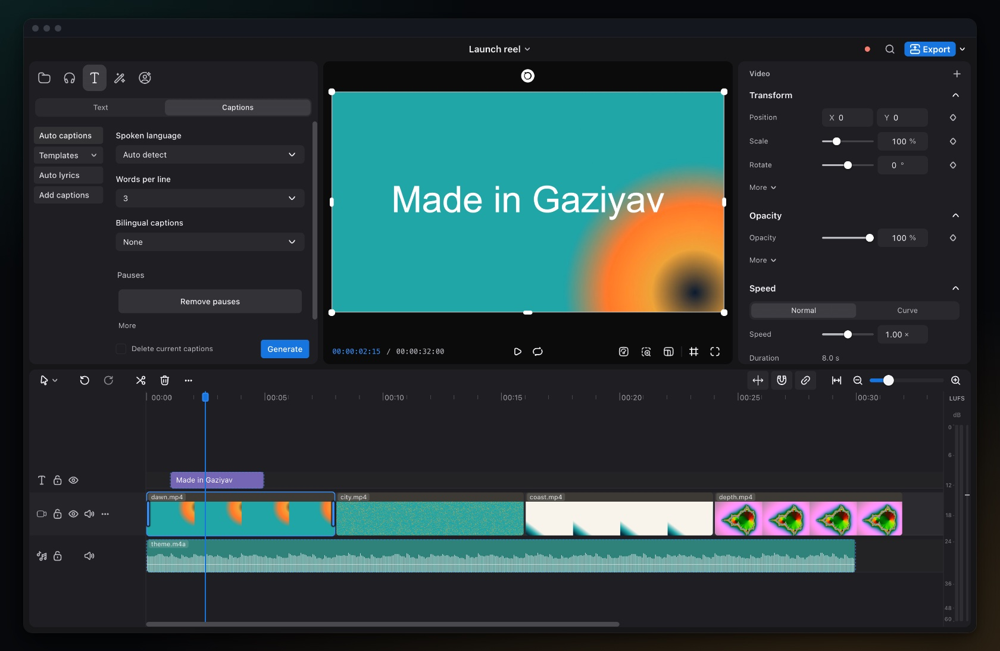
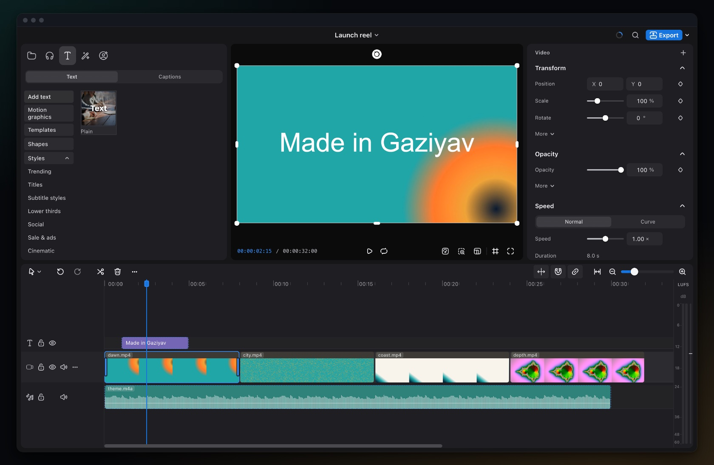
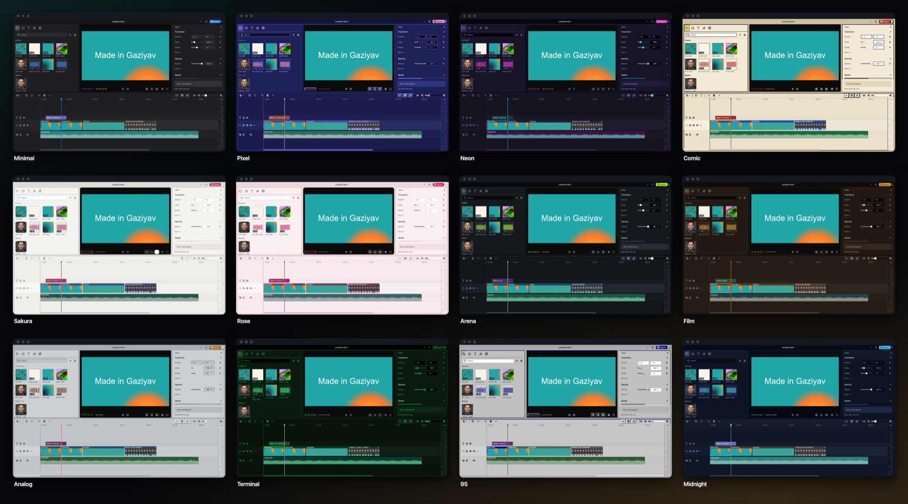
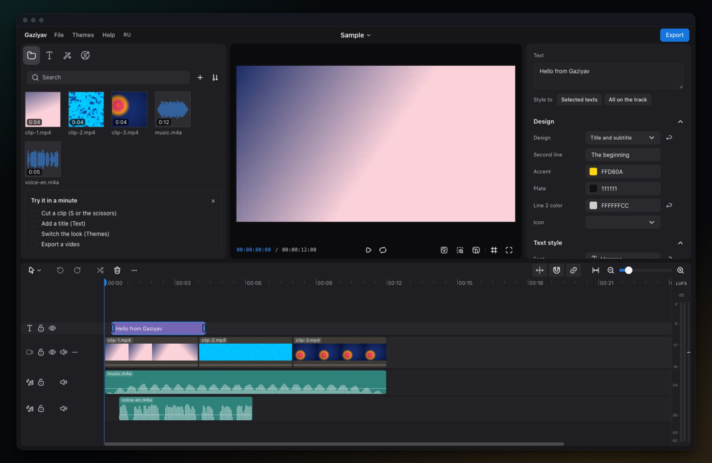
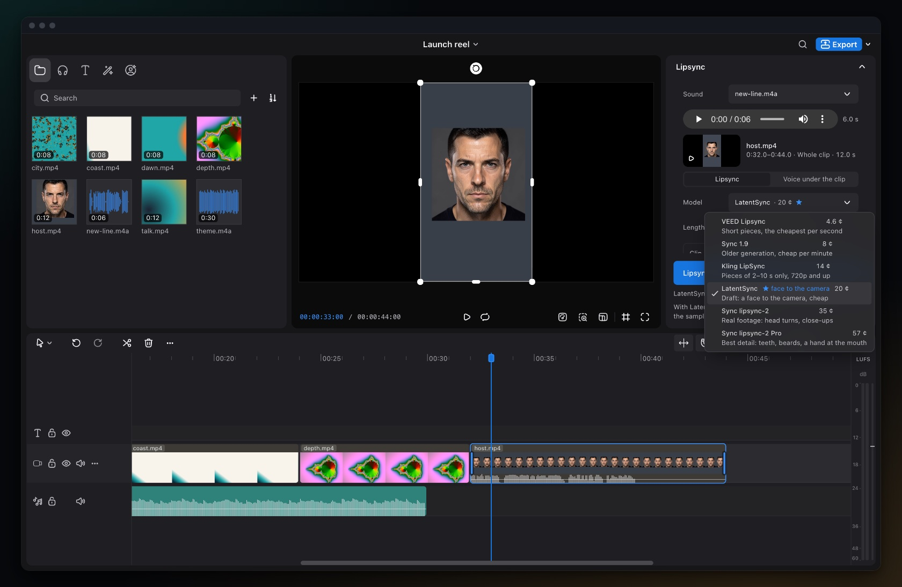

# The Gaziyav tour

**English** · [Русский](../ru/tour.md) · [as slides](../../tour/) · [as a PDF](../../tour/Gaziyav-tour-en.pdf)

Fifteen slides, two minutes. One idea per slide.

---

### 1 · The video editor, reinvented with AI

- We did not reskin an editor: we rethought how one works — the timeline, the undo, the way AI touches your project.
- AI edits **inside** the editor, with its own commands, on the timeline you see.
- Free, open source (the editor's own code is MIT), no account, no watermark.

---

### 2 · One timeline, one grammar

- Video, titles, audio, captions, shapes and compound clips all move, trim and copy the same way.
- Drag the body to move, an edge to trim; <kbd>⌥</kbd> copies, <kbd>⇧</kbd> adds, <kbd>Esc</kbd> cancels.
- Magnet <kbd>P</kbd> · snapping <kbd>N</kbd> · linked sound <kbd>`</kbd>.

---

### 3 · Every edit is one undo

- Each change is exactly one history step: <kbd>⌘Z</kbd> brings back the state before it, byte for byte.
- Checked over 930 automated runs of every command, zero broken timeline rules.
- <kbd>⌘K</kbd> finds and runs every command by name; <kbd>⌘/</kbd> lists every key — CapCut's keymap or Final Cut Pro's.

---

### 4 · Claude edits inside Gaziyav

- Say what you want in Claude: «remove the pauses». Claude does it in your open project.
- It uses the editor's own operations — cut by words, remove pauses, captions, titles, music levels, export.
- Every step lands on the timeline you see and is undone with <kbd>⌘Z</kbd>.

---

### 5 · Free: nothing to buy, no API key

- Gaziyav sells no credits for Claude and asks for no key: the connector is part of the app.
- It attaches to the Claude app you already use — Claude for Mac (desktop extensions are open to all Claude Desktop users) or Claude Code.
- **Settings → AI → Claude → Connect Claude**: one press.

---

### 6 · Things to say

- «Captions in a bold style, and a title "Day one" at 0:02.»
- «Make it vertical for Reels and keep it under 30 seconds.»
- «Find the scenes of this film and give me YouTube chapters.»

---

### 7 · Free AI on your own Mac

- Captions from speech, pause and filler removal, voice clean-up, voice and music apart, voice changer.
- Remove an object, retouch, remove or blur the background, upscale, deflicker.
- Auto colour, scenes, make vertical, beat markers, tracking. No key, no per-use price.

---

### 8 · Captions that follow the cut

- Word-timed captions recognised on your Mac; edit the words, pick a style.
- Remove pauses: cuts land inside the silence; captions and titles follow.
- One <kbd>⌘Z</kbd> takes the whole pass back.

---

### 9 · Titles, effects, transitions, filters

- Title designs, effects, transitions and colour filters — drag onto the timeline or double-click.
- Keyframes with easing on any animated parameter: <kbd>⌥⇧K</kbd>, <kbd>F9</kbd> for easy ease.
- Speed, speed curves, freeze frame <kbd>⌥F</kbd>, reverse.

---

### 10 · Looks

- Ten full skins — Pixel, Neon, Comic, Sakura, Rose, Arena, Film, Analog, Terminal, 95 — and quiet palettes.
- A look changes the interface, never your picture: the player stays neutral.
- Settings → Themes.

---

### 11 · Export, exact to the frame

- H.264, HEVC, AV1, ProRes, VP9 · MP4, MOV, WebM, GIF · up to 8K · 23.976–60 fps — free.
- 72 of 72 export cases exact to the frame.
- <kbd>⌘E</kbd>.

---

### 12 · A clip by link, straight into the edit

- Paste a YouTube, TikTok or Instagram link (or search YouTube) in Media.
- Mark the piece with <kbd>I</kbd> / <kbd>O</kbd>: only that piece downloads, one drag from the timeline (Claude places it there itself).
- For material you have the right to use. Desktop app.

---

### 13 · Post straight from the editor

- The arrow beside Export → **Post to Shorts, Reels, TikTok…**: YouTube, Instagram or TikTok.
- The platform's own upload page opens inside the app; you sign in there.
- Gaziyav never sees your password. Desktop app.

---

### 14 · The browser edition

- For Windows, Linux, a Chromebook — every computer that is not a Mac: the same editor as a page, no install, no account, works offline after the first open.
- Timeline, titles, effects, transitions, looks, local import and export; lipsync in beta on your own key.
- Only in the Mac app: Claude, on-device AI, a clip by link, posting.

---

### 15 · Extras with your own key — and how to start

- Optional, never needed to edit: lipsync, voice, pictures and video, face swap — on your own fal.ai key, the price on the button. A line of lipsync is **20 ¢**, a 3-second sample first about 2.6 ¢.
- Start: [download for macOS](https://github.com/gamidaliev03/gaziyav/releases/latest) or [open it in your browser](https://gamidaliev03.github.io/gaziyav/editor/).
- Then: [the manual](manual/README.md).
