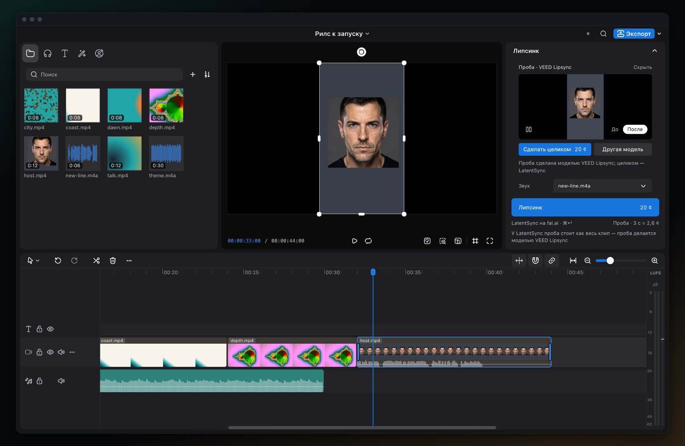

# Липсинк

[English](../en/lipsync.md) · **Русский**

Липсинк — дополнение на вашем ключе: для монтажа он не нужен, но это самый сильный из платных инструментов. Тот же клип, то же лицо, новые слова — в два клика, за центы, без прокруток и диалогов на пути.

Нужен [ключ fal.ai](ai.md) в **Настройки → ИИ**. Всё, что ниже, fal выставляет по своему прайсу; Gaziyav ничего не добавляет.

## Сценарий подкаста

У вас клип гостя, и нужно, чтобы он сказал другое: поправку, призыв подписаться, фразу на другом языке.

1. **Выделите клип** на таймлайне. Нажмите <kbd>⌥L</kbd> — или правый клик по клипу → **«Липсинк…»**, или <kbd>⌘K</kbd> → «липсинк». Липсинк — один из ИИ-инструментов в блоке инструментов инспектора; любой из трёх путей открывает его с курсором в поле текста.
2. **Напишите новые слова.** По умолчанию голос клонируется из самого клипа.
3. **Нажмите <kbd>⌘</kbd><kbd>↵</kbd>** (или кнопку). На кнопке уже написан итог — например, «Озвучить и липсинк ≈ 21 ¢».

Gaziyav озвучивает фразу голосом гостя, отправляет речь в модель липсинка и ставит результат **вместо старой речи клипа**: клип принимает длину голоса, остаток старого дубля срезается, как при обычной подрезке (потяните край или нажмите <kbd>⌘Z</kbd>, чтобы вернуть), а следующие клипы подтягивает магнит. Старые слова после новой фразы не звучат никогда. Всё отменяется одним <kbd>⌘Z</kbd>.

Прогресс живёт на запуске клипа, редактор свободен: пока считается первый клип, запускайте второй. Одновременно идут три клипа, остальные ждут в очереди с указанием места. Оплаченный запуск переживает закрытие приложения — откройте его снова, и результат придёт один раз, без второй оплаты.

### Другие источники звука

- **Звук, который уже лежит под клипом** (записанная фраза, песня): выберите его в **«Звук»**. Длина клипа сохранится.
- **Файл** из «Медиа» или с диска.
- **Сохранённые голоса** — или **«Только голос»**, если нужна одна озвучка без липсинка.

### Куда встаёт результат

| Вариант | Что происходит |
|---|---|
| **Клип по длине голоса** (по умолчанию для новых слов) | Результат встаёт в начало клипа, остаток срезается, следующие клипы смыкаются. |
| **Только кусок, остальное остаётся** | Результат заменяет столько клипа, сколько длится голос; остаток оригинала идёт следом. |
| **Весь клип** | Отправляется весь клип; после речи — тишина. |
| **Над клипом** | Результат ложится на дорожку выше, клип под ним на это время глушится. |

Если голос длиннее клипа, видео по умолчанию идёт вперёд-назад (без скачка) — или по кругу, или замирает на последнем кадре. Последний выбор запоминается.

## Сначала проба, потом дубли

- **Проба на 3 секунды.** Рядом с кнопкой запуска — **«Проба · 3 с»** (примерно **2,6 ¢**): три секунды настоящего лица с липсинком играют прямо в панели, «до» и «после». На таймлайн ничего не ложится. Нравится — **«Сделать целиком»**, нет — **«Другая модель»**. Если у выбранной модели цена за весь клип (LatentSync), пробу делает VEED Lipsync, и панель так и пишет.
- **Список моделей с ценами.** Строка модели раскрывает список: у каждой модели — её цена для этого клипа, звёздочка — у той, что подходит к кадру (лицо в камеру, профиль, рука у рта…); модель, которой клип не подходит, серая и с причиной.
- **Дубли на клипе.** Каждый результат — дубль того же клипа, а не новый клип: <kbd>⇧⌥L</kbd> (или меню клипа) переключает оригинал и дубль с липсинком на месте, одно <kbd>⌘Z</kbd>. **«Ещё дубль»** под результатом делает следующий по той же цене.
- **Губы устарели.** Если потом поменять звук под клипом, на клипе появится янтарная метка: губы больше не совпадают — и кнопка **«Переделать»** с ценой. <kbd>⌘Z</kbd> смены звука убирает метку сама.
- **Ход работы на клипе.** Идущий липсинк виден прямо на клипе; × на клипе останавливает его; ошибка — «!» там же, одно предложение и **«Повторить»**.
- **Нет звука — нет кнопки.** Если слова не вписаны и под клипом нет звука, кнопка серая и пишет почему — заплатить за пустоту нельзя.

## Сколько стоит

Модель по умолчанию — **LatentSync** (ByteDance): **0,20 $ за запуск до 40 секунд, дальше 0,005 $ за секунду.**

| Пример | Запросов | Цена |
|---|---|---|
| Реплика на 2, 7 или 24 с | 1 | 20 ¢ |
| Реплика на 45 с | 1 | 23 ¢ |
| Реплика на 70 с | 1 | 36 ¢ |
| Клип на 3 минуты, из них 64 % тишины | 3 | 60 ¢ (целиком было бы 90,5 ¢) |

Плюс голос: речь Qwen3 — 0,09 $ за 1000 символов (предложение ≈ полцента) и клон — 0,0008 $ за минуту образца, один раз.

**Почему дёшево:** Gaziyav находит места, где человек действительно говорит, отправляет только их (с запасом в четверть секунды) и никогда не отправляет тишину. Куски режутся по вашим склейкам и никогда не идут через них. Для моделей с ценой за клип короткие куски упаковываются в один запрос. Цена на кнопке — это план сервера ровно на то, что уйдёт, поэтому на кнопке и в счёте одно и то же число.

**Порог расходов:** **Настройки → ИИ**, «Спрашивать, если дороже [1] $». Ниже порога согласием служит сама кнопка, выше — одно подтверждение.

### Модели посильнее, ключ тот же

| Модель | Цена | Для чего |
|---|---|---|
| LatentSync | 0,20 $ за запуск до 40 с | черновики, лицо анфас |
| VEED Lipsync | 0,40 $/мин | короткие куски |
| Sync 1.9 | 0,70 $/мин | прошлое поколение, дёшево за минуту |
| Sync lipsync‑2 | 3 $/мин | живые съёмки, повороты головы, крупные планы |
| Sync lipsync‑2 Pro | 5 $/мин | детали: зубы, борода, рука у рта |
| Kling LipSync | 0,07 $ за 5 с | только куски по 2–10 с |

У каждой модели в панели — цена именно для этого клипа; модель, которая не возьмёт такую длину, выключена.

## Что уходит с компьютера

Только по нажатию кнопки и только это:

- **участки с речью из обрезанного клипа** — видеофайлом, который здесь же перекодируется в H.264 SDR (BT.709) в высоком качестве; никогда не весь проект и никогда не места, где никто не говорит;
- **звук**, за которым должны идти губы;
- для клона — **образец голоса** из клипа.

Всё это уходит в **fal.ai** (в его хранилище, затем в модель). Из ответа берётся только **область лица**: Gaziyav вклеивает рот из ответа в ваши исходные кадры, а вся остальная картинка остаётся вашими исходными пикселями.  Сколько fal хранит файлы, решают его собственные условия.

Ни водяного знака, ни пометки «сделано ИИ» на результат не ставится.

## Если что-то пошло не так

- **Нет ключа / нет денег на fal / таймаут:** на запуске одна фраза о том, что случилось; ничего не потеряно, **«Повторить»** запускает заново на том же месте. Упавший кусок длинного клипа один раз перезапускается сам.
- **В кадре несколько лиц:** пока модель выбирает сама; выбор лица на картинке — в [планах](../../README.ru.md#что-дальше).
- **Губы выглядят не так:** попробуйте модель посильнее из списка (её цена видна) — Sync lipsync‑2 лучше справляется с поворотами головы и крупными планами.

## Что дальше

Выбор лица, когда их в кадре несколько, несколько спикеров со своими голосами, песни с отделённым вокалом. См. [планы](../../README.ru.md#что-дальше).
