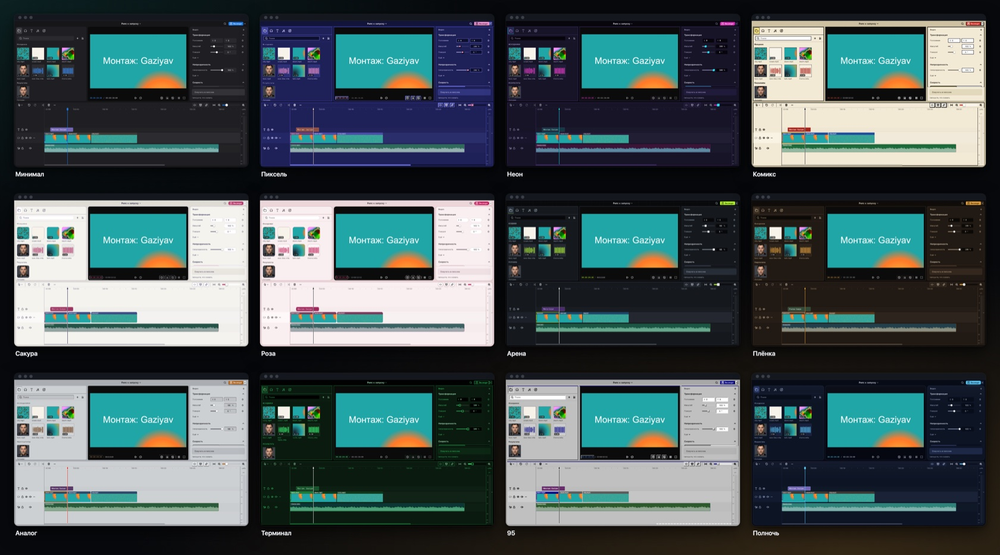

# Темы оформления

[English](../en/looks.md) · **Русский**

**Настройки → Темы.** Выберите тему — и весь интерфейс меняется сразу, без перезапуска.

## Что такое тема — и чего она не трогает

Тема — это полная шкура: поверхности, тонкие линии, тени, скругления, шрифты заголовков и цифр, стиль иконок, кнопки и ползунки, тела клипов и курсор на таймлайне, то, как идёт прогресс и как появляется меню.

Она **никогда** не меняет раскладку, размеры, зоны нажатия, клавиши и поведение — руки ничего не переучивают. И никогда не красит вашу картинку:

- обрамление плеера и все миниатюры нейтральны в любой теме, поэтому цвет везде оценивается одинаково;
- в покое ничего не двигается и не мигает; эффекты темы появляются только в ответ на ваше действие, и ни одно движение не длится дольше 320 мс; при включённом **«Уменьшении движения»** остаются простые растворения;
- имена клипов, таймкод и значения сохраняют контраст в любой теме;
- тема ничего не стоит во время монтажа: на таймлайне нет ни размытий, ни фильтров.

## Шкуры

| Тема | Характер |
|---|---|
| **95** | Серые кнопки, жёсткие фаски, тёмно-синие заголовки окон, ни размытия, ни теней, ни градиентов — всё мгновенно. Самая лёгкая в отрисовке: тема для старых Mac. |
| **Терминал** | Зелёный люминофор на чёрном, моноширинные заголовки и цифры, едва заметные строки развёртки по краю, появление «прокруткой луча». |
| **Пиксель** | 8 бит и мило: пастель на тёмно-синем, квадратные углы, жёсткие края в 2 пикселя, ступенчатые тени и ступенчатое движение. |
| **Неон** | Киберпанк: почти чёрный, пурпурный свет загорается только на фокусе и на выбранном — и никогда рядом с картинкой. |
| **Комикс** | Тушь, плоский цвет, растр, быстрый щелчок. |
| **Сакура** | Мягкая бумага, индиго, один цвет сакуры. |
| **Роза** | Розовый кварц и графит, кнопки-капсулы, мягкая пружина. |
| **Арена** | Для геймеров: графит, один яркий акцент, острые углы. |
| **Плёнка** | Винтажное кино: тёплый чёрный, кремовый, янтарь ламп. |
| **Аналог** | Студийная техника: выпуклые клавиши, утопленные поля, янтарная лампа. |

## Палитры

**Минимал** (по умолчанию), **Жидкое стекло**, **Матовое стекло**, **Строгая**, **Полночь** (настоящий чёрный для OLED и ночной работы), **Песок**, **Высокий контраст** — светлые и тёмные, где это имеет смысл, и с вашим акцентным цветом.
