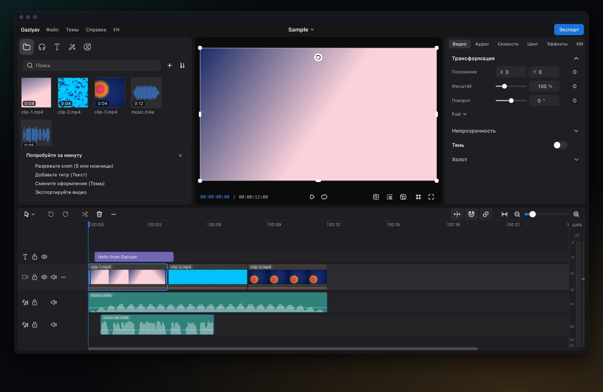

# Версия для браузера

[← Руководство](README.md)

**Для чего.** Gaziyav на любом компьютере, кроме Mac, — Windows, Linux, Chromebook, — на телефоне и планшете или на Mac, куда ничего нельзя поставить.

**Как.** Откройте `https://gamidaliev03.github.io/gaziyav/editor/`. Без установки, без аккаунта, без сервера: работает на вашем железе, файлы не покидают вкладку, после первого открытия — и без интернета. Когда на сайте выходит новая версия, страница подхватывает её сама; если вы уже монтируете, вместо этого появляется маленькая кнопка **«Вышла новая версия — обновить»**.

**Что есть.**
- Таймлайн и его грамматика, титры, эффекты, переходы, фильтры, [генераторы](generators.md), темы, импорт своих файлов и экспорт.
- **Звуки:** собственный набор звуков сайта («Аудио» → «Звуковые эффекты») и ваши звуки.
- **Субтитры из речи** и **«Удалить паузы»**. Открытая модель речи Whisper работает прямо на странице: она скачивается один раз с Hugging Face (около 300 МБ на компьютере, около 140 МБ на телефоне), а звук не покидает вкладку.
- **ИИ-картинка, ИИ-видео и липсинк (бета) на вашем ключе fal.ai** (вкладка «ИИ»): цена видна до запуска; ключ хранится только в этом браузере и уходит только в fal.ai.
- **Раскладка для телефона и планшета:** плеер, дорожки во всю ширину и нижняя панель — **«Добавить» · «Монтаж» · «Текст» · «Аудио» · «Фильтры» · «Формат»**. Каждая кнопка открывает лист; когда клип выделен, в **«Монтаже»** — быстрые действия (разрезать, удалить, дублировать, скорость, задом наперёд, стоп-кадр, без звука). «Отменить», воспроизведение и «Повторить» — над таймлайном; **«Формат»** ставит 9:16, 4:5, 1:1 или 16:9.
- Автоцвет: в меню клипа по правому щелчку или в **«Ещё инструменты»** на панели таймлайна.
- Инспектор показывает только то, что работает в браузере ([Инспектор](inspector.md)).

**Только в приложении для Mac.** Claude в Gaziyav; остальные инструменты ИИ на устройстве (удаление фона, очистка голоса, ретушь, увеличение, стабилизация и другое); клип по ссылке; публикация; голос из текста; моушн-графика; длинный тяжёлый экспорт.

**Что удивляет.** Проекты хранятся в памяти этого браузера: очистка данных сайта стирает их. Экспортируйте то, что хотите сохранить.

Экскурсия слайдами — на том же сайте: `https://gamidaliev03.github.io/gaziyav/tour/`.
