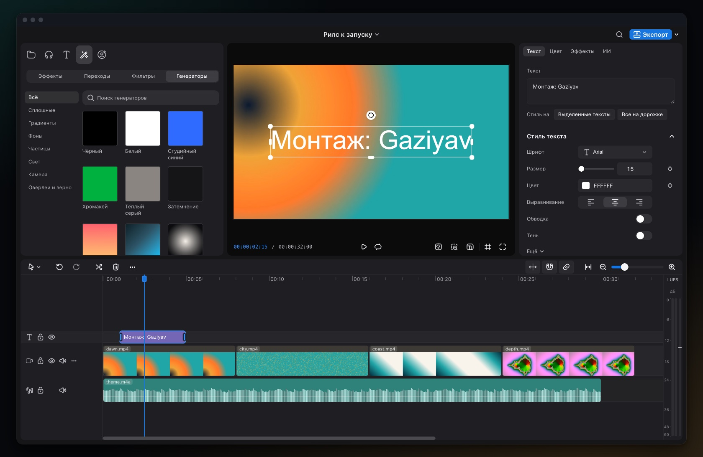
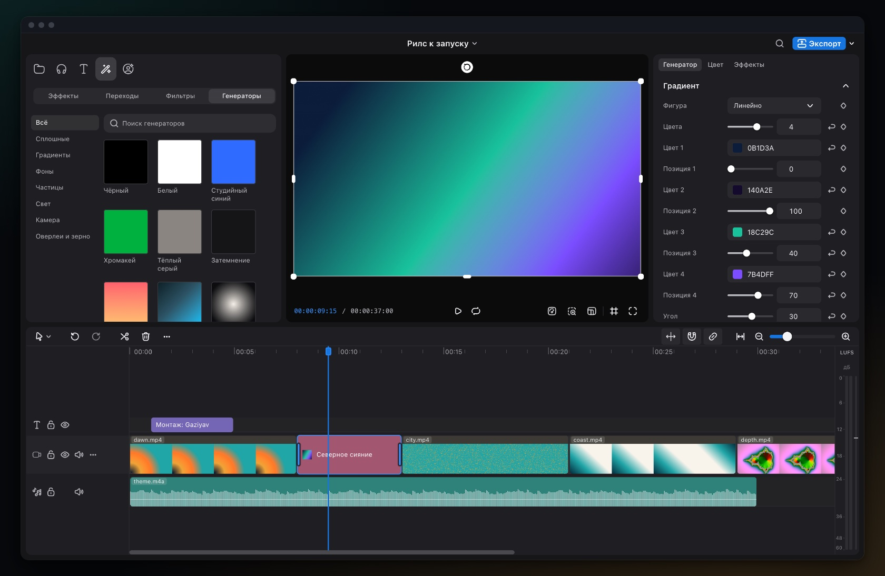

# Генераторы

[← Руководство](README.md)

**Для чего.** Картинка, которую рисует сам редактор: цветная подложка под титр, движущийся фон, снег или засветка поверх видео, плёночное зерно.

**Как.**
- Откройте **«Эффекты» → «Генераторы»**. Слева — семейства: **«Сплошные»**, **«Градиенты»**, **«Фоны»**, **«Частицы»**, **«Свет»**, **«Камера»**, **«Оверлеи и зерно»**. Поле поиска находит плитку по названию.
- Перетащите плитку на таймлайн или нажмите её **+** — она встанет у курсора. На таймлайн ложится обычный клип длиной 5 секунд: его можно подрезать, двигать и разрезать, как любой другой.
- Сплошные, градиенты и фоны заполняют весь кадр и встают на основную дорожку, на стык после клипа под курсором.
- Частицы, свет, метки камеры и зерно ложатся поверх видео — на дорожку выше, у курсора. Режим наложения у них уже выставлен, поэтому чёрный или серый фон вокруг не виден поверх вашего кадра.
- Выделите клип и правьте его в инспекторе. На первой вкладке, **«Генератор»**, — его собственные значения: цвет и непрозрачность сплошного; у градиента — фигура, цвета и их позиции, угол, центр, масштаб и **«Движение»** (статичный, дрейф, поворот, дыхание) со скоростью. Готовый фон или наложение — это генератор с эффектами редактора: их сила и настройки — на вкладке **«Эффекты»**, режим наложения — в **«Непрозрачность» → «Ещё»**.

- Любое значение можно анимировать ключевыми кадрами, как и другие параметры ([Ключевые кадры](keyframes.md)).

**Что там есть.** Около 460 плиток: сплошные цвета, 382 градиента с названиями (открытая палитра uiGradients), движущиеся фоны (жидкость, шёлк, стекло, калейдоскоп, боке, звёзды, дымка, снег, дождь, диско, лазеры…), наложения (снег, дождь, пыль, блёстки, туман, засветки, вспышки, шум VHS, плёночное зерно, старая плёнка, царапины, грязь на объективе, виньетка, кинополосы) и моушн-графика редактора, которая работает как генератор (конфетти, искры, сердечки, блик объектива, видоискатель камеры, VHS, отсчёт плёнки, рамка кинескопа…).

**Полезно знать.**
- Генератор всегда рисует один и тот же кадр: в плеере, в экспорте и после <kbd>⌘Z</kbd>.
- Плитка — неподвижная картинка; движется генератор только на таймлайне.

**Ограничения.** В [версии для браузера](browser.md) на вкладке «Генераторы» есть всё, кроме плиток моушн-графики.
