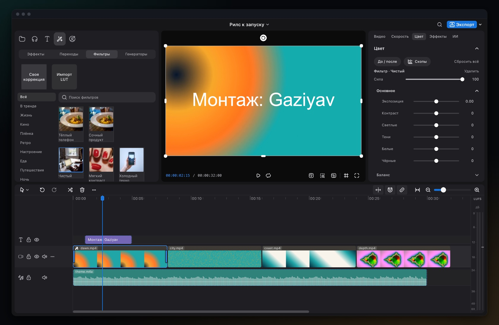

# Инспектор

[← Руководство](README.md)

**Для чего.** Всё о выделенном клипе — справа в окне (<kbd>⌘4</kbd> показывает и прячет его).

**Вкладки.** У любого клипа одни и те же несколько вкладок; видны только те, в которых у клипа что-то есть.

| Вкладка | Что в ней |
|---|---|
| **«Видео»** · **«Фото»** · **«Текст»** · **«Фигура»** · **«Стикер»** · **«Генератор»** · **«Аудио»**… — сам клип | Слова и оформление титра, фигура, цвета генератора; дальше «Трансформация», «Непрозрачность» (режим наложения — в её «Ещё»), «Тень», «Холст». У аудиоклипа — его громкость, панорама и звуковые эффекты. |
| **«Аудио»** | Звук видеоклипа (если в клипе есть звук): громкость, панорама, очистка, улучшение голоса, звуковые эффекты, смена голоса, разделение голоса и музыки. |
| **«Скорость»** | Скорость, кривая скорости, стоп-кадр, задом наперёд ([Скорость](speed.md)). |
| **«Цвет»** | Фильтр на клипе, цветокоррекция, автоцвет, подбор цвета ([Цвет](colour.md)). |
| **«Эффекты»** | Эффекты на клипе, его анимация, маски, удаление фона, хромакей, трекинг и слежение. |
| **«ИИ»** | Липсинк, замена лица, увеличение, улучшение, шумоподавление, удаление предметов, ретушь, стабилизация, удаление мерцания, вертикальный кадр; голос для титра. |

**Как.**
- На каждой вкладке раскрыта одна секция («Трансформация», громкость, скорость, цветокоррекция, эффекты), остальные — строками: щелчок раскрывает строку, и она остаётся раскрытой.
- Выбранная вкладка сохраняется, когда вы щёлкаете другой клип, — если она у него есть.
- <kbd>⌘K</kbd>, меню клипа и клавиши вроде <kbd>⌥L</kbd> открывают нужную вкладку на нужной секции. Фильтр или эффект, выбранный или брошенный на клип, открывает инспектор на нём.
- Фильтр на клипе — вверху вкладки **«Цвет»**: его название, сила, **«Удалить»**.

**Что удивляет.**
- Инструмент, применённый из инспектора (удаление фона, автоцвет, улучшение…), — эффект клипа, а не новый файл в «Медиа». В его секции есть переключатель: выключенный показывает клип таким, каким он был.
- Такая копия, которой больше не пользуется ни один клип, уходит из проекта при следующем его открытии ([Настройки](settings.md)).

**Ограничения.** В [версии для браузера](browser.md) инспектор показывает только то, что работает в браузере: инструменты, которым нужно приложение для Mac, там не показаны.
