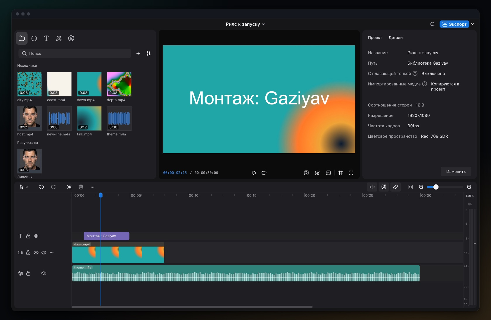

# Импорт и панель «Медиа»

[← Руководство](README.md)

**Для чего.** «Медиа» — один список всего, что есть в проекте: ваши клипы, картинки и звуки, куски по ссылке, ИИ-картинки и ИИ-видео, составные клипы.

**Как.**
- Импорт: перетащите файлы из Finder в «Медиа» или сразу на таймлайн либо нажмите <kbd>⌘I</kbd> («Импортировать медиа…»).
- **+** вверху «Медиа»: **«Импортировать файлы…»**, **«Ссылка YouTube…»**, **«Картинки из интернета…»**, **«ИИ-фото…»**, **«ИИ-видео…»**. Последние два открывают вкладку «ИИ» ([платно, на вашем ключе](extras.md)).
- На таймлайн: перетащите плитку. Место вставки подсвечивается до того, как вы её отпустите. Вставить у курсора: <kbd>⌥W</kbd>.
- Удалить: выделите файлы в «Медиа» и нажмите <kbd>⌫</kbd> или <kbd>Delete</kbd>. Если файл стоит на таймлайне, Gaziyav сначала спросит. <kbd>⌘Z</kbd> вернёт его.
- Отметить отрезок файла до того, как класть его на таймлайн: наведите указатель на плитку и нажмите <kbd>I</kbd> / <kbd>O</kbd>. Отметка встаёт там, где полоска под указателем; у полоски и монитора источника один курсор. Отрезок виден на плитке полосой ([Маркеры](markers.md)).
- Найти: <kbd>⌘F</kbd> ищет в текущей панели.
- Показать исходник клипа в «Медиа» (раскладка Final Cut Pro): <kbd>⇧F</kbd>.
- Клип по ссылке — см. [Клип по ссылке](link.md).

**Вкладки боковой панели.** Медиа · Аудио (библиотека музыки и звуков, ваши звуки в «Ваше» и «Голос» — [платно](extras.md)) · Текст (титры и субтитры) · Эффекты, переходы, фильтры, генераторы · ИИ ([платно, на вашем ключе](extras.md)).

**Полезно знать.**
- Инструмент, применённый из инспектора (удаление фона, автоцвет, улучшение…), — это эффект клипа. Обработанная копия в «Медиа» не появляется ([Инспектор](inspector.md)).
- Клип, брошенный на основную дорожку, встаёт по правилам магнита: на основной дорожке не бывает промежутков ([Таймлайн](timeline.md)). Бросили на левую половину клипа — новый встанет перед ним, на правую — после него.
- Импортируйте несколько клипов в **пустой** проект — и они сразу лягут на таймлайн в том порядке, в каком вы их выбрали, а их звук — под ними. Одно <kbd>⌘Z</kbd> убирает их все.
- О библиотеке музыки и звуков — в разделе [Звук](sound.md).
