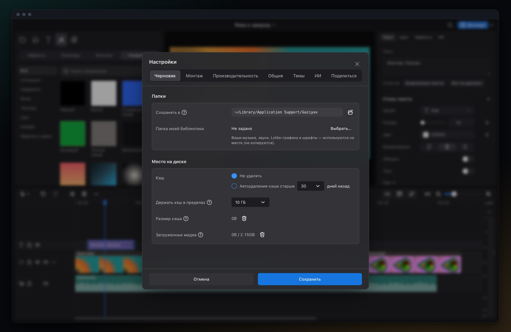

# Настройки

[← Руководство](README.md)

Настройки открываются из меню приложения (Gaziyav → Настройки). Разделы:

- **«Черновик»** — куда сохраняются проекты («Папки»), и **«Место на диске»**: сколько хранить кэш, **«Держать кэш в пределах»** (5, 10, 20 или 50 ГБ либо «Без ограничения»; сначала стоит 10 ГБ), размер кэша с кнопкой очистки, загруженные медиа и кэш экспорта.
- **«Монтаж»** — на сколько кадров ходит большой шаг, длительность картинки по умолчанию, частота кадров, целевая громкость, звук по окончании экспорта.
- **«Производительность»** — кодирование и декодирование: «Ускорить аппаратное кодирование».
- **«Общие»** — язык (русский, английский), уведомление, когда экспорт закончился в фоне, отклик трекпада (лёгкий щелчок, когда клип привязывается, направляющая совпадает или подрезка упирается в конец).
- **«Темы»** — [оформление](looks.md).
- **«ИИ»** — [бесплатные функции на устройстве](ondevice-ai.md), [Claude](claude.md) и ключи для [дополнений](extras.md) с вашим лимитом трат.
- **«Поделиться»** — аккаунты для [публикации](post.md).

**Кэш следит за собой сам.** Когда он превышает заданный размер, самое давнее удаляется и освобождает место новому; нужное создаётся заново. Копия, которую сделал инструмент на устройстве (удаление фона, улучшение, автоцвет…) и которой больше не пользуется ни один клип, уходит из проекта при следующем его открытии — если ей уже несколько дней; ваши собственные файлы и платные результаты так никогда не удаляются. Медиа, удалённые из проекта, стираются с диска, когда вы выходите из проекта; до этого <kbd>⌘Z</kbd> возвращает их.

Клавиши настраиваются в окне сочетаний (<kbd>⌘/</kbd>): раскладка CapCut или Final Cut Pro, любую команду можно переназначить ([Клавиши](keys.md)).
