# Экскурсия по Gaziyav

[English](../en/tour.md) · **Русский** · [слайдами](../../tour/) · [в PDF](../../tour/Gaziyav-tour-ru.pdf)

Пятнадцать слайдов, две минуты. Одна мысль на слайд.

---

### 1 · Монтажка, переизобретённая с ИИ

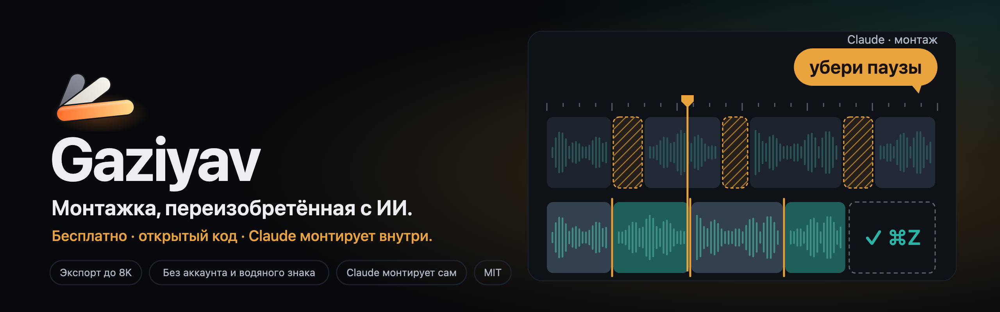

- Мы не перекрасили чужой редактор, а заново продумали, как он работает: таймлайн, отмену, то, как ИИ трогает ваш проект.
- ИИ монтирует **внутри** редактора, его же командами, на том таймлайне, который вы видите.
- Бесплатно, открытый код (собственный код редактора — MIT), без аккаунта, без водяного знака.

---

### 2 · Один таймлайн, одна грамматика

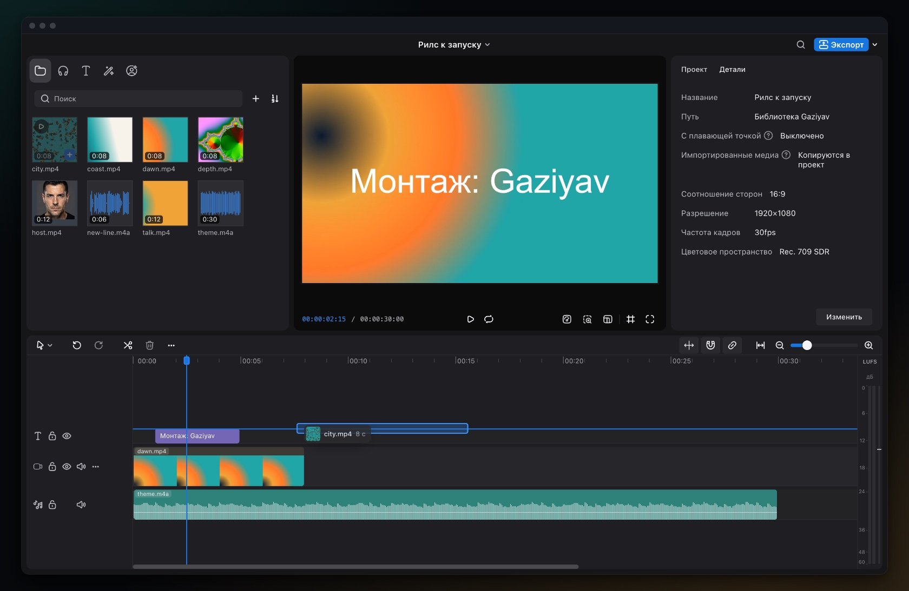

- Видео, титры, звук, субтитры, фигуры и составные клипы двигаются, обрезаются и копируются одинаково.
- Тянете тело — двигаете, край — обрезаете; <kbd>⌥</kbd> копирует, <kbd>⇧</kbd> добавляет, <kbd>Esc</kbd> отменяет.
- Магнит <kbd>P</kbd> · прилипание <kbd>N</kbd> · связка со звуком <kbd>`</kbd>.

---

### 3 · Любая правка — один шаг отмены

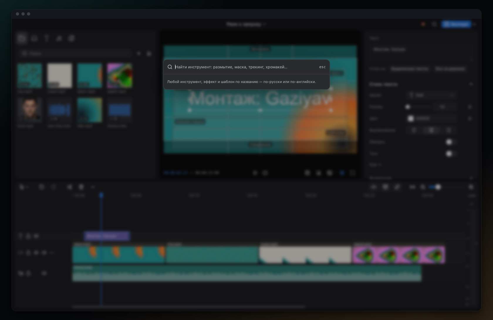

- Каждое изменение — ровно один шаг истории: <kbd>⌘Z</kbd> возвращает состояние до него байт в байт.
- Проверено в 930 автоматических прогонах всех команд, ни одно правило таймлайна не нарушено.
- <kbd>⌘K</kbd> находит и запускает любую команду по названию; <kbd>⌘/</kbd> показывает все клавиши — раскладка CapCut или Final Cut Pro.

---

### 4 · Claude монтирует прямо в Gaziyav

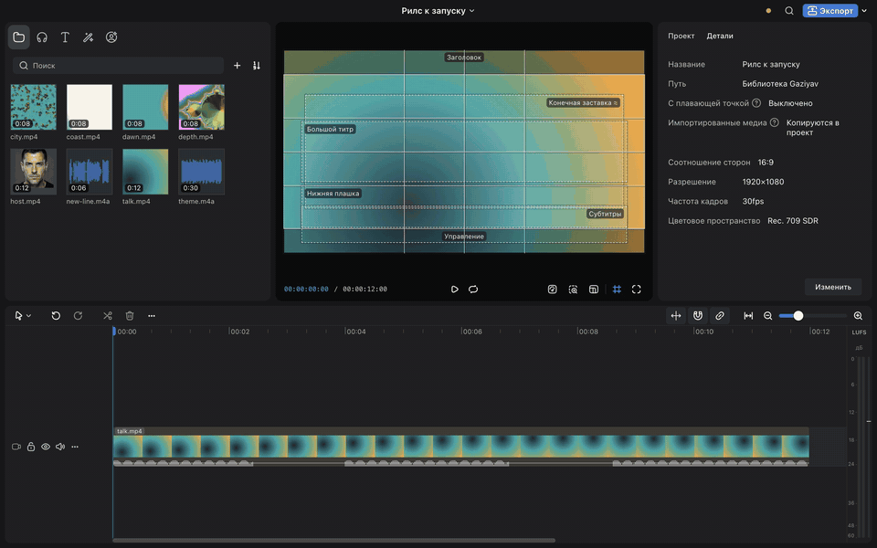

- Скажите Claude, что нужно: «убери паузы». Claude сделает это в вашем открытом проекте.
- Он пользуется операциями самого редактора — резать по словам, убирать паузы, субтитры, титры, громкость музыки, экспорт.
- Каждый шаг ложится на тот таймлайн, который вы видите, и отменяется <kbd>⌘Z</kbd>.

---

### 5 · Бесплатно: ничего не покупать, никаких API-ключей

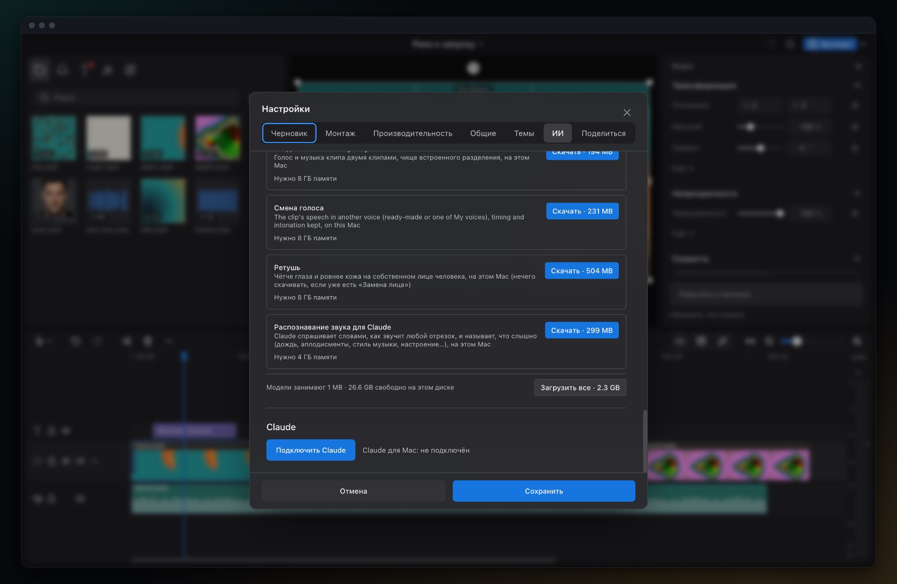

- Gaziyav не продаёт кредиты за Claude и не просит ключ: коннектор — часть приложения.
- Он подключается к приложению Claude, которым вы уже пользуетесь, — Claude для Mac (расширения открыты всем пользователям Claude Desktop) или Claude Code.
- **Настройки → ИИ → Claude → «Подключить Claude»**: одно нажатие.

---

### 6 · Что сказать

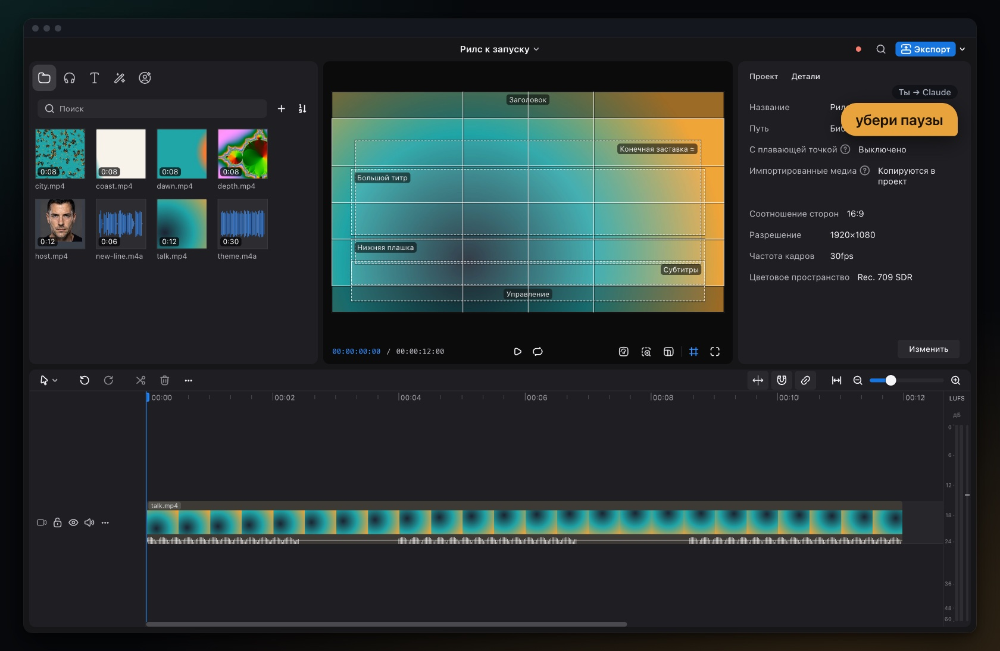

- «Субтитры жирным стилем и титр „День первый“ на 0:02.»
- «Сделай вертикально для Reels и уложись в 30 секунд.»
- «Найди сцены этого фильма и дай главы для YouTube.»

---

### 7 · Бесплатный ИИ на вашем Mac

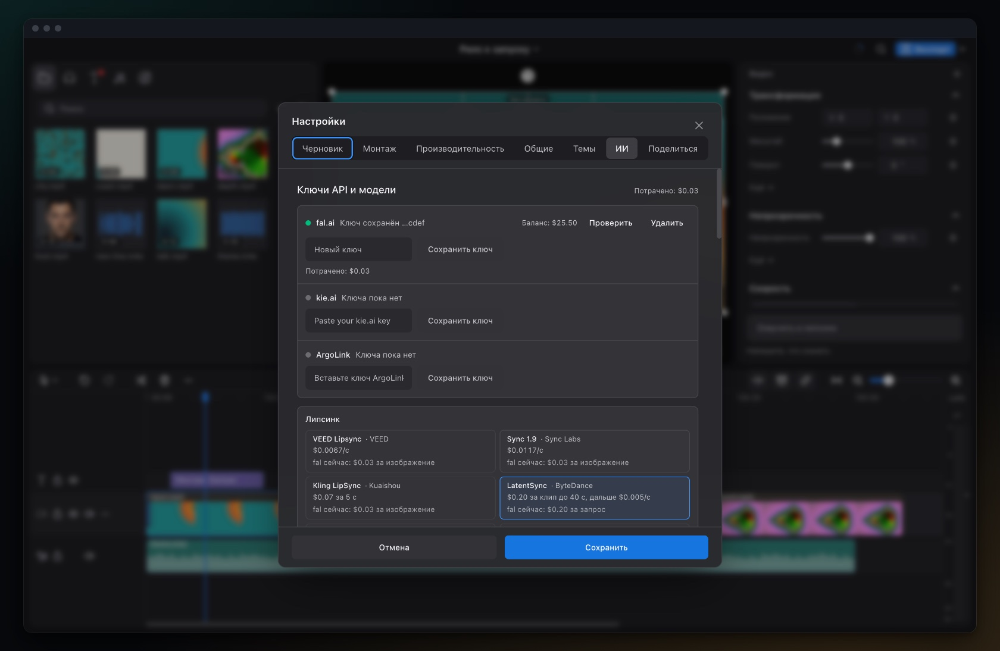

- Субтитры из речи, удаление пауз и слов-паразитов, очистка голоса, разделение голоса и музыки, смена голоса.
- Убрать предмет, ретушь, убрать или размыть фон, увеличение, устранение мерцания.
- Автоцвет, сцены, вертикальный кадр, маркеры битов, трекинг. Без ключа и без платы за запуск.

---

### 8 · Субтитры, которые идут за монтажом

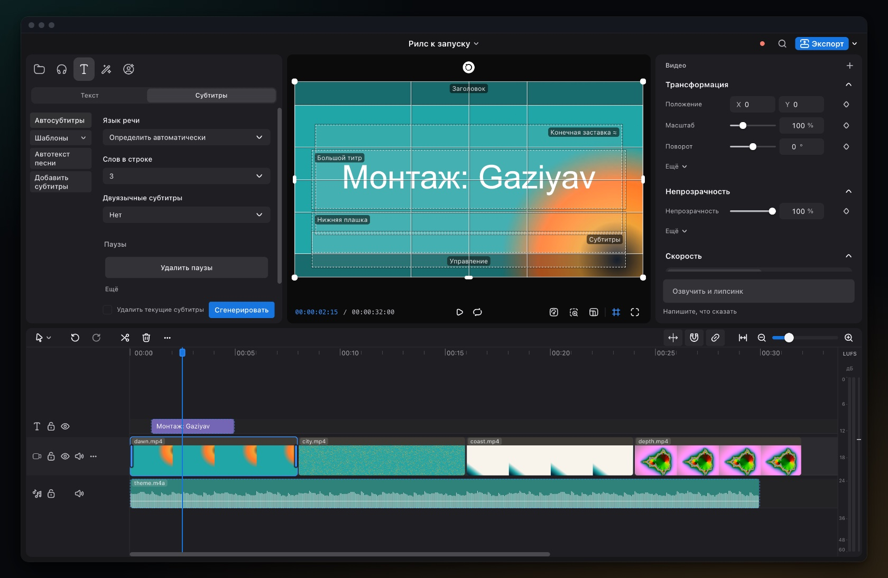

- Субтитры по словам, распознанные на вашем Mac; правьте слова, выбирайте стиль.
- Удаление пауз: разрезы ложатся внутрь тишины; субтитры и титры едут следом.
- Одно <kbd>⌘Z</kbd> отменяет весь проход.

---

### 9 · Титры, эффекты, переходы, фильтры

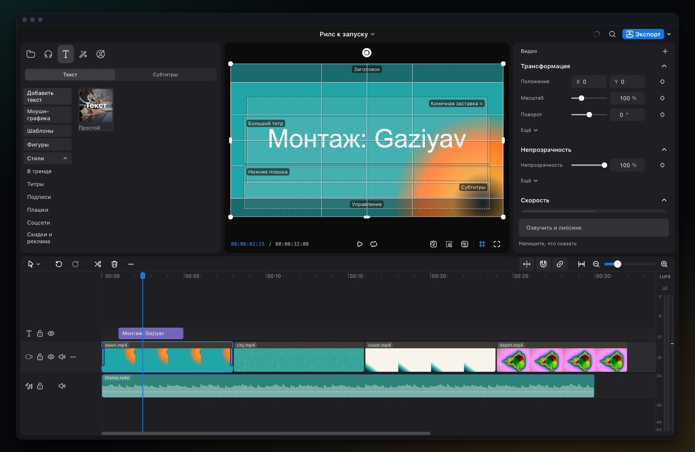

- Стили титров, эффекты, переходы и цветовые фильтры — перетащите на таймлайн или дважды щёлкните.
- Ключевые кадры со сглаживанием на любом анимируемом параметре: <kbd>⌥⇧K</kbd>, <kbd>F9</kbd> — плавно.
- Скорость, кривые скорости, стоп-кадр <kbd>⌥F</kbd>, задом наперёд.

---

### 10 · Темы оформления

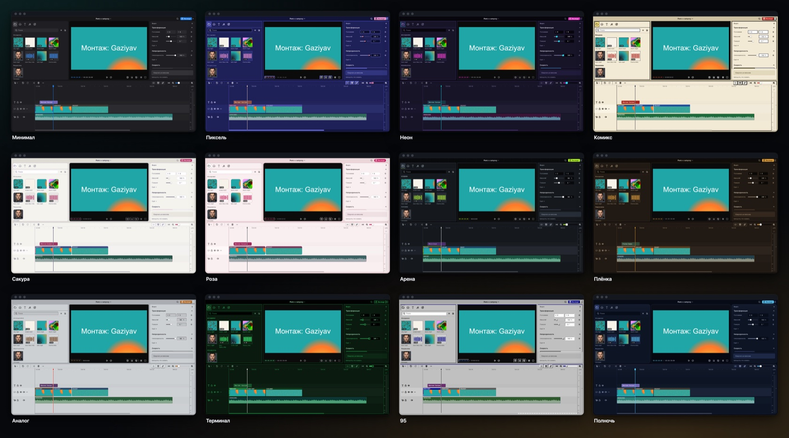

- Десять полноценных «шкур» — Пиксель, Неон, Комикс, Сакура, Роза, Арена, Плёнка, Аналог, Терминал, 95 — и тихие палитры.
- Тема меняет интерфейс, но не вашу картинку: плеер остаётся нейтральным.
- Настройки → Темы.

---

### 11 · Экспорт точно до кадра

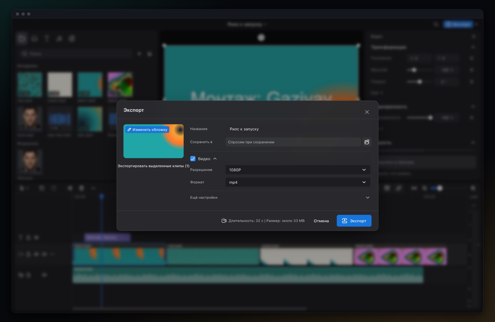

- H.264, HEVC, AV1, ProRes, VP9 · MP4, MOV, WebM, GIF · до 8K · 23,976–60 к/с — бесплатно.
- 72 из 72 вариантов экспорта сошлись до кадра.
- <kbd>⌘E</kbd>.

---

### 12 · Клип по ссылке — прямо в монтаж

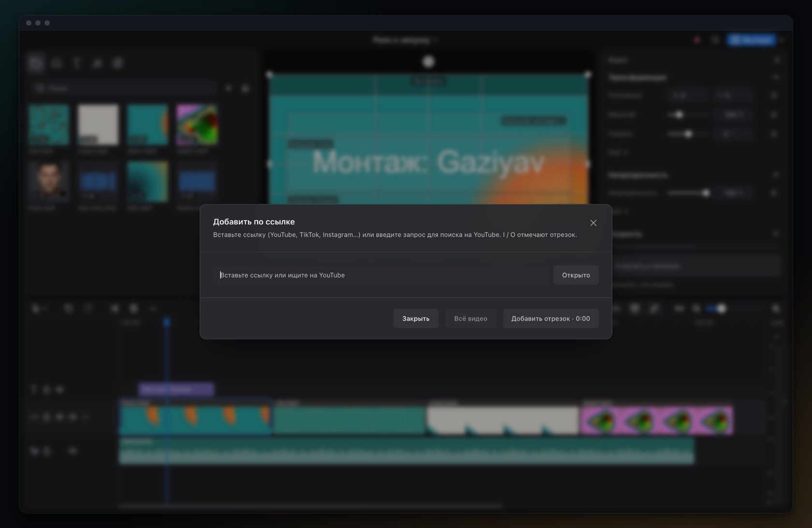

- Вставьте в «Медиа» ссылку на YouTube, TikTok или Instagram (или найдите видео на YouTube).
- Отметьте кусок клавишами <kbd>I</kbd> / <kbd>O</kbd>: скачается только он и одним перетаскиванием ляжет на таймлайн (а Claude кладёт его туда сам).
- Для материала, который вы вправе использовать. В приложении для компьютера.

---

### 13 · Публикация прямо из монтажки

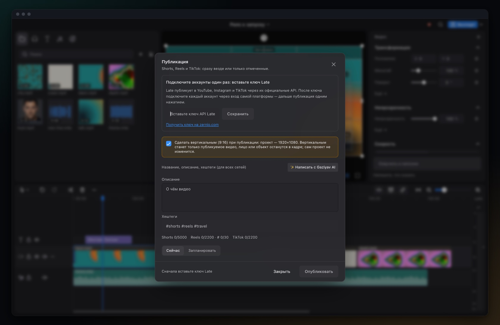

- Стрелка рядом с «Экспорт» → **«Опубликовать в Shorts, Reels, TikTok…»**: YouTube, Instagram или TikTok.
- Внутри приложения открывается страница загрузки самой площадки; входите там вы сами.
- Пароль Gaziyav не видит. В приложении для компьютера.

---

### 14 · Gaziyav в браузере

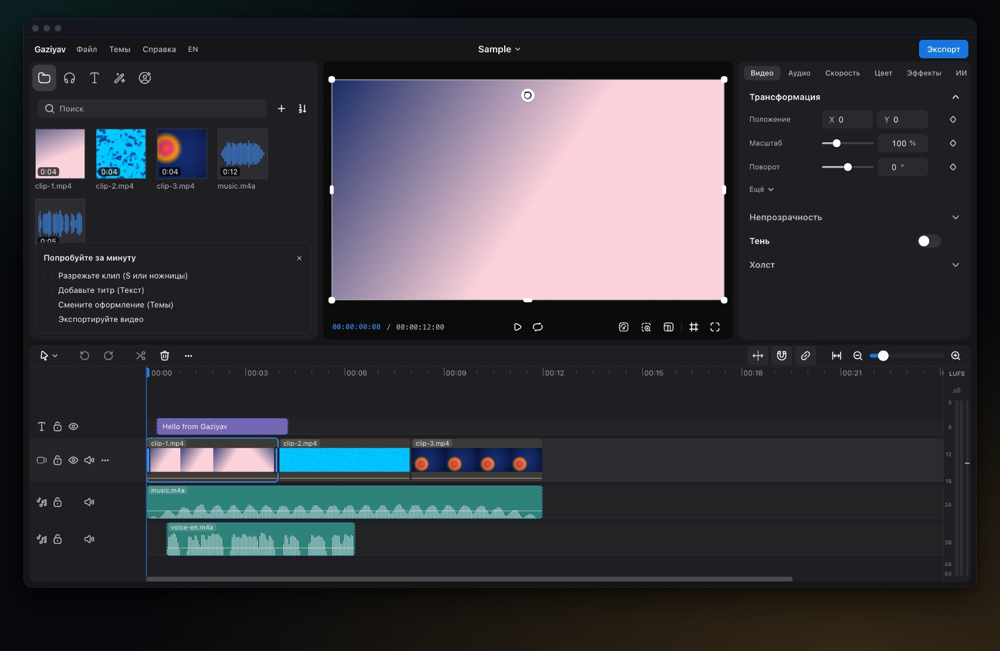

- Для Windows, Linux, Chromebook, телефона и планшета: тот же редактор страницей, без установки, без аккаунта, после первого открытия работает без интернета; на телефоне — раскладка под палец.
- Таймлайн, титры, эффекты, переходы, генераторы, звуки, темы, импорт и экспорт; субтитры из речи и удаление пауз — модель работает прямо на странице; ИИ-картинка, ИИ-видео и липсинк (бета) на вашем ключе.
- Только в приложении для Mac: Claude, остальные инструменты ИИ на устройстве, клип по ссылке, публикация, голос, моушн-графика.

---

### 15 · Дополнительно на своём ключе — и с чего начать

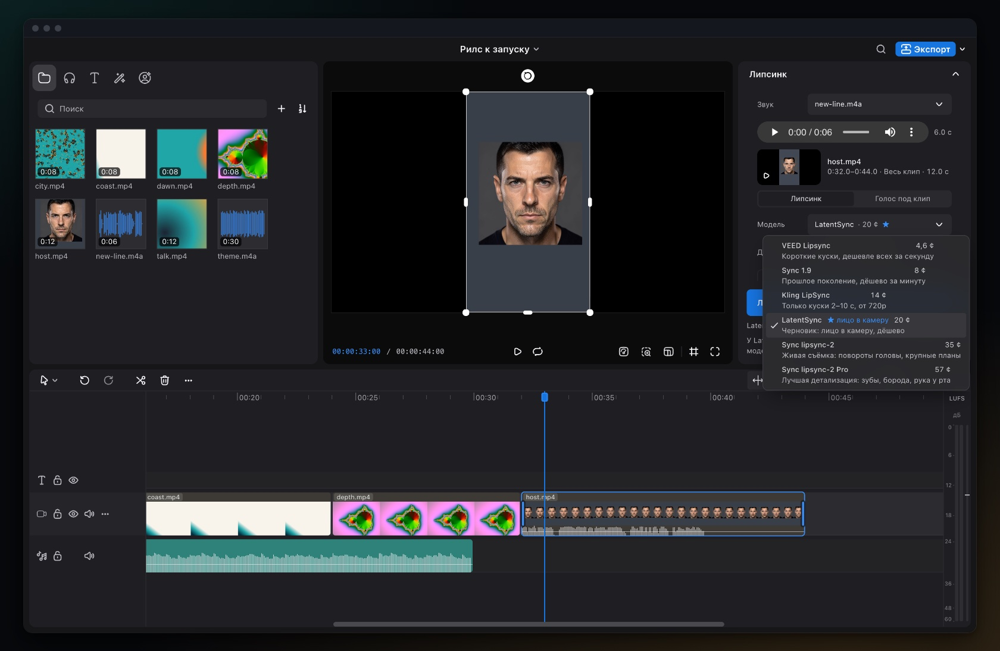

- По желанию, для монтажа не нужно: липсинк, голос, картинки и видео, замена лица — на вашем ключе fal.ai, цена на кнопке. Реплика липсинка — **20 ¢**, а сначала проба на 3 секунды — примерно 2,6 ¢.
- Начать: [скачать для macOS](https://github.com/gamidaliev03/gaziyav/releases/latest) или [открыть в браузере](https://gamidaliev03.github.io/gaziyav/editor/).
- Дальше: [руководство](manual/README.md).
